<div align="center">


<br/>

**Ingeniero de software · 61 proyectos · Bolivia**
Sistemas de gestión y POS, e-commerce, IA y datos, apps móviles y sitios web — de principio a fin.


</div>

<div align="center">

### ¿Tu empresa depende de Excel, WhatsApp o procesos manuales?

**Diseño y desarrollo sistemas que convierten esos procesos en operaciones controladas, integradas y preparadas para crecer.**
Casos reales de sistemas empresariales, POS, CRM, industria, e-commerce, automatización e IA.

**61 proyectos · 251 diagramas · Laravel · React · Flutter · APIs · IA**

<a href="#sistemas"></a>
<a href="#ia"></a>
<a href="#industria"></a>
<a href="#contacto"></a>

</div>

Este documento reúne mi trabajo en un solo lugar. Cada proyecto dice **qué problema resolvía**, **con qué stack** y **qué solución le dimos**, con sus **diagramas de arquitectura y flujos** (se despliegan al hacer clic). Desarrollo de **Ing. Santiago Abasto**; las colaboraciones están marcadas al final.

<a name="casos-destacados"></a>
##  Casos destacados

Ocho sistemas que representan mi trabajo: un problema real, la solución construida y evidencia que se puede comprobar. Cada imagen lleva al producto o a su caso público; la ficha técnica completa está más abajo.

<p>
<a href="https://appleboss.com.bo">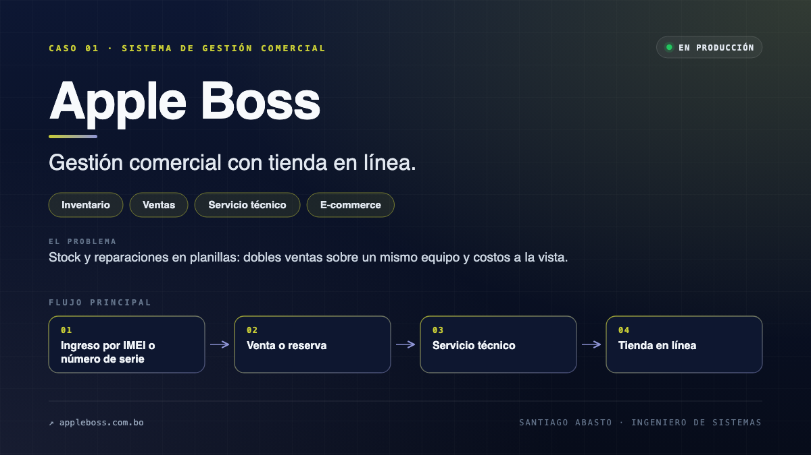</a>
<a href="https://burrowlabs.com.bo/proyectos/burrow-prospect">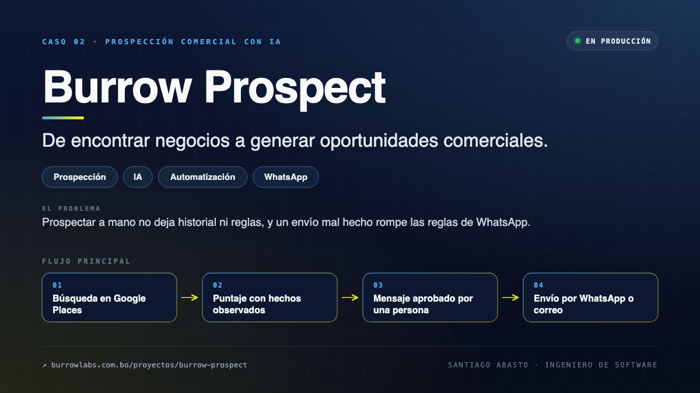</a>
</p>

- **Apple Boss** · Gestión comercial con tienda en línea. *En producción* · [Ver producto](https://appleboss.com.bo) · [Ficha técnica](#apple-boss)
- **Burrow Prospect** · De encontrar negocios a generar oportunidades comerciales. *En producción* · [Ver producto](https://burrowlabs.com.bo/proyectos/burrow-prospect) · [Ficha técnica](#burrow-prospect)

<p>
<a href="https://sistema.odessaoil.com">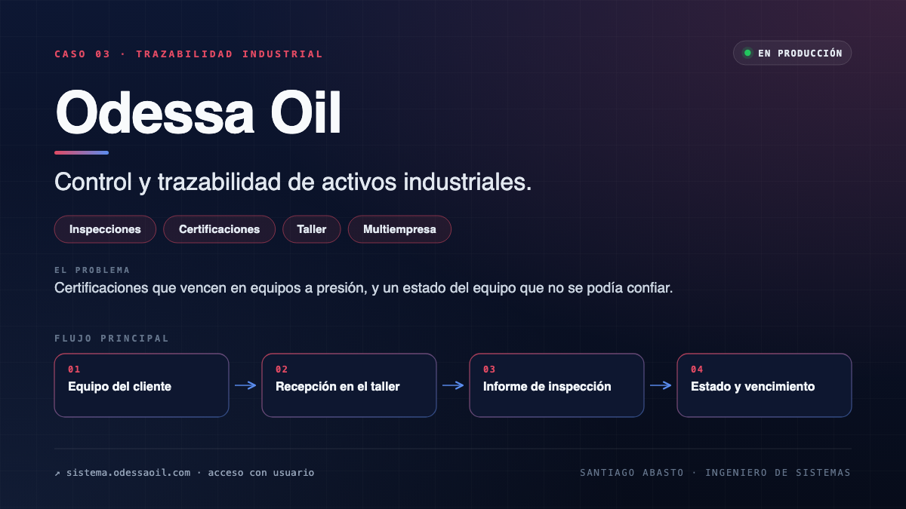</a>
<a href="https://www.moldpack.com.ar">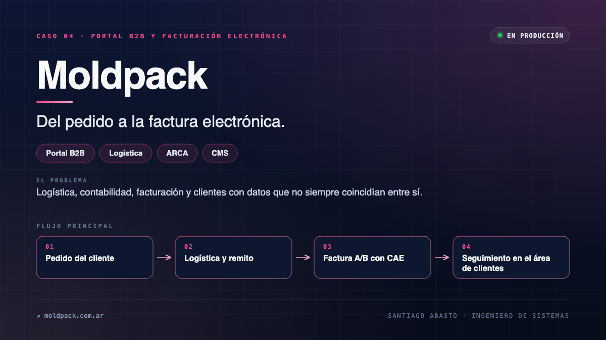</a>
</p>

- **Odessa Oil** · Control y trazabilidad de activos industriales. *En producción* · [Ver producto](https://sistema.odessaoil.com) · [Ficha técnica](#odessa-oil)
- **Moldpack** · Del pedido a la factura electrónica. *En producción* · [Ver producto](https://www.moldpack.com.ar) · [Ficha técnica](#moldpack)

<p>
<a href="#locoton">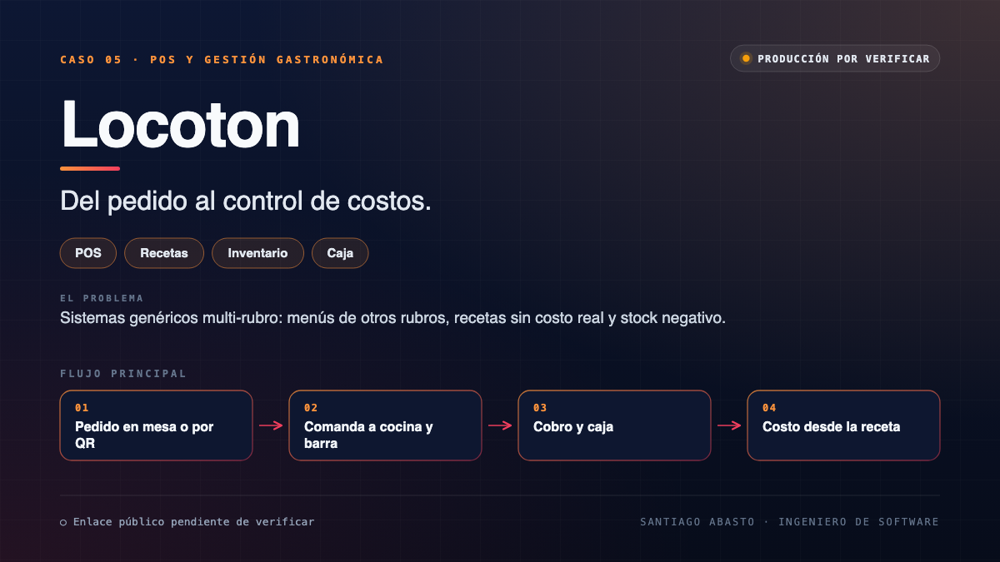</a>
<a href="https://ninthgroup.bo/">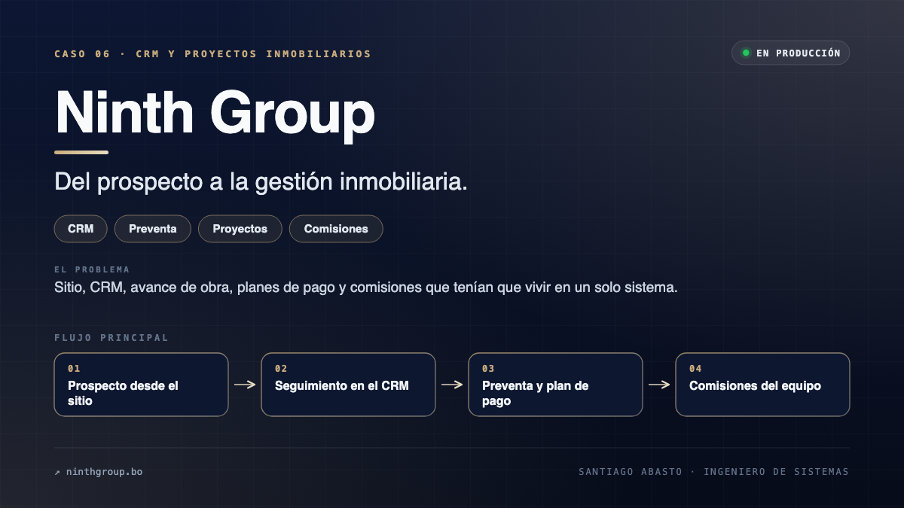</a>
</p>

- **Locoton** · Del pedido al control de costos. *Producción por verificar* · [Ficha técnica](#locoton)
- **Ninth Group** · Del prospecto a la gestión inmobiliaria. *En producción* · [Ver producto](https://ninthgroup.bo/) · [Ficha técnica](#ninth-group)

<p>
<a href="https://aiq.com.ar/">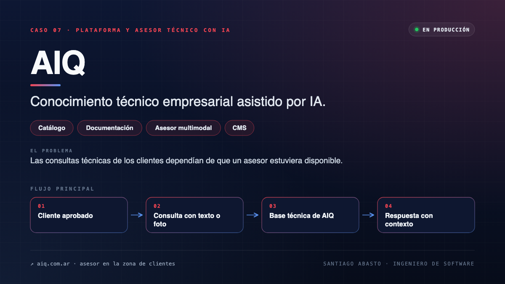</a>
<a href="#calendariow">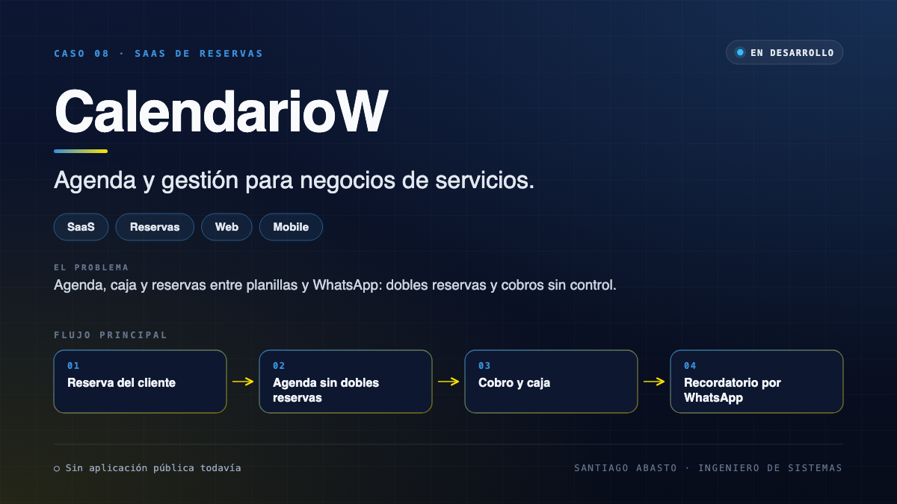</a>
</p>

- **AIQ** · Conocimiento técnico empresarial asistido por IA. *En producción* · [Ver producto](https://aiq.com.ar/) · [Ficha técnica](#aiq)
- **CalendarioW** · Agenda y gestión para negocios de servicios. *En desarrollo* · [Ficha técnica](#calendariow)

<a name="problemas"></a>
##  Qué problemas resuelvo

| Si tu empresa… | Construyo… | Casos |
|---|---|---|
| Lleva ventas, stock, caja o reservas en planillas y WhatsApp | Sistemas de gestión con roles, caja, inventario y reportes | [Apple Boss](#apple-boss) · [Locoton](#locoton) · [CalendarioW](#calendariow) |
| Vende a otras empresas y factura a mano | Portales B2B con logística y factura electrónica | [Moldpack](#moldpack) |
| Tiene que demostrar inspecciones, certificaciones o vencimientos | Trazabilidad multiempresa con estados que salen de la evidencia | [Odessa Oil](#odessa-oil) |
| Depende de que una persona responda o salga a buscar clientes | IA aplicada con reglas, contexto y aprobación humana | [AIQ](#aiq) · [Burrow Prospect](#burrow-prospect) |
| Necesita unir sitio, CRM y gestión de proyectos | Plataformas integrales con módulos de dominio | [Ninth Group](#ninth-group) |

**Cómo leer las fichas.** Cada una separa *problema*, *stack* y *solución*; los casos destacados suman *participación y evidencia* (producción, código y pruebas, verificados el 16-11-2026). Las fichas 1 a 55 son proyectos desarrollados en mis repositorios; las 56 a 61 son colaboraciones en repositorios de terceros, y cada una indica mi participación.

<a name="indice"></a>
##  Índice

**Empezá por acá:** [Casos destacados](#casos-destacados) · [Qué problemas resuelvo](#problemas) · [Contacto](#contacto)

**Sistemas de gestión, POS y ERP**  
[Locoton — POS y gestión gastronómica](#locoton) · [Qué Tacos — Katt](#que-tacos-katt) · [Lima Sushi — Nikkei](#lima-sushi-nikkei) · [Macondo POS](#macondo-pos) · [Solo Pastas](#solo-pastas) · [Apple Boss](#apple-boss) · [Blackphone (Axel)](#blackphone-axel) · [Sistema Boss](#sistema-boss) · [Odessa Oil](#odessa-oil) · [Moldpack](#moldpack) · [Tickets Osole](#tickets-osole) · [Pórpora — Producción](#porpora-produccion) · [Tigo — Tickets de soporte](#tigo-tickets-de-soporte)

**E-commerce, catálogos y sitios industriales**  
[Conar](#conar) · [Felrro](#felrro) · [Fitinox](#fitinox) · [Iron-Screw](#iron-screw) · [Calderas Hercal](#calderas-hercal) · [Gran Sasso](#gran-sasso) · [Nicolais Mario e Hijo](#nicolais-mario-e-hijo) · [Panelcar](#panelcar) · [Tarea SRL](#tarea-srl) · [San Justo Iluminación](#san-justo-iluminacion) · [Elite — Inmobiliaria](#elite-inmobiliaria) · [TechReturns](#techreturns) · [Roberto Cordes — Web](#roberto-cordes-web) · [Cordes — Sistema de cotizaciones](#cordes-sistema-de-cotizaciones) · [Elementos](#elementos) · [Muela del Diablo](#muela-del-diablo)

**IA, datos y automatización**  
[BMH — Asesor con IA](#bmh-asesor-con-ia) · [GACRI — Asistente](#gacri-asistente) · [AIQ](#aiq) · [Melectric IA](#melectric-ia) · [X-Urban IA](#x-urban-ia) · [Carlos — Bolsa de Valores](#carlos-bolsa-de-valores) · [Burrow Prospect](#burrow-prospect) · [Commerce Intelligence](#commerce-intelligence) · [CotizaFlow](#cotizaflow) · [Pruebas de estrés](#pruebas-de-estres)

**Web, reservas, salud y landing**  
[Burrow Labs](#burrow-labs) · [Ninth Group](#ninth-group) · [CalendarioW](#calendariow) · [Visión Tours](#vision-tours) · [Visión Tours 2](#vision-tours-2) · [Summer's Style](#summer-s-style) · [Sumer Style](#sumer-style) · [Ginos Barbershop](#ginos-barbershop) · [Dra. Isabel Piérola](#dra-isabel-pierola) · [Valentina's Medical Store](#valentina-s-medical-store) · [Wasi Pet](#wasi-pet) · [FundasAlis](#fundasalis) · [LavaFácil](#lavafacil) · [Match & Adopt](#match-adopt) · [Juegos 2D](#juegos-2d) · [21 — Regalo para Sharol](#21-regalo-para-sharol)

**Colaboraciones**  
[Frenos SR33](#frenos-sr33) · [Testori](#testori) · [AgroMarket](#agromarket) · [Nikitos — Figma](#nikitos-figma) · [Nikitos — Prueba técnica](#nikitos-prueba-tecnica) · [Prueba técnica Osole](#prueba-tecnica-osole)


<a name="sistemas"></a>

##  Sistemas de gestión, POS y ERP

<a name="locoton"></a><a name="mahiki-restaurante-y-bar"></a>
### 1. Locoton — POS y gestión gastronómica
> Sistema POS, inventario y gestión integral para restaurantes y bares, de la receta al cobro: todo lo que se vende descuenta sus insumos, todo el dinero pasa por una caja y cada módulo se enciende o se apaga sin tocar código.

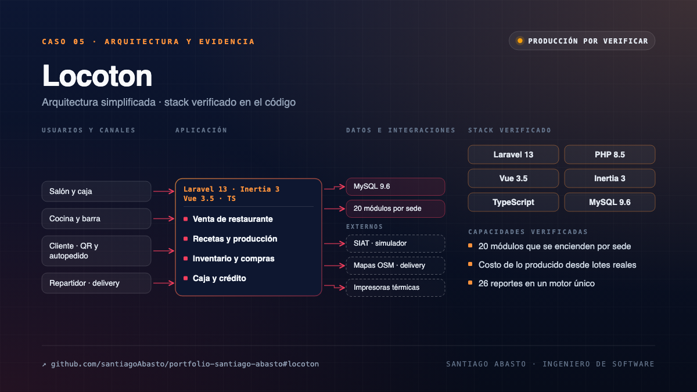


Locoton parte de una investigación de procesos en un restaurante y bar en operación (ver *Procedencia*), que trabaja con **Siesam**, un sistema genérico multi-rubro (sirve igual a un hotel, una distribuidora o un taller). Ese relevamiento mostró lo que eso significa para el rubro:

- **Un menú de ~95 entradas y 229 rutas**, muchas de otros rubros, y acciones que dependen de seleccionar una fila y buscar el botón o de atajos F4, F8 y F9.
- **Recetas que no se usan bien:** el costo de materia prima figura en 0,00 en todas las recetas, así que no se sabe cuánto cuesta de verdad una hamburguesa o un trago.
- **Stock negativo** por vender sin existencias, sin un camino claro para cuadrarlo.
- **38 pantallas de reportes** distintas para responder preguntas parecidas.
- Una interfaz pensada para computadora, incómoda en el celular del mesero o en la tablet de la barra.

El relevamiento completo (pantallas, campos y los 8 roles con sus permisos reales) se hizo en solo lectura y está documentado fuera de este repo, en la carpeta del proyecto.


| Capa | Tecnología | Versión |
|---|---|---|
| Lenguaje | PHP | 8.5 (composer exige ^8.3) |
| Framework | Laravel | 13.42 |
| Puente | Inertia (Laravel · Vue) | 3.7 · 3.11 |
| Acceso | Fortify (clave, 2FA, passkeys) | 1.42 |
| Rutas tipadas | Wayfinder | 0.1 |
| Frontend | Vue · TypeScript | 3.5 · 5.9 |
| Estilos | Tailwind CSS · reka-ui (shadcn-vue) | 4.3 · 2.11 |
| Compilación | Vite+ (`vite-plus`) | 1.4 |
| Mapas | Leaflet + teselas de OpenStreetMap | 1.9 |
| Exportación | OpenSpout (Excel) · Dompdf (PDF) | 5.14 · 3.1 |
| Base de datos | MySQL | 9.6 |
| Calidad | PHPUnit · Larastan (PHPStan nivel 7) · Pint · vue-tsc | 12.5 · 3.15 · 1.32 · 3.3 |

Punto de partida: `laravel/vue-starter-kit` (rama `dev-main`, la que trae Laravel 13 y Tailwind 4).


**Locoton** toma la lógica de negocio que el rubro ya conoce (los nombres de módulos, roles y permisos de Siesam, relevados en la investigación) y la ordena en un sistema hecho solo para restaurante y bar, rápido en celular, tablet y computadora.

Tres principios guían todo:

1. **Todo configurable.** Una o varias sedes; 20 módulos y sus ajustes (de la empresa y de cada sede) se encienden o apagan desde Configuración. Un módulo apagado no tiene menú, ni rutas, ni permisos visibles.
2. **Todo bajo recetas.** Lo que se vende descuenta sus insumos según su receta, y el costo de cada plato o trago sube solo cuando sube un insumo.
3. **Intuitivo.** Un menú de 8 secciones, «Nuevo» dentro de cada lista, botones grandes, listas como tarjetas en el celular y un solo selector de fechas.

**Quién lo usa** (8 roles de fábrica, con los permisos de Siesam):

| Rol | Qué hace en Locoton |
|---|---|
| Superadministrador · Administrador | Configuración, sedes, usuarios, cargos, permisos y todo el sistema |
| Mesero | Mesas, comandas, clientes y pantalla de cocina; no ve costos ni cobra |
| Asesor de ventas (cajera) | Cobro, caja (también ciega), facturas, cuentas por cobrar, anular comandas |
| Almacenero | Productos, stock, transferencias, kardex y reportes de inventario |
| Contador | Compras, ventas, cuentas, costos, ajustes y reportes |
| Supervisor gerente · T.I | Consulta y reportes; catálogos y caja según el rol |
| Repartidor (cargo) | App del repartidor con GPS mientras está en servicio |

Y fuera del personal: el **cliente en la mesa** (autopedido por QR) y el **cliente a domicilio** (tienda en línea), ambos sin crear cuenta.


- **Procedencia:** la investigación de procesos del restaurante y bar Mahiki, que opera con Siesam, fue la referencia de diseño. Mahiki no figura como cliente: no hay evidencia contractual en el repositorio.
- **Implementado (verificado en local):** las 11 fases del plan, desde la base y el inventario hasta la venta de restaurante, la caja, multi-sede, los reportes y el delivery, cada una con sus pruebas.
- **Pendiente:** conexión real con el SIAT (hoy con simulador), la app del repartidor en un celular real y las impresoras térmicas reales.
- **Producción:** reportada por el autor; la documentación del repositorio (15-11-2026) indica ejecución local. URL pública pendiente de verificar.
- **Código:** privado. Conserva el nombre interno `mahiki` de la etapa de investigación (por ejemplo, `config/mahiki.php`).

<details>
<summary> <b>Ver 5 diagramas y flujos</b></summary>
<br>

**Canales y opcionales**

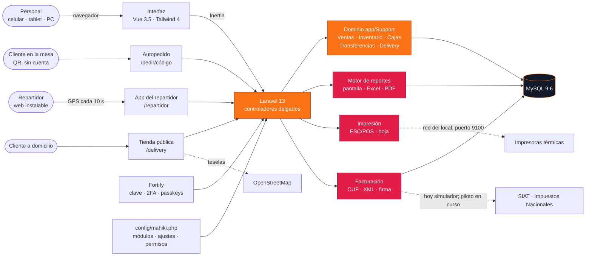

**De la mesa al cobro**

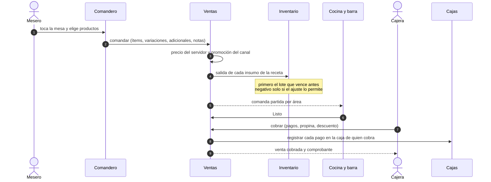

**Estados de una cuenta**

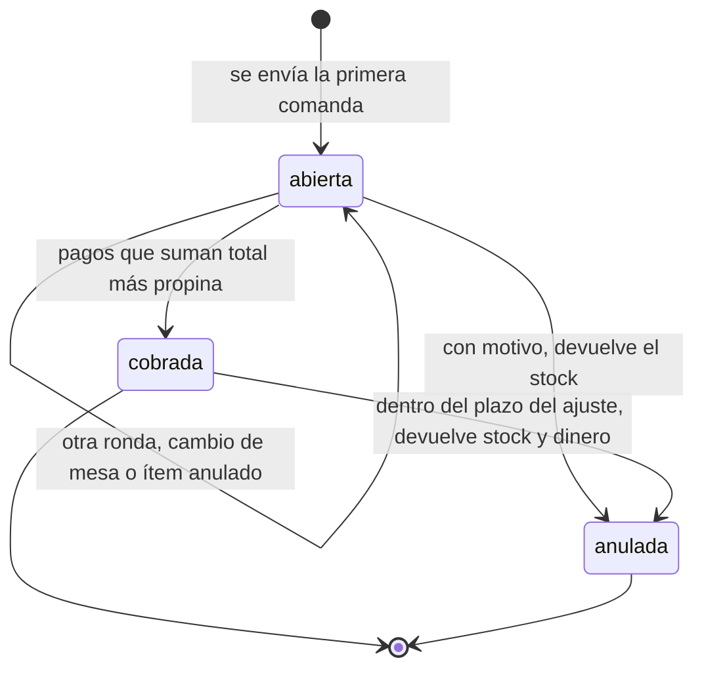

**Pedido a domicilio**

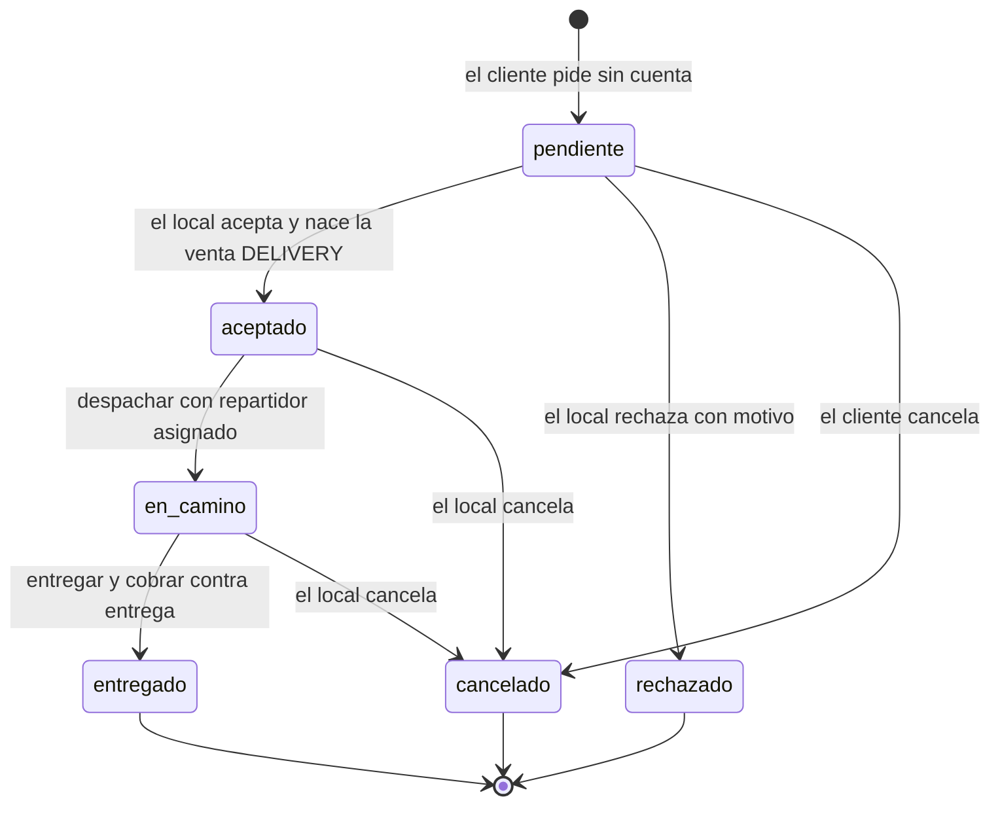

**Pedido a domicilio**

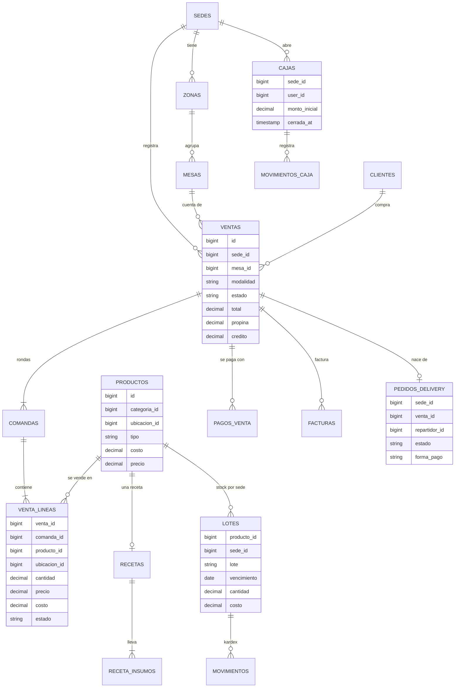

</details>

[↑ Volver al índice](#indice)

---

<a name="que-tacos-katt"></a>
### 2. Qué Tacos — Katt
> El sistema que opera la taquería QUÉ TACOS!!! de punta a punta: lo que se vende en el mostrador y en la web sale del mismo stock, con el mismo costo y en los mismos reportes.


Una taquería con varias sucursales vive de márgenes chicos y de mucha operación a la vez: mostrador, cocina, delivery, compras a proveedores, producción de bases (la birria, las salsas) y caja. Cuando cada cosa se lleva por separado aparecen los problemas de siempre:

- **No se sabe cuánto cuesta de verdad un taco.** El precio del proveedor cambia, hay merma, hay subrecetas, y el costo que se usó para fijar el precio queda viejo sin que nadie lo note.
- **El stock no cuadra.** Lo que se vende por la web, lo que se vende en caja y lo que se tira no descuentan del mismo lugar.
- **El arqueo nunca da.** Se mezclan cobros con QR o tarjeta con la plata del cajón y el faltante diario se vuelve ruido.
- **Los pedidos web llegan a cocina sin que nadie los acepte**, aunque el local esté sin birria o desbordado.
- **El dueño no puede comparar sucursales** porque cada número sale de una planilla distinta.


| Capa | Tecnología | Versión |
|---|---|---|
| Lenguaje | PHP | 8.5 (composer pide `^8.3`) |
| Framework | Laravel | 13.29 |
| Base de datos | MySQL (`tacoos` y `tacoos_testing`) | 9.6 |
| Vistas | Blade + Tailwind CSS | Tailwind 4.3 |
| Build | Vite + `laravel-vite-plugin` | 8.2 · 3.2 |
| 3D | Three.js (solo «Armá tu taco») | 0.186.1 |
| IA en el navegador | runonweb | 0.1.0 |
| IA del copiloto | `anthropic-ai/sdk` (fijado) | 1.3.0 |
| Pruebas | Pest · PHPUnit · `node --test` | 4.7 · 12.5 |
| Estilo | Laravel Pint | 1.30 |
| Tipografía | Instrument Sans y Archivo Black (Bunny Fonts) | — |


**TacoOS** es un único sistema Laravel con dos caras sobre la misma base de datos:

- **Web pública de QUÉ TACOS!!!**: menú por sucursal, ficha de producto, **«Armá tu taco» en 3D**, carrito, cupones, checkout como invitado o con cuenta, seguimiento del pedido y **Taco Puntos**.
- **Sistema interno**: POS, caja, cocina (KDS), pedidos web, cobranzas, mermas, producción, compras, recepciones, conteos físicos, catálogo, promociones, fidelización, reportes, IA en el navegador y el copiloto del dueño.

Un pedido web no es «otro sistema»: termina en la misma tabla `orders`, congela el costo con la misma acción y descuenta el mismo inventario que una venta de mostrador. Un test fija esa paridad.

**Quién lo usa.** Un usuario no tiene un rol fijo sino **un rol por sucursal** (puede ser cajero en una y encargado en otra). Hay 10 roles: `owner`, `admin`, `manager`, `cashier`, `kitchen`, `inventory`, `purchasing`, `finance`, `delivery` y `analyst`, más los **clientes** de la web, que entran por un guard propio, separado del personal.

<details>
<summary> <b>Ver 5 diagramas y flujos</b></summary>
<br>

**Reportes y dueño**

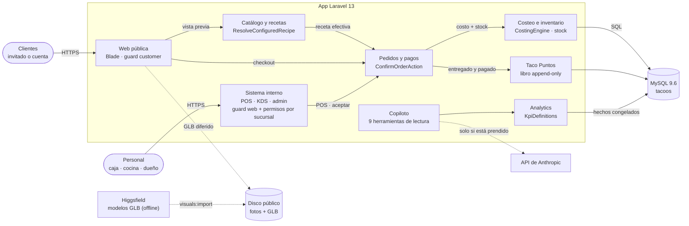

**Un pedido web de la vidriera a la cocina**

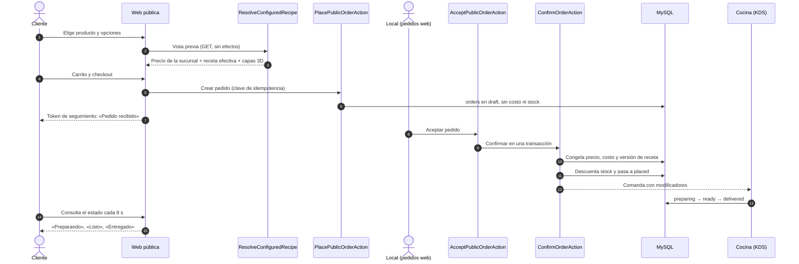

**Estados de un pedido**

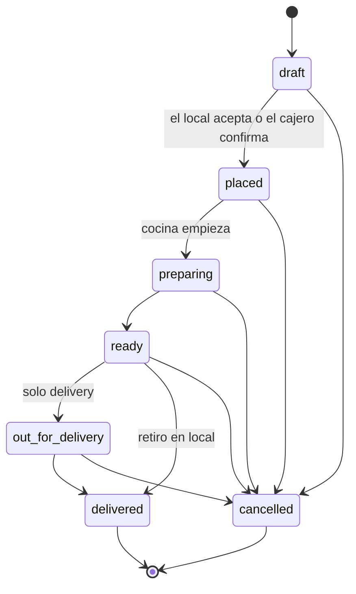

**Órdenes de compra**

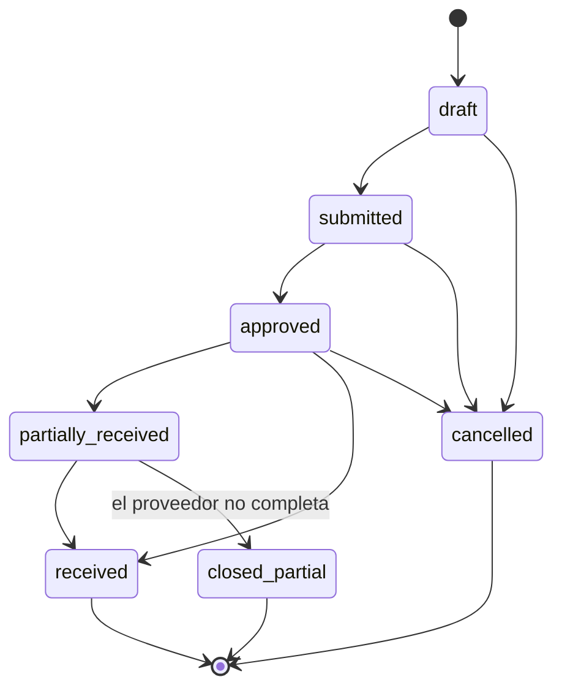

**Órdenes de compra**

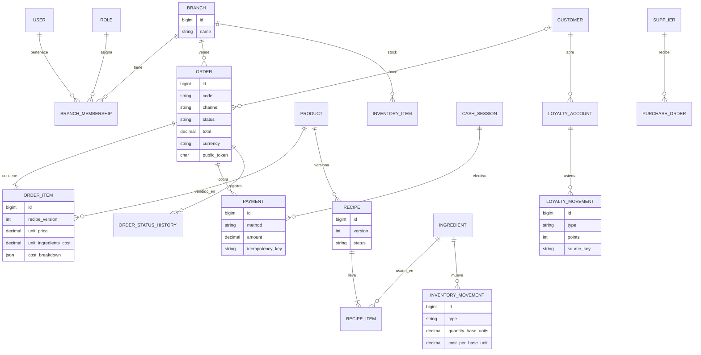

</details>

[↑ Volver al índice](#indice)

---

<a name="lima-sushi-nikkei"></a>
### 3. Lima Sushi — Nikkei
> La primera web propia de Lima Cocina Nikkei: carta, eventos y reservas en línea que ocupan una mesa real del plano, con el mismo motor que usa recepción.


**Lima Cocina Nikkei** (también publicada como Lima Sushi Nikkei) es un restaurante de cocina japonesa-peruana en Cochabamba que no tenía web propia. Su carta, su horario, su ubicación y las reservas vivían en Facebook, en Google Maps y en el catálogo de WhatsApp:

- **La información pública se contradecía.** Google Maps y Facebook mostraban horarios distintos, la carta no tenía precios publicados y no había una fuente oficial que el dueño pudiera actualizar sin depender de un desarrollador.
- **Reservar exigía escribir o llamar.** El comensal, casi siempre desde el celular y llegando desde Facebook, Maps o WhatsApp, no podía ver si había mesa y reservar en menos de un minuto.
- **Varios canales, ningún control de cupos.** Web, recepción, teléfono y WhatsApp podían prometer la misma mesa: el riesgo de doble reserva en pleno servicio era real.


| Capa | Tecnología | Versión |
|---|---|---|
| Backend | PHP · Laravel | 8.5 (composer pide ^8.3) · 13.40 |
| Base de datos | MySQL | 9.6 (según la documentación) |
| Panel | Inertia (Laravel / React) · React · TypeScript | 3.7 / 3.11 · 19.3 · 7.0 |
| Estilos y build | Tailwind CSS · Vite | 4.3 · 8.3 |
| Movimiento y 3D | GSAP · Lenis · three.js | 3.15 · 1.3 · 0.187 |
| Tipografía | Bodoni Moda Variable · Manrope Variable (Fontsource) | 5.3 |
| Pruebas | Pest · Playwright | 5.3 · 1.65 |
| Calidad | Laravel Pint · `tsc --noEmit` | 1.32 · — |


Un monolito Laravel con tres caras sobre una sola base de datos:

| Quién | Qué usa | Para qué |
|---|---|---|
| **Comensal** | Sitio público (Blade + Tailwind, sin login) | Ver la carta real, la experiencia y los eventos; reservar en dos pasos y gestionar su reserva desde un enlace privado `/r/{token}` |
| **Recepción** (`reception`) | Panel `/admin` (Inertia + React) | Agenda del día, alta de reservas de cualquier canal, plano de mesas 2D/3D, sentar, finalizar, ausencias, bloqueos |
| **Propietario** (`owner`) | Panel `/admin` | Todo lo anterior más reglas de servicio, mesas, combinaciones, ajustes del sitio y usuarios |
| **Editor** (`editor`) | Panel `/admin` | Carta, bloques de contenido, eventos, medios y escenas de la portada, con borrador y publicación |

La pieza central es **un solo motor de disponibilidad**: la reserva web ocupa una mesa real del plano, y recepción, teléfono y WhatsApp pasan por el mismo servicio. La web se ve como una noche en Lima (pizarra, dorado apagado, Bodoni Moda) y usa fotos y reels del propio restaurante.

<details>
<summary> <b>Ver 5 diagramas y flujos</b></summary>
<br>

**CMS**

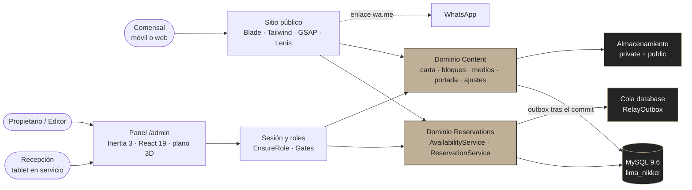

**Reserva web sin dobles reservas**

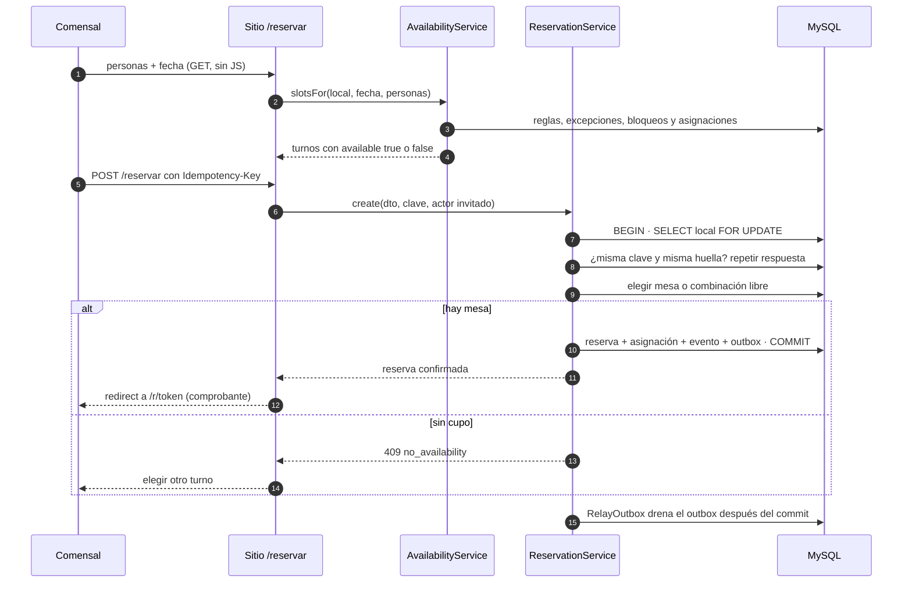

**Estados de una reserva**

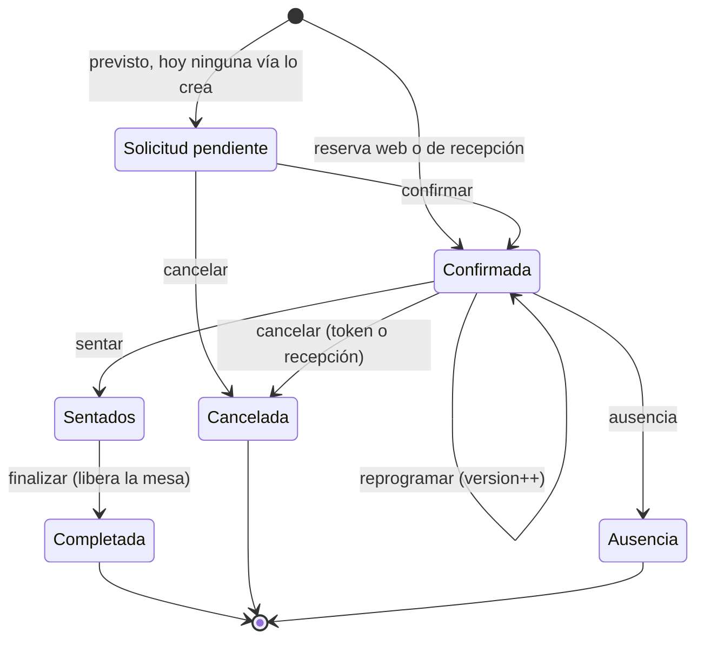

**Publicación de contenido**

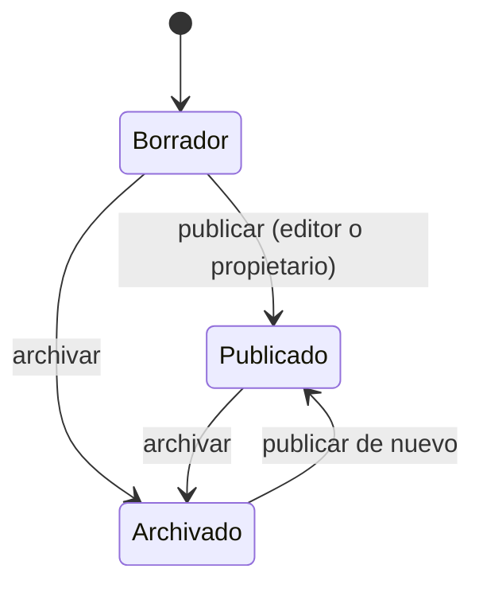

**Publicación de contenido**

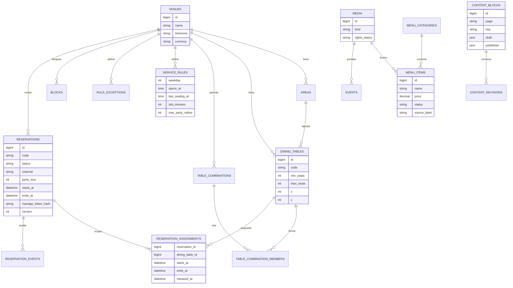

</details>

[↑ Volver al índice](#indice)

---

<a name="macondo-pos"></a>
### 4. Macondo POS
> Punto de venta móvil para un restaurante: vender desde el celular, con historial e indicadores para el dueño.


En un restaurante, el cobro de cada mesa, el control del catálogo y el cierre del día suelen llevarse en papel o en planillas separadas. Cuando cambian los precios, el historial deja de ser confiable, y el dueño no tiene a la mano cuánto se vendió, por qué medio de pago y qué productos salen más.


| Capa | Tecnología | Versión (manifiestos) |
|---|---|---|
| App | Expo, React Native, React | ~57 · 0.86.3 · 19.2.3 |
| Navegación y estado | Expo Router, Zustand, TanStack Query | ~57 · ^5.0.2 · ^5.62.16 |
| Estilos | NativeWind, Tailwind CSS | ^4.1.23 · ^3.4.16 |
| Cliente HTTP | Axios | ^1.7.9 |
| Lenguaje | TypeScript | ~6.0.3 |
| API | PHP, Laravel, Sanctum | ^8.2 · ^12.0 · ^4.0 |
| Base de datos y colas | PostgreSQL, Redis (predis) | — · ^2.3 |
| Contenedores | Docker Compose (PHP-FPM, Nginx, PostgreSQL, Redis, worker, túnel opcional) | — |


MacondoPOS es una caja móvil conectada a una API:

- **Cajero:** arma el pedido con el catálogo, indica la mesa si corresponde, cobra en efectivo o QR y consulta sus propias ventas.
- **Propietario:** administra productos y categorías, ve el historial de todas las ventas y revisa reportes diarios, mensuales y anuales.

La API guarda el nombre y el precio de cada producto en el momento de la venta, así que el historial no cambia cuando el catálogo cambia.

Roles: `propietario` y `cajero`.

<details>
<summary> <b>Ver 3 diagramas y flujos</b></summary>
<br>

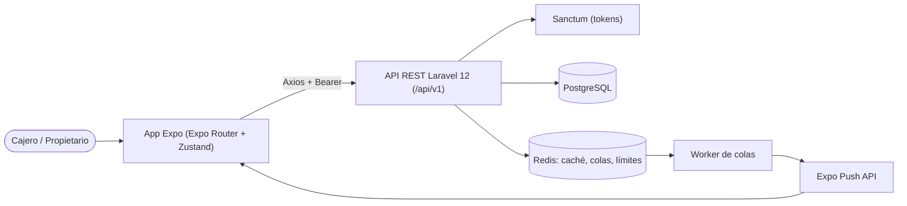

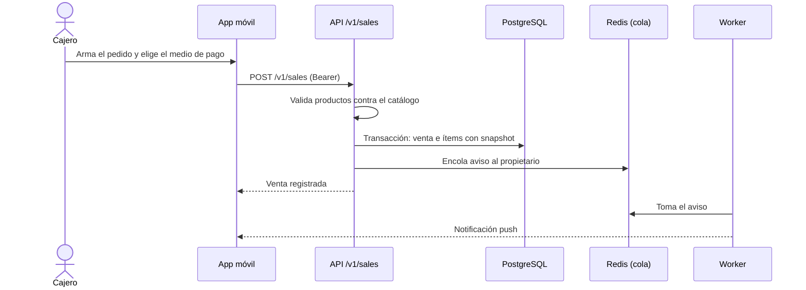

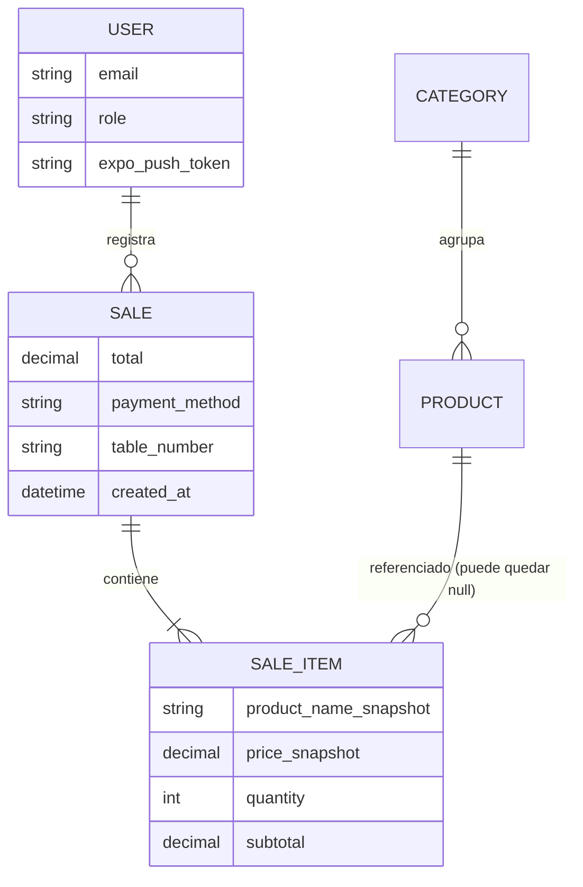

</details>

[↑ Volver al índice](#indice)

---

<a name="solo-pastas"></a>
### 5. Solo Pastas
> La web de la pizzería y el sistema del local en una sola app: el cliente pide y sigue su pedido, el equipo lo cocina, lo cobra y lo entrega.


Una pizzería de barrio que vende en salón y por delivery suele trabajar con tres herramientas que no se hablan:

- **Los pedidos llegan por WhatsApp o por teléfono** y el cliente no tiene cómo saber si su pizza ya salió del horno, así que vuelve a escribir para preguntar.
- **Las comandas del salón van en papel**: la cocina no ve en qué orden entraron y la caja suma a mano lo que se consumió en cada mesa.
- **El stock de ingredientes y el contenido de la web** (fotos, historia, horarios, ubicación) se actualizan cuando alguien se acuerda, y para cambiar un texto de la página hay que pedírselo a un programador.


Versiones de `package.json`, con la instalada en `node_modules` cuando difiere.

| Capa | Tecnología | Versión |
|---|---|---|
| Interfaz | React · React DOM | 19.2 |
| Lenguaje | TypeScript | 6.0 |
| Build y servidor de desarrollo | Vite · `@vitejs/plugin-react` | 8.2 · 6.0 |
| Rutas | React Router DOM | 7.18 |
| Estado | Zustand (`persist`) | 5.0 |
| Formularios | React Hook Form · Zod · `@hookform/resolvers` | 7.80 · 4.4 · 5.4 |
| Estilos | Tailwind CSS · PostCSS · Autoprefixer | 3.4 · 8.5 · 10.5 |
| Animación | Framer Motion | 12.43 |
| Gráficos | Recharts | 3.10 |
| Avisos | sonner · sileo | 2.0 · 0.1 |
| API | Express · cors | 5.2 · 2.8 |
| Base de datos | SQLite con better-sqlite3 | 12.11 |
| Contraseñas | bcryptjs | 3.0 |
| Calidad | ESLint (flat config) · typescript-eslint | 10.3 · 8.59 |
| Paquetes | pnpm (`pnpm-lock.yaml`, `allowBuilds: better-sqlite3`) | — |


Una sola aplicación con dos caras sobre la misma base de datos:

- **Sitio público** (`/`): landing con el menú, carrito, checkout sin cuenta para delivery o retiro (`/checkout`) y una página de seguimiento (`/tracking/:numero`) que se actualiza sola cada 5 segundos.
- **Panel del local** (`/admin`): pedidos web, comandas de salón, mesas, menú, caja, inventario, personal y el contenido de la web.

| Rol | Qué hace |
|---|---|
| **Cliente** (sin cuenta) | Ve el menú, arma el carrito, confirma el pedido y sigue su estado por número. |
| **Mesero** | Abre comandas por mesa, agrega platos, las manda a cocina y ve pedidos, mesas, caja e inventario. |
| **Admin** | Todo lo del mesero, más **Personal** y **Contenido de la web**. |
| **Super admin** | Igual que admin; el rol existe en la base para el dueño del sistema. |

<details>
<summary> <b>Ver 5 diagramas y flujos</b></summary>
<br>

**Panel /admin**

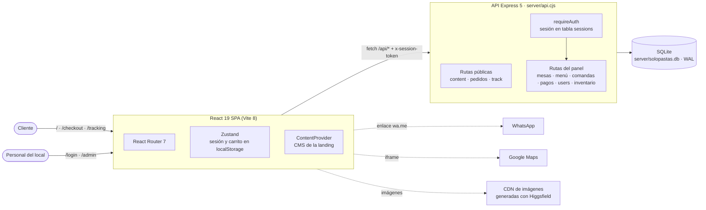

**Pedido web de la landing al tracking**

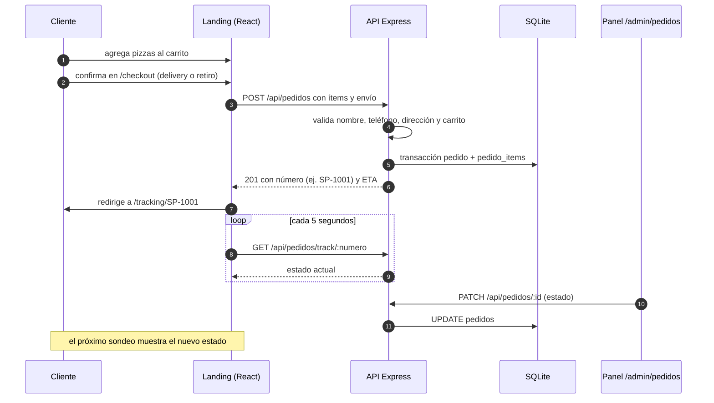

**Estados de un pedido web**

```mermaid
stateDiagram-v2
    [*] --> recibido: POST /api/pedidos
    recibido --> preparacion: enviar a cocina
    preparacion --> listo
    listo --> entregado
    recibido --> cancelado
    preparacion --> cancelado
    listo --> cancelado
    entregado --> [*]
    cancelado --> [*]
```

**Comanda de salón y estado de la mesa**

```mermaid
stateDiagram-v2
    state "Mesa libre" as libre
    state "Mesa ocupada" as ocupada
    [*] --> libre
    libre --> ocupada: POST /api/comandas
    state ocupada {
        [*] --> abierta
        abierta --> en_cocina: enviar a cocina
        en_cocina --> lista: marcar lista
    }
    ocupada --> libre: POST /api/pagos (comanda pagada)
```

**Comanda de salón y estado de la mesa**

```mermaid
erDiagram
    USERS ||--o{ SESSIONS : "inicia"
    USERS ||--o{ COMANDAS : "atiende"
    USERS ||--o{ PAGOS : "cobra"
    MESAS ||--o{ COMANDAS : "tiene"
    CATEGORIAS ||--o{ MENU_ITEMS : "agrupa"
    COMANDAS ||--o{ COMANDA_ITEMS : "contiene"
    MENU_ITEMS ||--o{ COMANDA_ITEMS : "se pide en"
    COMANDAS ||--o{ PAGOS : "se cobra con"
    PEDIDOS ||--o{ PEDIDO_ITEMS : "contiene"
    USERS {
        int id PK
        text email UK
        text password_hash
        text role "mesero, admin, super_admin"
        int active
    }
    SESSIONS {
        int id PK
        int user_id FK
        text token UK
    }
    MESAS {
        int id PK
        int numero UK
        int capacidad
        text estado "libre, ocupada, reservada"
        text zona "salon, terraza, barra"
    }
    CATEGORIAS {
        int id PK
        text nombre
        int orden
    }
    MENU_ITEMS {
        int id PK
        int categoria_id FK
        text nombre
        real precio
        int activo
        int tiempo_prep
    }
    COMANDAS {
        int id PK
        int numero
        int mesa_id FK
        int mesero_id FK
        text estado "abierta, en_cocina, lista, pagada, cancelada"
        real subtotal
    }
    COMANDA_ITEMS {
        int id PK
        int comanda_id FK
        int menu_item_id FK
        int cantidad
        real precio_unit
        text estado
    }
    PAGOS {
        int id PK
        int comanda_id FK
        int cajero_id FK
        real monto
        real propina
        text metodo "efectivo, tarjeta, qr, transfer"
    }
    PEDIDOS {
        int id PK
        text numero UK "SP-1001 en adelante"
        text cliente_telefono
        text tipo_entrega "delivery, pickup"
        text estado "recibido a entregado o cancelado"
        real delivery_fee
        real total
        int eta_minutos
    }
    PEDIDO_ITEMS {
        int id PK
        int pedido_id FK
        text nombre
        real precio_unit
        int cantidad
        real subtotal
    }
    INVENTARIO {
        int id PK
        text nombre
        real stock
        real stock_minimo
        text categoria "ingrediente, bebida, insumo"
    }
    SITE_CONTENT {
        text clave PK
        text valor "JSON"
    }
```

</details>

[↑ Volver al índice](#indice)

---

<a name="apple-boss"></a>
### 6. Apple Boss
> Sistema de gestión comercial e inventario, con tienda pública, para un negocio de productos y servicios tecnológicos.

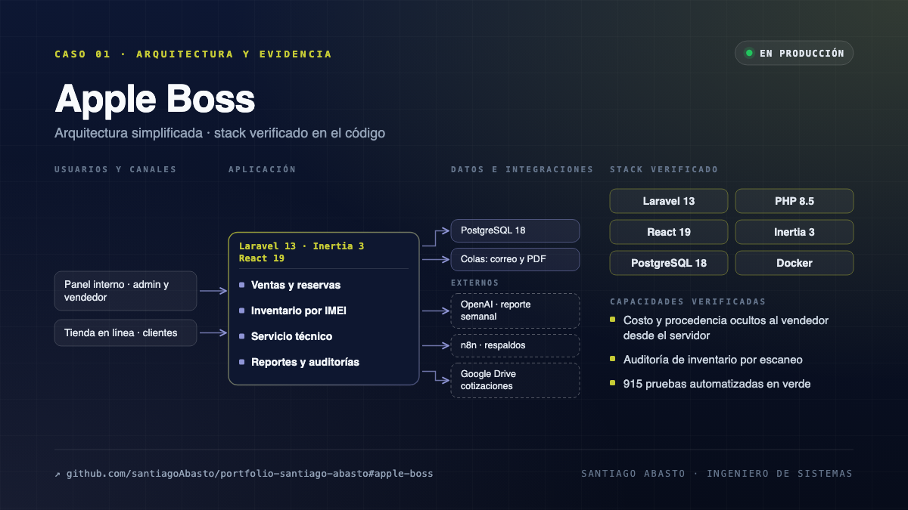


Un negocio de equipos Apple y tecnología vende unidades **únicas**: cada celular, computadora o accesorio tiene su código, su IMEI o su número de serie. Antes del sistema, el stock, las reservas, las permutas y las reparaciones vivían en planillas y en la memoria del equipo de ventas. Eso producía dobles ventas sobre el mismo equipo, costos y procedencias visibles para quien no debía verlos, y reportes que no coincidían con la caja.


| Capa | Tecnología | Versión |
|---|---|---|
| Backend | Laravel · PHP | 13 (13.32 en `composer.lock`) · 8.5 en producción y desarrollo; `composer.json` admite desde 8.3 |
| Autenticación y API | Sesión, Sanctum, Ziggy | Sanctum 4 · Ziggy 2 |
| Frontend | React · Inertia · TypeScript | 19.3 · 3.7 · JavaScript con React (TypeScript no aparece en `package.json`) |
| Estilos | Tailwind CSS | 3.x (se mantiene en la 3) |
| Build | Vite | 8.3 |
| Datos | PostgreSQL | 18 (Docker Compose) |
| PDF | Dompdf (`barryvdh/laravel-dompdf`) | 3.1 |
| Integraciones | Google API Client y Flysystem (Drive) · Laravel Mail · OpenAI vía n8n | n8n 2.39 |
| Pruebas | PHPUnit · SQLite en memoria | 12.5 |
| Infraestructura | Docker Compose · Caddy · Cloudflare | Apache con PHP 8.5 en la imagen |


**Apple Boss** centraliza ventas, reservas, clientes, cotizaciones, inventario, egresos y servicio técnico en un solo panel, y publica una **tienda en línea** con el mismo inventario, sin exponer datos internos.

| Rol | Qué hace en el sistema |
|---|---|
| **Administrador** | Ve todo: costos, ganancias, procedencia, usuarios, reportes, auditorías y configuración de la tienda. |
| **Vendedor** | Registra ventas, reservas, clientes, cotizaciones y servicios. Nunca ve costo, ganancia ni procedencia: se quitan en el servidor. |
| **Cliente de la tienda** | Navega el catálogo, compara modelos, arma su carrito, paga y sigue su pedido. |


- **Participación:** desarrollo integral, como fundador de Apple Boss. 193 commits entre mayo de 2025 y noviembre de 2026.
- **Producción:** [appleboss.com.bo](https://appleboss.com.bo) responde (verificado el 16-11-2026).
- **Código:** [público en GitHub](https://github.com/santiagoAbasto/ApplebBoss-Laravel). La suite de 915 pruebas pasó completa el 16-11-2026.

<details>
<summary> <b>Ver 5 diagramas y flujos</b></summary>
<br>

```mermaid
flowchart LR
    U(["Vendedor / Administrador"]) -->|"panel interno"| L["Laravel 13 + Inertia<br/>rutas, roles, políticas"]
    C(["Cliente de la tienda"]) -->|"catálogo y checkout"| L
    L --> M["Controladores y Services<br/>reglas de negocio"]
    M --> E[("PostgreSQL 18<br/>Eloquent")]
    M --> Q["Colas<br/>PDF de auditorías y cotizaciones"]
    M --> G["Google Drive<br/>opcional"]
    M --> R["Correo<br/>Laravel Mail"]
    N["n8n<br/>respaldos y reportes"] -->|"X-AUTOMATION-TOKEN"| L
    N -->|"API de OpenAI"| AI(["OpenAI"])
    L --> F["React 19 + TypeScript<br/>páginas Inertia"]
```

**Venta con control de stock**

```mermaid
sequenceDiagram
    autonumber
    participant V as Vendedor
    participant UI as Panel (Inertia)
    participant C as VentaController
    participant DB as PostgreSQL
    V->>UI: Registra venta (equipo, cliente, pago, permuta)
    UI->>C: POST venta
    C->>DB: BEGIN
    C->>DB: SELECT ... FOR UPDATE (unidad de inventario)
    alt la unidad ya no está disponible
        DB-->>C: sin stock
        C-->>UI: error de validación
    else disponible
        C->>DB: INSERT venta e ítems (snapshots de nombre, costo y precio)
        C->>DB: marcar unidad como vendida
        C->>DB: COMMIT
        C-->>UI: venta registrada y comprobante PDF
    end
```

**Estados de un pedido de la tienda**

```mermaid
stateDiagram-v2
    [*] --> PendientePago
    PendientePago --> PagoEnRevision: el cliente sube el comprobante
    PendientePago --> Cancelado
    PagoEnRevision --> Pagado: se confirma el pago
    PagoEnRevision --> Cancelado
    Pagado --> Preparando
    Preparando --> Enviado
    Enviado --> Entregado
    Entregado --> [*]
    Cancelado --> [*]
```

**Estados de un servicio técnico**

```mermaid
stateDiagram-v2
    [*] --> Recibido
    Recibido --> EnDiagnostico: modo diagnóstico
    Recibido --> EnReparacion: reparación directa
    EnDiagnostico --> Presupuesto
    Presupuesto --> EnReparacion: el cliente acepta
    Presupuesto --> Rechazado: el cliente rechaza
    EnReparacion --> Reparado
    Reparado --> Entregado
    Entregado --> [*]
    Rechazado --> [*]
```

**Estados de un servicio técnico**

```mermaid
erDiagram
    USUARIO ||--o{ VENTA : registra
    USUARIO ||--o{ RESERVA : registra
    USUARIO ||--o{ PEDIDO : realiza
    CLIENTE ||--o{ COTIZACION : recibe
    USUARIO ||--o{ COTIZACION : emite
    VENTA ||--o{ VENTA_ITEM : contiene
    RESERVA ||--o{ RESERVA_ITEM : contiene
    RESERVA |o--o| VENTA : "puede convertirse en"
    VENTA ||--o{ SERVICIO_TECNICO : "genera"
    PEDIDO ||--o{ PEDIDO_ITEM : contiene
    PEDIDO ||--o{ PEDIDO_EVENTO : registra
    INVENTARIO_AUDITORIA ||--o{ INVENTARIO_AUDITORIA_ITEM : contiene
    VENTA_ITEM }o--|| CELULAR : "referencia"
    VENTA_ITEM }o--|| COMPUTADORA : "referencia"
    VENTA_ITEM }o--|| PRODUCTO_GENERAL : "referencia"
    VENTA_ITEM }o--|| PRODUCTO_APPLE : "referencia"

    USUARIO { bigint id PK }
    CLIENTE { bigint id PK }
    VENTA { bigint id PK string estado }
    VENTA_ITEM { bigint id PK bigint producto_id }
    RESERVA { bigint id PK string estado }
    RESERVA_ITEM { bigint id PK bigint producto_id }
    SERVICIO_TECNICO { bigint id PK string estado }
    COTIZACION { bigint id PK }
    PEDIDO { bigint id PK string estado }
    PEDIDO_ITEM { bigint id PK }
    PEDIDO_EVENTO { bigint id PK string estado }
    INVENTARIO_AUDITORIA { bigint id PK }
    INVENTARIO_AUDITORIA_ITEM { bigint id PK }
    CELULAR { bigint id PK }
    COMPUTADORA { bigint id PK }
    PRODUCTO_GENERAL { bigint id PK }
    PRODUCTO_APPLE { bigint id PK }
```

</details>

[↑ Volver al índice](#indice)

---

<a name="blackphone-axel"></a>
### 7. Blackphone (Axel)
> Sistema interno para una tienda de tecnología: inventario, ventas, reservas, servicio técnico y reportes, con varias sucursales.


Una tienda de celulares y computadoras con más de una sucursal necesita saber, a la vez, qué equipo tiene cada una, quién lo vendió, cuánto cuesta y dónde está. Con planillas separadas por sucursal, un mismo equipo podía venderse dos veces, un traspaso quedaba sin registrar y la caja del día no cuadraba con las boletas. El servicio técnico y los accesorios sumaban otra planilla.


| Capa | Tecnología | Versión |
|---|---|---|
| Backend | Laravel · PHP | 13 · 8.5 en la imagen Docker (`composer.json` admite desde 8.3) |
| Autenticación y API | Sanctum · Ziggy | 4 · 2 |
| Frontend | React · Inertia · Vite | 19.3 · 3.7 · 8.3 |
| Estilos | Tailwind CSS · sistema de tokens propio | 3.x en `package.json` |
| PDF | Dompdf (`barryvdh/laravel-dompdf`) | 3.1 |
| Datos | PostgreSQL | 18 |
| Integraciones | Google Drive (Flysystem) · n8n | n8n con token de automatización |
| Contenedores | Docker Compose | `app`, `db`, `queue`, `scheduler`, `node`, `adminer` |


**Blackphone** —la empresa de celulares y servicio técnico de **Axel**— opera con este sistema **privado**: no tiene tienda pública ni pantallas abiertas a internet. Todo lo que está detrás de `/` pide sesión. Concentra el inventario, las ventas, las reservas con anticipo, el servicio técnico, las cotizaciones, los egresos, los clientes y los reportes de todas las sucursales, con un panel para administración y otro para vendedores.

| Rol | Qué hace |
|---|---|
| **Super administrador** | Ve todas las sucursales o una a la vez. Crea sucursales, cuentas y roles. |
| **Administrador de sucursal** | Trabaja solo con su sucursal y puede dar acceso a ella, sin crear cuentas fuera de su alcance. |
| **Vendedor** | Vende, reserva, recibe equipos de servicio técnico y cotiza desde su propio panel. |

<details>
<summary> <b>Ver 4 diagramas y flujos</b></summary>
<br>

```mermaid
flowchart LR
    U(["Admin · vendedores"]) -->|"HTTPS"| P["Panel React<br/>Inertia 3 · Vite"]
    P -->|"Inertia"| L["Laravel 13<br/>controladores"]
    L --> S["Alcance por sucursal<br/>DeSucursal"]
    S --> V["Servicios de dominio<br/>caja · stock · traspasos"]
    V --> DB[("PostgreSQL 18")]
    A(["Automatización n8n"]) -->|"token"| L
    Q["Cola<br/>jobs en la base"] --> F["Procesos de fondo<br/>queue · schedule"]
    V --> Q
    F --> DB
```

**Traspaso de un equipo entre sucursales**

```mermaid
sequenceDiagram
    autonumber
    participant O as Sucursal origen
    participant L as Laravel
    participant DB as PostgreSQL
    participant D as Sucursal destino
    O->>L: Crea traspaso (equipo, destino)
    L->>DB: traspaso en_transito · equipo en tránsito
    L-->>O: traspaso enviado
    D->>L: Recibe el equipo
    L->>DB: traspaso recibido · equipo vuelve a la venta en destino
    L-->>D: equipo disponible en la sucursal
```

**Estados de un traspaso**

```mermaid
stateDiagram-v2
    [*] --> EnTransito
    EnTransito --> Recibido: la sucursal destino lo recibe
    EnTransito --> Cancelado: se anula antes de recibirlo
    Recibido --> [*]
    Cancelado --> [*]
```

**Estados de un traspaso**

```mermaid
erDiagram
    SUCURSAL ||--o{ USUARIO : "tiene acceso"
    SUCURSAL ||--o{ VENTA : "registra"
    SUCURSAL ||--o{ RESERVA : "registra"
    SUCURSAL ||--o{ CAJA : "abre"
    VENTA ||--o{ VENTA_ITEM : contiene
    RESERVA ||--o{ RESERVA_ITEM : contiene
    TRASPASO ||--o{ TRASPASO_ITEM : contiene
    SUCURSAL ||--o{ TRASPASO : "origen y destino"
    CLIENTE ||--o{ VENTA : compra
    CELULAR ||--o{ VENTA_ITEM : "referencia"
    COMPUTADORA ||--o{ VENTA_ITEM : "referencia"

    SUCURSAL { bigint id PK string codigo }
    USUARIO { bigint id PK bigint sucursal_id }
    VENTA { bigint id PK bigint sucursal_id }
    VENTA_ITEM { bigint id PK bigint producto_id }
    RESERVA { bigint id PK bigint sucursal_id }
    RESERVA_ITEM { bigint id PK bigint producto_id }
    TRASPASO { bigint id PK string estado }
    TRASPASO_ITEM { bigint id PK }
    CAJA { bigint id PK bigint sucursal_id }
    CLIENTE { bigint id PK bigint sucursal_id }
    CELULAR { bigint id PK bigint sucursal_id }
    COMPUTADORA { bigint id PK bigint sucursal_id }
```

</details>

[↑ Volver al índice](#indice)

---

<a name="sistema-boss"></a>
### 8. Sistema Boss


La tienda vende equipos **por unidad** (cada uno con su IMEI o serie), maneja precios en dólares y en bolivianos según un tipo de cambio que cambia, y recibe consultas de WhatsApp a cualquier hora. Sin un sistema, cada respuesta depende de quién esté atendiendo, el stock puede venderse dos veces y un precio cotizado puede no coincidir con el del día.


| Capa                  | Tecnología                 | Versión                 |
| --------------------- | -------------------------- | ----------------------- |
| Lenguaje backend      | PHP                        | 8.5                     |
| Framework             | Laravel                    | 13                      |
| Auth                  | Laravel Fortify + passkeys | 1.37                    |
| Rutas tipadas         | Laravel Wayfinder          | 0.1                     |
| Permisos              | spatie/laravel-permission  | 8.3                     |
| Puente SPA            | Inertia (Laravel + React)  | 3                       |
| Base de datos         | PostgreSQL                 | 18                      |
| Caché, colas y sesión | Redis                      | 8                       |
| Frontend              | React                      | 19                      |
| Tipos                 | TypeScript                 | 7                       |
| Estilos               | Tailwind CSS               | 4 (+ shadcn/ui)         |
| Build y tooling       | vite-plus (`vp`)           | 1, **requiere pnpm**    |
| Runtime JS            | Node                       | 26                      |
| Gestor JS             | pnpm                       | 12                      |
| IA                    | SDK oficial de Anthropic   | Claude Sonnet 5.5       |
| Mensajería            | WhatsApp Cloud API de Meta | v25.0                   |
| Tests                 | PHPUnit                    | 13                      |
| Análisis estático     | Larastan                   | nivel 7                 |
| Formato PHP           | Pint                       | —                       |
| Contenedores          | Laravel Sail (Docker)      | proyecto `sistema-boss` |

Todo corre **dentro del contenedor** con `./vendor/bin/sail`. `npm run` falla a propósito, porque el tooling exige pnpm.

---


APPLE BOSS vende productos Apple nuevos, sellados, seminuevos y a pedido, además de accesorios, incluida su marca propia MYSKIN. Este sistema le da:

- **Catálogo e inventario** por unidad (IMEI o serie) o por cantidad, con stock separado en **disponible, reservado, a pedido y sin confirmar**.
- **Precios** en dólares y bolivianos con un **tipo de cambio autorizado** en el panel, con vigencia.
- **Cotizaciones** con el tipo de cambio **congelado** al emitir y validez configurable.
- **Importador** del catálogo (PDF transcrito a JSON) con **vista previa y aprobación manual fila por fila**.
- **Catálogo público** y un **contrato de lectura** (`CatalogReader`) que la IA consume sin ver costos ni IMEI.
- **Conexión de solo lectura con la API de appleboss.com.bo**: inventario real, stock, precios en Bs y el tipo de cambio de la tienda, como **una fuente más** que se suma al catálogo comercial.
- **Motor de IA comercial (S2)**: herramientas de solo lectura, un validador que frena cualquier dato inventado, presupuesto diario, derivación a personas, trazas, un simulador y una batería de evaluación.
- **WhatsApp Cloud API oficial (S3)** en **modo sombra**: webhook firmado, cola sin duplicados, borradores de la IA y una **bandeja** donde una persona aprueba, atiende o devuelve la conversación a la IA.
- **Acceso seguro**: roles, permisos, auditoría, recuperación de contraseña con el correo de la marca y **passkeys**.

---

<details>
<summary> <b>Ver 9 diagramas y flujos</b></summary>
<br>

```mermaid
flowchart LR
    staff["Personal<br/>ventas · admin"] -->|HTTPS| panel["Panel de administración<br/>React 19 · Inertia"]
    customer["Cliente web"] -->|HTTPS| public["Catálogo público<br/>solo publicados"]
    wa["Cliente WhatsApp"] -->|Meta Cloud API| hook["Webhook firmado<br/>X-Hub-Signature-256"]

    panel -->|acciones| app["App Laravel 13<br/>Controllers · Gates"]
    public -->|consulta| reader["CatalogReader<br/>solo lectura<br/>sin costo ni IMEI"]

    app -->|escribe stock| inv["InventoryService<br/>transiciones atómicas"]
    app -->|emite| quote["QuoteIssuer<br/>congela el TC"]
    app -->|importa| imp["CatalogImporter<br/>stage → aprobar → aplicar"]

    inv --> db[("PostgreSQL 18<br/>centavos · TC ×10⁴")]
    quote --> db
    imp --> db
    reader --> db

    hook -->|dedup · cola por remitente| job["HandleInboundWhatsAppMessage"]
    job -->|redacta borrador| ai["SalesAssistant (S2)<br/>herramientas · presupuesto · trazas"]
    panel -->|simulador · bandeja| ai
    ai -->|solo lectura| reader
    ai -->|solo lectura| abinv["AppleBossInventory<br/>reglas comerciales<br/>verificación en vivo"]
    ai -->|valida cada respuesta| val["ResponseValidator<br/>determinista"]
    ai -->|Messages API| claude["API de Claude"]

    abinv --> abidx[("Índice de lectura<br/>appleboss_products")]
    sync["AppleBossSync<br/>cambios c/5 min · completa diaria"] -->|upsert| abidx
    sync -->|GET solo lectura| abapi["API appleboss.com.bo"]
    abinv -->|GET en vivo| abapi

    panel -->|aprobar y enviar| out["WhatsAppCloudChannel<br/>tras el candado send_enabled"]
    out -. "hoy apagado" .-> meta["Meta Cloud API"]

    classDef svc fill:#eef0ff,stroke:#585e9f,color:#011446;
    classDef store fill:#f6f7dc,stroke:#a3a82a,color:#011446;
    classDef ext fill:#ffffff,stroke:#28224f,color:#28224f;
    classDef lock fill:#011446,stroke:#c6cb36,color:#ffffff;
    class inv,quote,imp,reader,app,abinv,sync,ai,val,job,hook svc;
    class db,abidx store;
    class abapi,claude,meta ext;
    class out lock;
```

```mermaid
sequenceDiagram
    autonumber
    participant C as Cliente (WhatsApp)
    participant M as Meta Cloud API
    participant W as Webhook
    participant Q as Cola (por remitente)
    participant E as SalesAssistant
    participant V as ResponseValidator
    participant B as Bandeja (persona)
    C->>M: escribe al número de prueba
    M->>W: POST firmado
    W->>W: verifica X-Hub-Signature-256 · descarta duplicados
    W->>Q: encola el mensaje
    Q->>E: conversación del remitente
    E->>E: herramientas de solo lectura
    E->>V: ¿cada dato sale de una herramienta?
    V-->>E: aprobado o frenado
    E-->>B: borrador listo
    alt aprueba y envía
        B->>M: WhatsAppCloudChannel (rechazado mientras el envío está apagado)
    else atiende ella misma
        B-->>C: responde desde el celular (coexistencia)
    else devuelve a la IA
        B->>E: la IA vuelve a atender la conversación
    end
```

```mermaid
erDiagram
    CATEGORIES ||--o{ PRODUCTS : "agrupa"
    BRANDS ||--o{ PRODUCTS : "marca"
    PRODUCTS ||--o{ PRODUCT_VARIANTS : "tiene"
    PRODUCTS ||--o{ PRODUCT_ALIASES : "se busca por"
    PRODUCTS ||--o{ PRODUCT_SPECS : "ficha tecnica"
    PRODUCTS ||--o{ PRODUCT_IMAGES : "imagenes"
    PRODUCT_VARIANTS ||--o{ INVENTORY_UNITS : "unidades fisicas"
    PRODUCT_VARIANTS ||--o{ INVENTORY_MOVEMENTS : "historial"
    INVENTORY_UNITS ||--o{ INVENTORY_RESERVATIONS : "reserva"
    INVENTORY_UNITS ||--o{ INVENTORY_MOVEMENTS : "movimientos"
    QUOTES ||--o{ QUOTE_ITEMS : "contiene"
    QUOTES ||--o{ INVENTORY_RESERVATIONS : "puede reservar"
    EXCHANGE_RATES ||--o{ QUOTES : "TC congelado"

    PRODUCTS {
        string family
        string model
        string tracking "serial | quantity"
        bool is_active
    }
    PRODUCT_VARIANTS {
        string condition
        string sim
        int sale_price_cents
        int quantity_on_hand
        int quantity_reserved
        bool is_published
    }
    INVENTORY_UNITS {
        string status "AVAILABLE | ON_ORDER | RESERVED | SOLD | PENDING_CHECK | RETIRED"
        string imei
        string serial_number
        int sale_price_cents
        int cost_cents
    }
    EXCHANGE_RATES {
        decimal rate "Bs por USD"
        string source "USDT_REFERENCE | MANUAL"
        datetime effective_at
    }
    QUOTES {
        string number "COT-AAAA-NNNNNN"
        string rate_snapshot "TC congelado"
        datetime issued_at
        datetime valid_until
    }
```

**1 Importación de catálogo revisión manual**

```mermaid
flowchart LR
    src["Transcripción<br/>PDF → JSON · 104 filas"] --> stage["stage()<br/>vista previa · no aplica nada"]
    stage --> review{"Revisión<br/>fila por fila"}
    review -->|70 sin observaciones| clean["Aprobar limpias"]
    review -->|34 a revisar| correct["Corregir o completar<br/>condición faltante, etc."]
    review -->|duplicado en archivo| reject["Rechazar"]
    clean --> apply["apply()<br/>lockForUpdate · idempotente"]
    correct --> apply
    apply --> cat[("Catálogo<br/>variantes sin publicar<br/>unidades PENDING_CHECK")]
```

**2 Ciclo de vida de una unidad**

```mermaid
stateDiagram-v2
    [*] --> SinConfirmar: importado (stage → aplicar)
    [*] --> Disponible: alta en tienda (con IMEI)
    [*] --> APedido: a pedido
    SinConfirmar --> Disponible: confirmar (registrar IMEI)
    APedido --> Disponible: llega a tienda
    Disponible --> Reservado: reservar (cliente)
    Reservado --> Disponible: liberar o vence
    Reservado --> Vendido: vender al reservado
    Disponible --> Vendido: venta directa
    Disponible --> DeBaja: dar de baja
    Vendido --> [*]
    DeBaja --> [*]

    note right of APedido
        ON_ORDER nunca cuenta
        como stock disponible
    end note
    note right of Vendido
        una sola venta por unidad
        (índice único parcial)
    end note
```

**3 Emisión de cotización TC congelado**

```mermaid
sequenceDiagram
    participant V as Vendedor (panel)
    participant P as Panel
    participant Q as QuoteIssuer
    participant R as ExchangeRate
    participant D as PostgreSQL

    V->>P: arma la cotización
    P->>Q: POST ids + cantidades
    Q->>R: lee el TC vigente
    R-->>Q: Bs 12,07 (error si está vencido)
    Q->>D: lee los precios publicados
    D-->>Q: precios en centavos
    Q->>D: guarda la cotización + snapshot del TC
    D-->>Q: COT-2026-000001
    Q-->>P: cotización emitida
    P-->>V: muestra o imprime
```

**4 Sincronización con la API de Apple Boss**

```mermaid
flowchart TD
    sched["Programador<br/>cambios c/5 min · completa 04:30"] --> lock{"¿Otra sincronización<br/>en curso?"}
    lock -->|sí| skip["Se omite (candado)"]
    lock -->|no| mode{"¿Hay una corrida<br/>buena previa?"}
    mode -->|no| full
    mode -->|sí| changes["GET /changes<br/>cursor o since − 5 min · limit=200"]
    full["GET /products?availability=all<br/>sort=updated_asc · página a página"] --> validate["Valida cada registro<br/>inválido → se omite y se registra"]
    changes --> validate
    validate --> upsert[("Upsert en appleboss_products<br/>payload original · centavos")]
    changes -->|"tombstone = vendido o agotado"| withdraw["withdrawn_at<br/>sale del conjunto vendible"]
    full --> complete{"¿Pasada completa<br/>y consistente?"}
    complete -->|"sí: total = registros distintos"| absent["Suma 1 a absent_full_passes<br/>de lo que no se listó"]
    absent -->|"2 pasadas seguidas"| missing["Marca missing_since<br/>nunca borra"]
    complete -->|"no: falló, incompleta o vacía"| nomark["No cuenta nada<br/>corrida = failed"]
```

**5 Un mensaje en el motor de IA**

```mermaid
sequenceDiagram
    autonumber
    participant C as Cliente
    participant E as SalesAssistant
    participant B as Budget
    participant M as Claude (Messages API)
    participant T as SalesTools
    participant V as ResponseValidator
    C->>E: mensaje
    E->>E: ¿encendida, con clave, dentro de límites?<br/>oculta teléfonos, correos e IMEI
    loop hasta max_rounds
        E->>B: reserva el peor caso
        B-->>E: cabe o no cabe (deriva)
        E->>M: prompt fijo (caché) + historial + hora local
        M-->>E: tool_use
        E->>T: herramientas (solo lectura, argumentos validados)
        T-->>E: datos con procedencia
    end
    M-->>E: borrador
    E->>V: ¿cada dato sale de una herramienta de este turno?
    alt respaldado
        V-->>E: OK
        E-->>C: respuesta (en WhatsApp, borrador para la bandeja)
    else inventado (1.ª vez)
        V-->>E: violaciones
        E->>M: aviso como mensaje de sistema → reescribe
    else inventado otra vez
        E-->>C: texto de derivación · pasa a una persona
    end
    E->>E: traza: herramientas, fuentes, tokens, costo, latencia
```

**5 Un mensaje en el motor de IA**

```mermaid
flowchart LR
    wa["Cliente WhatsApp"] --> meta["Meta Cloud API<br/>número de prueba"]
    meta -->|"POST firmado"| cf["Cloudflare<br/>DNS + proxy"]
    team["Equipo de ventas"] -->|"HTTPS · panel"| cf
    cf --> caddy["Caddy compartido<br/>TLS · noindex · HSTS"]
    subgraph vps["VPS · Docker · stack sistemaboss-production"]
        app["sistemaboss-app<br/>Apache + PHP 8.5 · /up"]
        queue["sistemaboss-queue<br/>queue:work"]
        sched["sistemaboss-scheduler<br/>schedule:work"]
        db[("sistemaboss-db<br/>PostgreSQL 18")]
        redis[("sistemaboss-redis<br/>Redis 8")]
    end
    caddy -->|red edge| app
    app --> db
    app --> redis
    queue --> redis
    queue --> db
    sched --> db
    queue -->|"borradores"| claude["API de Claude"]
    sched -->|"GET solo lectura"| abapi["API appleboss.com.bo"]
    app -. "envío: hoy apagado" .-> meta

    classDef svc fill:#eef0ff,stroke:#585e9f,color:#011446;
    classDef store fill:#f6f7dc,stroke:#a3a82a,color:#011446;
    classDef ext fill:#ffffff,stroke:#28224f,color:#28224f;
    class app,queue,sched svc;
    class db,redis store;
    class meta,claude,abapi,cf,caddy ext;
```

</details>

[↑ Volver al índice](#indice)

---

<a name="odessa-oil"></a>
### 9. Odessa Oil
> Cada equipo a presión con su estado real, su vencimiento y su recorrido por el taller, sin planillas sueltas.

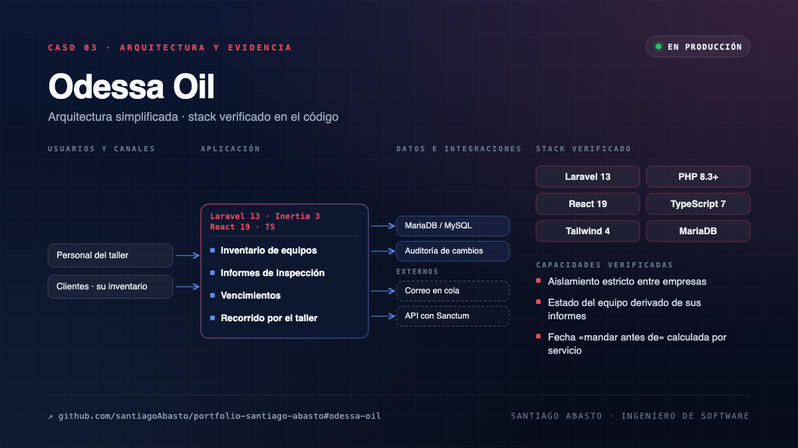


Odessa Oil inspecciona, repara y certifica equipos a presión de sus clientes. Cada pieza tiene una o varias certificaciones (COS, COC…) que vencen, y un equipo que sale a operar con una certificación vencida es un riesgo y un incumplimiento. Antes de este sistema, la información vivía en una plataforma anterior (auditada en [`docs/auditoria-sistema-actual.md`](docs/auditoria-sistema-actual.md)) con problemas concretos:

- **El estado de un equipo no se podía confiar.** Se veía como un ícono de color, sin texto, y no había forma de saber qué informe lo había fijado.
- **Saber si un equipo armado podía salir** obligaba a abrir el set y revisar sus piezas una por una.
- **El taller trabajaba con banderas** («liberado», «despachado») que no decían quién ni cuándo, y «en taller» y «despachados» eran pantallas separadas.
- **Identificadores secuenciales en la URL** (`/view/526`, `/download/8498`): cambiando el número se podía recorrer el inventario y los documentos.
- **Nadie avisaba a tiempo.** El cliente tenía que adivinar cuándo mandar un equipo al taller para que no perdiera la certificación mientras lo reparaban.

El detalle, punto por punto y con la solución aplicada, está en [`docs/problemas-y-oportunidades.md`](docs/problemas-y-oportunidades.md).


| Capa | Tecnología | Versión |
|---|---|---|
| Backend | PHP · Laravel | ^8.3 (piso del servidor) · 13.29 |
| Puente | Inertia (Laravel / React) | 3.3 / 3.6 |
| Interfaz | React · TypeScript (estricto) | 19.2 · 7.0 |
| Estilos y build | Tailwind CSS · Vite | 4.3 · 8.2 |
| Componentes | Radix UI · TanStack Table · lucide-react · Sonner | primitivas accesibles · 8.21 · 1.x · 2.x |
| Formularios | react-hook-form · Zod | 7.x · 4.4 |
| Gráficos y movimiento | Apache ECharts (registro selectivo) · Motion | 6.1 · 12.43 |
| Subida de archivos | Uppy | 5.2 |
| Permisos | spatie/laravel-permission | 8.3 |
| Planillas Excel | openspout/openspout | 4.32 |
| Datos | MySQL en desarrollo · MariaDB en producción | 8+ |
| Calidad | PHPUnit · Laravel Pint · `tsc --noEmit` | 12.5 · 1.30 |

<sub>Versiones de `composer.lock` y `package-lock.json`.</sub>


Una plataforma web multiempresa que registra el **inventario de cada cliente**, sus **informes de inspección** y vencimientos, y el **recorrido del equipo por el taller**, con aislamiento estricto entre organizaciones y auditoría de cada cambio.

- **El estado de un equipo se deriva, nunca se asigna a mano**: sale de sus informes finales.
- **Cada equipo tiene una fecha «mandar antes de»** calculada con los días de taller de cada servicio, para que llegue y vuelva sin perder la certificación.
- **El cliente ve lo suyo, en tiempo real**, y decide si autoriza una reparación (que se le cobra).

| Rol | Alcance |
|---|---|
| Superadministrador | Todo el sistema. |
| Taller | Inventario, informes, recepciones y envíos de todas las empresas. |
| Cliente · Operador | Lo propio: consulta, carga de envíos, decisión sobre reparaciones y certificaciones de otra empresa. |
| Cliente · Consulta | Lo propio, solo lectura. |

El detalle está en la [matriz de roles y permisos](docs/matriz-roles-permisos.md), que se genera desde `Permissions::roleMatrix()`.


- **Participación:** desarrollo integral; único autor en el historial de git (49 commits).
- **Producción:** [sistema.odessaoil.com](https://sistema.odessaoil.com) (acceso con usuario); la configuración de despliegue está en el repositorio.
- **Código:** [público en GitHub](https://github.com/santiagoAbasto/odessa).

<details>
<summary> <b>Ver 5 diagramas y flujos</b></summary>
<br>

**Reportes avisos y administración**

```mermaid
flowchart LR
    staff(["Personal de Odessa<br/>superadmin · taller"]) -->|HTTPS| panel
    client(["Cliente<br/>operador · consulta"]) -->|HTTPS| panel
    panel["Panel web<br/>React 19 · Inertia 3"] -->|Inertia| app["Laravel 13<br/>permisos + Policies<br/>alcance por empresa"]
    app --> actions["Actions del negocio<br/>envío · taller · informe"]
    actions -->|al finalizar| status["RecalculateAssetStatus<br/>estado derivado"]
    status --> db[("MySQL / MariaDB")]
    app -->|Eloquent| db
    app -->|descarga autorizada| files[("Disco privado<br/>certificados · fotos · remitos")]
    app -->|avisos por correo| queue["Cola de trabajos<br/>tabla jobs"]
    queue -->|SMTP| mail["Servidor de correo"]
    cron(["Cron del hosting"]) -->|"GET /cron cada minuto"| sched["Scheduler<br/>schedule:run"]
    sched -->|queue:work| queue

    classDef brand fill:#4073e9,stroke:#1b2340,color:#fff
    classDef crimson fill:#c0263f,stroke:#1b2340,color:#fff
    classDef navy fill:#1b2340,stroke:#0b1020,color:#fff
    class panel,app,actions brand
    class status crimson
    class db,files,queue navy
```

**Del envío del cliente al despacho**

```mermaid
sequenceDiagram
    autonumber
    participant C as Cliente operador
    participant S as Sistema
    participant T as Taller
    C->>S: arma el envío y declara los equipos
    S-->>C: rechaza un equipo que ya está en circuito
    C->>S: envía (pendiente de recepción)
    T->>S: da recepción pieza por pieza
    Note over S: una recepción por equipo,<br/>lo que no llegó queda marcado
    T->>S: empieza el trabajo e inspecciona
    alt Aprobado
        T->>S: finaliza el informe con el dictamen
        S->>S: RecalculateAssetStatus fija estado y vencimiento
    else Rechazado
        S-->>C: consulta por correo: ¿autoriza reparar?
        C->>S: SÍ (se re-trabaja) o NO (vuelve sin reparar)
    end
    T->>S: despacha
    S-->>C: el equipo vuelve a estar disponible para enviar
```

**Etapas de una recepción en el taller**

```mermaid
stateDiagram-v2
    state "Pendiente" as pending
    state "En proceso" as inProgress
    state "Aprobado" as approved
    state "Despachado" as dispatched
    state "Rechazado" as rejected
    state "En consulta con el cliente" as awaiting
    state "Sin solución" as unrepairable
    state "No autorizada" as declined
    state "Devuelto sin reparar" as returned
    state "Cancelada, a devolver" as cancelled
    state "Devuelta sin trabajar" as returnedCancelled
    state "Eliminada (baja lógica)" as deleted

    [*] --> pending
    pending --> inProgress: empezar
    inProgress --> approved: aprobar
    approved --> dispatched: despachar
    approved --> inProgress: deshacer (superadmin)
    inProgress --> rejected: rechazar
    rejected --> awaiting: consultar
    awaiting --> pending: SÍ, se re-trabaja
    awaiting --> declined: NO
    rejected --> unrepairable: motivo obligatorio
    declined --> returned
    unrepairable --> returned
    pending --> cancelled: cancelar
    inProgress --> cancelled: cancelar
    rejected --> cancelled: cancelar
    awaiting --> cancelled: cancelar
    cancelled --> returnedCancelled: despachar
    pending --> deleted: eliminar repetida
    dispatched --> [*]
    returned --> [*]
    returnedCancelled --> [*]
```

**Estado de un equipo**

```mermaid
stateDiagram-v2
    state "Sin inspección" as unknown
    state "Apto" as fit
    state "Por vencer (60 días o menos)" as expiring
    state "No apto" as unfit

    [*] --> unknown
    unknown --> fit: primer informe final Apto
    unknown --> unfit: informe final No Apto
    fit --> expiring: se acerca el vencimiento
    expiring --> fit: recertificado
    expiring --> unfit: venció
    fit --> unfit: dictamen No Apto
    unfit --> fit: nuevo informe Apto
```

**Estado de un equipo**

```mermaid
erDiagram
    ORGANIZATIONS ||--o{ USERS : "tiene"
    ORGANIZATIONS ||--o{ ASSETS : "posee"
    ORGANIZATIONS }o--o{ SERVICES : "operaciones habilitadas"
    ORGANIZATIONS ||--o{ SHIPMENTS : "envía"
    ORGANIZATIONS ||--o{ INSPECTION_REPORTS : "recibe"
    MANUFACTURERS ||--o{ CATALOG_ITEMS : "fabrica"
    CATALOG_ITEMS ||--o{ ASSETS : "modelo de"
    ASSETS ||--o{ ASSETS : "set con piezas"
    ASSETS ||--o{ INSPECTION_REPORT_ASSET : "inspeccionado en"
    INSPECTION_REPORTS ||--o{ INSPECTION_REPORT_ASSET : "dictamina"
    SERVICES ||--o{ INSPECTION_REPORT_ASSET : "ejecutado"
    ASSETS ||--o{ ASSET_EXTERNAL_CERTIFICATIONS : "certificado por otra empresa"
    SHIPMENTS ||--o{ SHIPMENT_ITEMS : "declara"
    ASSETS ||--o{ SHIPMENT_ITEMS : "viaja en"
    SHIPMENT_ITEMS |o--o| RECEPTIONS : "se recibe como"
    ASSETS ||--o{ RECEPTIONS : "ingresa al taller"
    INSPECTION_REPORTS |o--o{ RECEPTIONS : "resuelve"
    USERS ||--o{ ACTIVITY_LOGS : "produce"

    ORGANIZATIONS {
        uuid public_id
        string name
        string short_code
        boolean is_active
    }
    SERVICES {
        string code
        string name
        boolean determines_fitness
        int validity_days
        int turnaround_days
    }
    ASSETS {
        uuid public_id
        string kind
        string serial_number
        string code
        string client_reference
        boolean is_set
        string status
        date expires_at
        date send_by_at
    }
    INSPECTION_REPORTS {
        uuid public_id
        string number
        string status
        date inspected_at
        timestamp finalized_at
    }
    INSPECTION_REPORT_ASSET {
        string result
        date expires_at
        string seal
        text findings
    }
    SHIPMENTS {
        uuid public_id
        string reference
        string status
        timestamp submitted_at
    }
    RECEPTIONS {
        uuid public_id
        date received_at
        date promised_at
        timestamp released_at
        timestamp dispatched_at
        timestamp cancelled_at
    }
    ACTIVITY_LOGS {
        string action
        json changes
        string ip_address
    }
```

</details>

[↑ Volver al índice](#indice)

---

<a name="moldpack"></a>
### 10. Moldpack
> Sitio editorial, panel de gestión, portal B2B de clientes y facturación electrónica ARCA de Moldpack, en una sola aplicación Laravel.

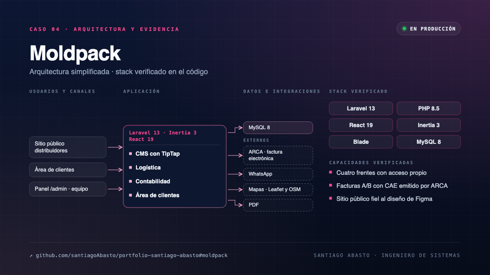


Moldpack es un fabricante argentino de packaging gastronómico que vende a distribuidores y comercios. Necesita presentarse como fabricante confiable, que cada visita encuentre productos y catálogos, convertir esas visitas en consultas comerciales y llevar cada pedido hasta su factura. Con el sistema anterior:

- El sitio era un **Laravel 9 con Blade, Bootstrap 4 y Laravel Mix**; la identidad visual nueva, definida en Figma, se construyó sobre una base nueva.
- **Logística, Contabilidad, Facturación y la zona privada** mostraban datos que no siempre coincidían entre sí (el README del sistema anterior registra las correcciones que se hicieron para reducirlo).
- La facturación electrónica dependía de un **SDK de AFIP embebido** en los controladores, cuando el CAE es irreversible y un error de datos del cliente tiene que detectarse antes de pedirlo.
- Los pedidos se reparten entre **factura A/B y remito X** (sin valor fiscal) y cada parte necesita sus propios documentos, coherentes con lo que se preparó y se envió.


| Capa | Tecnología | Versión |
|---|---|---|
| Backend | Laravel · PHP | 13.30 · 8.5 |
| Panel | React · Inertia.js · TipTap · Lucide · Motion | 19.2 · 3.7 · 3.30 · 1.33 · 13.1 |
| Sitio público | Blade · CSS nativo (Lightning CSS) · Leaflet | — · 1.33 · 1.9 |
| Build | Vite (con `laravel-vite-plugin` y `@vitejs/plugin-react`) | 8.2 |
| Datos | MySQL en producción · SQLite en desarrollo y pruebas | 8 · — |
| Colas | Driver `database` (colas `mail` y `default`) | — |
| Documentos | DomPDF (`barryvdh/laravel-dompdf`) · Bacon QR Code | 3.1 · 3.1 |
| Fiscal | ARCA (ex AFIP): WSAA + WSFE por SOAP, transporte propio | — |
| Pruebas | PHPUnit · scripts de navegador en `tests/Browser` | 13.3 |
| Entorno | Node (`.nvmrc`) · npm | 26.7.0 · 11.12 |


Una sola aplicación Laravel con cuatro frentes, cada uno con su propia identidad de acceso:

| Frente | Quién lo usa | Interfaz |
|---|---|---|
| **Sitio público** | Visitantes y distribuidores | Blade + CSS propio, fiel al diseño de Figma |
| **Panel `/admin` (CMS)** | Equipo de Moldpack | React 19 + Inertia 3 + TipTap |
| **Logística y Contabilidad** | Logística, contabilidad y administración | React + Inertia, dentro del panel |
| **Zona privada `/area-clientes`** | Clientes aprobados | Blade, integrada al layout público (guard `cliente`) |

Roles del panel (definidos en `app/Support/AdminAccess.php`): **super administrador**, **administrador**, **comercial**, **logística**, **contabilidad** y **editor**. Cada módulo exige su permiso y los importes se ocultan a los roles que no deben verlos.


- **Participación:** desarrollo integral; único autor en el historial de git del sistema vigente (14 commits).
- **Producción:** [moldpack.com.ar](https://www.moldpack.com.ar): el sitio público sale de este código (sus recursos y su dominio coinciden con el repositorio).
- **Código:** privado.

<details>
<summary> <b>Ver 6 diagramas y flujos</b></summary>
<br>

**Zona privada de clientes**

```mermaid
flowchart LR
    V(["Visitantes y distribuidores"]) -->|HTTPS| PUB["Sitio público<br/>Blade + CSS propio"]
    C(["Clientes aprobados"]) -->|"guard cliente"| ZP["Zona privada<br/>/area-clientes"]
    S(["Equipo Moldpack<br/>6 roles"]) -->|"guard web + admin"| ADM["Panel /admin<br/>React 19 + Inertia 3"]
    PUB --> L["Laravel 13<br/>Controllers · Services · Support"]
    ZP --> L
    ADM --> L
    L --> DB[("MySQL 8<br/>SQLite en desarrollo")]
    L --> ST["storage/app<br/>medios y adjuntos"]
    L --> FA["Archivo fiscal privado<br/>credenciales · XML · PDF"]
    L -->|"SOAP WSAA + WSFE"| ARCA["ARCA (ex AFIP)"]
    L --> PDF["DomPDF<br/>facturas · remitos · notas · catálogo"]
    L --> Q["Cola database<br/>mail · default"]
    Q -->|SMTP| M["Correo saliente<br/>destinatarios permitidos"]
```

**Del carrito a la factura**

```mermaid
sequenceDiagram
    autonumber
    actor CL as Cliente
    participant ZP as Zona privada
    participant LO as Logística
    participant CO as Contabilidad
    participant AR as ARCA
    CL->>ZP: Confirma el carrito (checkout)
    ZP->>ZP: Token + lock idempotente, revalida precio y stock
    ZP-->>CL: Pedido pendiente y correo de pedido recibido
    LO->>LO: Prepara cantidades y bultos
    LO->>CO: Aprueba el pedido, entra a la cola de Contabilidad
    CO->>CO: Reparte cada renglón entre factura A/B y remito X
    CO->>CO: Reserva el borrador local (sin CAE, reversible)
    CO->>AR: Confirmar con un clic (ticket WSAA + solicitud WSFE)
    AR-->>CO: Número de comprobante y CAE
    CO->>CO: Archiva XML firmado + PDF y proyecta la factura en el pedido
    CO-->>CL: Factura descargable en la zona privada
```

**Ciclo de un documento fiscal ArcaDocument**

```mermaid
stateDiagram-v2
    state "Borrador local · sin CAE" as draft
    state "Enviando a ARCA" as submitting
    state "Autorizado · CAE" as authorized
    state "Rechazado" as rejected
    state "Incierto" as uncertain
    [*] --> draft: reservar borrador
    draft --> submitting: confirmar
    draft --> rejected: descartar borrador y liberar el pedido
    submitting --> authorized: ARCA devuelve el CAE
    submitting --> rejected: ARCA rechaza
    submitting --> uncertain: respuesta no concluyente
    uncertain --> authorized: reconciliar con ARCA
    uncertain --> uncertain: volver a consultar
    authorized --> [*]
    rejected --> [*]
```

**Estado de facturación de un pedido**

```mermaid
flowchart LR
    P["Ítems preparados<br/>por Logística"] --> X["Cantidad facturada por ítem<br/>factura A/B + remito X"]
    X --> R{"¿Facturado menor<br/>que lo preparado?"}
    R -->|"sí"| PEN["pending<br/>parcial o sin facturar"]
    R -->|"no"| I{"¿Facturado mayor<br/>que lo preparado?"}
    I -->|"sí"| INC["Inconsistente<br/>revisar remitos"]
    I -->|"no"| FAC["invoiced<br/>facturado completo"]
```

**Estado de facturación de un pedido**

```mermaid
erDiagram
    PAGE ||--o{ SECTION : tiene
    SECTION ||--o{ CONTENT_ITEM : tiene
    CONTENT_ITEM ||--o{ MEDIA : "medios"
    CLIENTE ||--o{ CLIENT_ORDER : hace
    CLIENTE ||--o| CLIENT_CART : "carrito persistente"
    CLIENTE ||--o{ CLIENT_PAYMENT_REPORT : informa
    CLIENT_ORDER ||--o{ CLIENT_ORDER_ITEM : contiene
    CLIENT_ORDER ||--o{ CLIENT_ORDER_EVENT : registra
    CLIENT_ORDER ||--o{ CLIENT_INVOICE : "factura A/B o remito X"
    CLIENT_INVOICE ||--o{ CLIENT_INVOICE_LINE : contiene
    CLIENT_ORDER ||--o{ ARCA_DOCUMENT : "documentos fiscales"
    ARCA_DOCUMENT |o--o| CLIENT_INVOICE : "se proyecta en"
    CONTENT_ITEM ||--o{ CLIENT_ORDER_ITEM : producto
    USER ||--o{ CLIENT_ORDER_EVENT : registra

    CLIENTE {
        string username
        string business_name
        string tax_id
        decimal discount_percent
        boolean is_active
    }
    CLIENT_ORDER {
        string number
        enum status
        enum billing_status
        decimal total
        int package_count
    }
    CLIENT_ORDER_ITEM {
        string sku
        int quantity
        int prepared_quantity
        decimal unit_price
    }
    CLIENT_INVOICE {
        string type
        string number
        enum status
        decimal total
    }
    ARCA_DOCUMENT {
        string environment
        int point_of_sale
        int voucher_number
        string status
        string draft_hash
        string cae
    }
```

**Comandos**

```mermaid
flowchart LR
    A["Archivos tocados"] --> B["Respaldo con fecha<br/>en el servidor"]
    B --> C["php -l por archivo"]
    C -->|"OK"| D["Reemplazo archivo por archivo<br/>sin --delete"]
    C -->|"falla"| X["Abortar<br/>no se tocó nada"]
    D --> E["Assets de Vite<br/>manifest.json al final"]
    E --> F["optimize:clear<br/>y recacheo"]
    F --> G["Verificación y logs"]
    G -->|"falla"| R["Restaurar el respaldo"]
```

</details>

[↑ Volver al índice](#indice)

---

<a name="tickets-osole"></a>
### 11. Tickets Osole
> Mesa de ayuda interna para la atención de solicitudes de clientes: asignación, conversación, SLA y reportes.


Una agencia de desarrollo web que también ofrece hosting y soporte recibe pedidos de clientes por correo, mensajes y llamadas. Sin un registro común, un pedido se pierde entre personas, nadie sabe quién lo tiene, los vencimientos no se controlan y no hay antecedentes del trabajo hecho en cada cuenta.


| Capa | Tecnología | Versión (composer.json / package.json) |
|---|---|---|
| Backend | PHP · Laravel | PHP ^8.3 · Laravel ^13.8 (fijado en el lock: 13.12) |
| Permisos | Spatie Laravel Permission | ^7.4 |
| Tiempo real | Laravel Reverb (disponible) | ^1.10 |
| PDF | Laravel DomPDF | ^3.1 |
| Frontend | Blade · Alpine.js · Lucide · ApexCharts | Alpine 3.14.8 (CDN) · ApexCharts 3.54.1 |
| Estilos | Tailwind CSS (CLI) | ^4.3 |
| Pruebas | PHPUnit · Mockery · Pint | PHPUnit ^12.5 |

El efecto visual de la página pública usa Three.js y Vanta, cargados en el front.


Osole Tickets es un sistema de mesa de ayuda: el cliente abre el ticket sin cuenta (o desde su portal), el equipo lo asigna, conversa con el cliente con notas internas, controla los plazos SLA y mide la atención con reportes.

Roles que usa el sistema:

- **Visitante**: crea tickets desde la página pública y sigue su avance por código y correo o por enlace firmado.
- **Cliente**: consulta y responde los tickets propios desde el portal autenticado.
- **Agente**: atiende tickets asignados, responde, deja notas internas y puede tomar tickets o delegarlos (la delegación requiere aprobación).
- **Super Admin**: autorización global, configuración del sitio público, usuarios, roles y reportes.
- **Diseñadora industrial**: rol propio, con permisos acotados por el sistema de roles.

<details>
<summary> <b>Ver 4 diagramas y flujos</b></summary>
<br>

```mermaid
flowchart TB
    VI(["Visitante"]) --> PUB["Área pública<br/>alta y seguimiento"]
    CL(["Cliente"]) --> POR["Portal de clientes"]
    AG(["Agente / Super Admin"]) --> ADM["Panel administrativo"]
    PUB --> C["Controladores"]
    POR --> C
    ADM --> C
    C --> P["Form Requests y policies<br/>TicketPolicy · Gate::before"]
    P --> S["Servicios<br/>asignación · notificaciones · SLA · reportes"]
    S --> E[("MySQL<br/>Eloquent")]
    S --> N["Notificaciones<br/>correo · Telegram"]
    S --> W["WhatsApp wa.me<br/>enlace, sin API"]
    S --> D["Disco público<br/>adjuntos"]
    SCH["Scheduler<br/>tickets:check-sla · 15 min"] --> S
```

```mermaid
sequenceDiagram
    autonumber
    participant A as Agente
    participant S as Servicio de asignación
    participant DB as Base de datos
    participant ADM as Administrador
    participant N as Notificaciones
    A->>S: Solicita delegar el ticket a otro agente
    S->>DB: Crea TicketDelegationRequest pendiente
    S->>N: Avisa al administrador
    ADM->>S: Aprueba o rechaza
    alt Aprobada
        S->>DB: Cambia asignación · registra actividad
        S->>N: Avisa al nuevo responsable
    else Rechazada
        S->>DB: Registra rechazo · el ticket sigue con el agente
    end
```

```mermaid
sequenceDiagram
    autonumber
    participant V as Cliente
    participant L as Laravel
    participant DB as Base de datos
    participant AG as Agente
    V->>L: Crea ticket (límites por IP y correo)
    L->>DB: BEGIN · código anual correlativo con lockForUpdate · COMMIT
    L-->>AG: Notificación de asignación
    AG->>L: Responde o deja nota interna
    L->>DB: Guarda mensaje o nota · actividad
    L-->>V: Respuesta por correo y en el seguimiento
```

```mermaid
erDiagram
    COMPANY ||--o{ CUSTOMER : tiene
    CUSTOMER ||--o{ TICKET : abre
    COMPANY ||--o{ TICKET : asociada_a
    DEPARTMENT ||--o{ TICKET : recibe
    TICKETCATEGORY ||--o{ TICKET : clasifica
    TICKETPRIORITY ||--o{ TICKET : prioriza
    TICKETSTATUS ||--o{ TICKET : estado
    SLAPOLICY ||--o{ TICKET : aplica
    USER ||--o{ TICKETASSIGNMENT : recibe
    TICKET ||--o{ TICKETASSIGNMENT : registra
    TICKET ||--o{ TICKETMESSAGE : contiene
    TICKET ||--o{ TICKETNOTE : contiene
    TICKET ||--o{ TICKETATTACHMENT : adjunta
    TICKET ||--o{ TICKETDELEGATIONREQUEST : solicita
    TICKET ||--o{ TICKETACTIVITYLOG : registra
    COMPANY ||--o{ HOSTCREDENTIAL : guarda
```

</details>

[↑ Volver al índice](#indice)

---

<a name="porpora-produccion"></a>
### 12. Pórpora — Producción
> Sistema de producción de Porpora: configura productos, crea órdenes de fabricación y registra el avance de cada proceso en planta.


En una planta, cada orden de fabricación depende de la configuración del producto (su estructura, sus procesos y sus controles), del operario que la trabaja, de las máquinas y de las paradas. Si esa información vive en planillas separadas, la orden no refleja fielmente el producto y no queda registro de quién hizo qué, cuándo y con qué resultado.


| Capa | Tecnología | Versión (composer.json / package.json / Dockerfile) |
|---|---|---|
| Backend | PHP · Laravel | PHP ^8.2 (imagen PHP 8.5) · Laravel ^13.8 |
| Frontend | React · Vite · Tailwind CSS · lucide-react | React ^19.2 · Vite ^8.0 · Tailwind ^4.0 |
| Puente Blade-React | `laravel-vite-plugin` · `@vitejs/plugin-react` | ^3.1 · ^6.0 |
| Base de datos | MariaDB (LTS en compose) | `mariadb:lts` |
| Servidor | Nginx · PHP-FPM (Alpine) | `nginx:stable-alpine` · `php:8.5-fpm-alpine` |
| Pruebas | PHPUnit · Mockery · Pint | PHPUnit ^12.5 |
| Integración | Tango (API de ERP) | cliente propio `TangoApi` |


El sistema centraliza la configuración de productos y estructuras, genera órdenes de fabricación con sus pasos, registra turnos, pausas y avance de cada proceso, y guarda los controles de calidad y los rechazos. Cada orden conserva los datos del producto con los que se creó.

Roles que usa el sistema:

- **Administración y planeación**: configura productos, estructuras, máquinas, códigos y planes de calidad; crea órdenes y carga sugerencias de producción.
- **Operario**: inicia, pausa y finaliza turnos, y registra el avance de los pasos asignados.
- **Calidad**: registra mediciones según el plan y los rechazos con su motivo.

<details>
<summary> <b>Ver 4 diagramas y flujos</b></summary>
<br>

```mermaid
flowchart TB
    AD(["Administración y planeación"]) --> UI["Páginas React<br/>Vite · Tailwind"]
    OP(["Operario"]) --> UI
    CA(["Calidad"]) --> UI
    UI --> W["Rutas web y API interna<br/>routes/web.php · auth"]
    W --> C["Controladores<br/>OrdenesDeFabricacion · Turnos · Calidad…"]
    C --> S["Servicios de dominio<br/>estructura · planificación · paradas · sugerencias"]
    S --> E[("MariaDB<br/>Eloquent")]
    S --> IM["Importación de planillas<br/>estructuras · sugerencias"]
    S --> TG["Tango ERP<br/>sincronización de productos y máquinas"]
    SCH["Scheduler<br/>schedule:work"] --> S
```

```mermaid
sequenceDiagram
    autonumber
    participant OP as Operario
    participant APP as Aplicación
    participant DB as MariaDB
    OP->>APP: Inicia turno
    APP->>DB: Crea OperatorShift activo
    OP->>APP: Registra avance del paso
    APP->>DB: Actualiza WorkOrderStep
    OP->>APP: Pausa con motivo (PauseReason)
    APP->>DB: Registra MachineStop o pausa
    OP->>APP: Finaliza el turno
    APP->>DB: Cierra el turno y guarda tiempos
```

```mermaid
stateDiagram-v2
    [*] --> activa: operator-shifts/start
    activa --> pausada: pause
    pausada --> finalizada: finish
    activa --> finalizada: finish
    finalizada --> [*]
```

```mermaid
erDiagram
    PRODUCT ||--o{ PRODUCTSTRUCTURE : define
    PRODUCT ||--o{ WORKORDER : origina
    WORKORDER ||--o{ WORKORDERSTEP : contiene
    WORKORDERSTEP }o--o| MACHINE : usa
    WORKORDERSTEP ||--o{ QUALITYMEASUREMENT : mide
    QUALITYPLAN ||--o{ QUALITYPLANDIMENSION : define
    QUALITYMEASUREMENT }o--o| QUALITYPLANDIMENSION : corresponde_a
    MACHINEGROUP ||--o{ MACHINE : agrupa
    MACHINE ||--o{ MACHINESTOP : registra
    OPERATORSHIFT }o--o| USER : realiza
    OPERATORSHIFT }o--o| WORKORDERSTEP : trabaja
    PRODUCT ||--o{ SUBPRODUCTPROCESS : tiene
    DEPOSITO ||--o{ DEPOSITENTRY : recibe
```

</details>

[↑ Volver al índice](#indice)

---

<a name="tigo-tickets-de-soporte"></a>
### 13. Tigo — Tickets de soporte
> Backend REST/JSON del proyecto P13 del Bootcamp de Desarrollo Tigo: cada ticket nace con su SLA, deja rastro de cada cambio y se escala solo cuando vence.


En una mesa de soporte, un ticket que nadie mide se pierde: la urgencia queda a criterio de quien lo lee, nadie sabe cuánto tiempo le queda para cumplir el acuerdo de servicio, un caso cerrado vuelve a recibir mensajes y, cuando algo se vence, el escalamiento depende de que alguien se acuerde. Tampoco queda rastro de quién asignó, comentó o cambió el estado.

El proyecto **P13 — Tickets de Soporte** del Bootcamp de Desarrollo Tigo pide resolver eso como un servicio backend, sobre el template oficial y con los conectores de **Tigo Library**.


| Capa | Tecnología | Versión |
|---|---|---|
| Runtime | Node.js (ESM) | 22 |
| HTTP | ultimate-express · body-parser | 2.0.9 · ^2.3.0 |
| Validación | Zod | ^4.1.12 |
| Fechas | Luxon | ^3.7.2 |
| Datos | PostgreSQL (`@tigo/postgres-connector`) | 16 (imagen) · ^1.1.0 |
| Caché | Redis (`@tigo/redis-connector`) | 7-alpine · ^1.0.35 |
| Mensajería | Apache Kafka en modo KRaft (`@tigo/kafka-connector`) | 4.3.1 · ^2.1.8 |
| Seguridad y métricas | helmet · express-prom-bundle | ^8.1.0 · ^8.0.0 |
| Pruebas | Vitest · @vitest/coverage-v8 · node-mocks-http · K6 · OWASP ZAP | ^4.0.7 |
| Calidad | ESLint · SonarQube (`@sonar/scan`) · Trivy | ^9.39.2 · ^4.4.0 |
| Contenedor | `gcr.io/distroless/nodejs22-debian13:nonroot` | Debian 13 |
| CI | Jenkins (`Jenkinsfile` declarativo) | — |


Una API REST/JSON versionada en `/api/v1` que gestiona el ciclo de vida completo del ticket:

- **Cliente**: crea y actualiza tickets y agrega comentarios.
- **Agente de soporte**: recibe tickets asignados, comenta y avanza el estado.
- **Supervisor**: asigna agentes y consulta el SLA; si está vencido, la API lo escala y avisa por Kafka.

Cada operación de negocio queda registrada en `actividad_ticket` con actor, tipo y detalle. En la implementación local el llamador se identifica con la cabecera `X-ClientId`; OAuth2/OIDC con JWT está modelado como integración objetivo en el [repositorio de arquitectura](https://gitlab.com/santiagoabastoortega-group/p13-arquitectura-tickets-soporte), no implementado aquí.

<details>
<summary> <b>Ver 6 diagramas y flujos</b></summary>
<br>

**Seguridad HTTP**

```mermaid
flowchart LR
    C(["Cliente"]) -->|"HTTP + X-ClientId"| R
    A(["Agente de soporte"]) --> R
    S(["Supervisor"]) --> R
    subgraph api["API Tickets · Node.js 22 · ultimate-express"]
        R["Rutas /api/v1"] --> M["Middleware Zod"]
        M --> CT["Controllers"]
        CT --> SV["Services<br/>ticket · comment · sla · activity"]
        SV --> RP["Repositories"]
        SV --> N["Notification"]
    end
    RP --> PG[("PostgreSQL 16<br/>@tigo/postgres-connector")]
    SV -->|"reglas SLA, TTL 300 s"| RD[("Redis 7<br/>@tigo/redis-connector")]
    N -->|"TicketEscalado"| K[["Kafka 4.3<br/>tickets.sla.escalamiento"]]

    classDef blue fill:#00377b,stroke:#00c8ff,color:#fff
    classDef data fill:#0b1020,stroke:#ffbe00,color:#fff
    class R,M,CT,SV,RP,N blue
    class PG,RD,K data
```

**Crear un ticket RF131**

```mermaid
sequenceDiagram
    autonumber
    actor C as Cliente
    participant API as API Tickets
    participant R as Redis
    participant DB as PostgreSQL
    C->>API: POST /api/v1/tickets (X-ClientId, asunto, prioridad)
    alt datos inválidos según Zod
        API-->>C: 400 BR001
    end
    API->>R: leer regla sla:rule:PRIORIDAD
    alt regla no está en caché
        API->>DB: SELECT sla_rules
        API->>R: guardar regla con TTL 300 s
    end
    API->>DB: INSERT tickets (ABIERTO, sla_vence = ahora + objetivo)
    API->>DB: INSERT actividad_ticket TICKET_CREADO
    API-->>C: 201 ticket creado
```

**Consultar el SLA y escalar RF135**

```mermaid
sequenceDiagram
    autonumber
    actor S as Supervisor
    participant API as API Tickets
    participant DB as PostgreSQL
    participant N as Notification
    participant K as Kafka
    S->>API: GET /api/v1/tickets/ID/sla
    API->>DB: SELECT ticket
    alt SLA vencido y todavía no escalado
        API->>DB: UPDATE escalado = true, escalado_en
        API->>DB: INSERT actividad_ticket SLA_ESCALADO
        API->>N: notifyTicketEscalated(ticket)
        N->>K: publish TicketEscalado
    end
    API-->>S: 200 vencido, minutosRestantes, escalado
```

**Estados del ticket RF134**

```mermaid
stateDiagram-v2
    [*] --> ABIERTO: crear ticket
    ABIERTO --> EN_CURSO: cambiar estado
    EN_CURSO --> RESUELTO: cambiar estado
    RESUELTO --> CERRADO: cambiar estado
    CERRADO --> [*]
    note right of CERRADO
        Sin comentarios ni actualizaciones (409 CF001)
    end note
```

**Estados del ticket RF134**

```mermaid
erDiagram
    AGENTES |o--o{ TICKETS : "atiende"
    TICKETS ||--o{ COMENTARIOS : "recibe"
    TICKETS ||--o{ ACTIVIDAD_TICKET : "registra"
    SLA_RULES ||..o{ TICKETS : "fija sla_vence por prioridad"
    AGENTES {
        varchar id PK
        varchar nombre
        boolean activo
    }
    TICKETS {
        varchar id PK
        varchar asunto
        varchar prioridad
        varchar estado
        varchar agente_id FK
        timestamptz sla_vence
        boolean escalado
        timestamptz escalado_en
    }
    COMENTARIOS {
        varchar id PK
        varchar ticket_id FK
        varchar autor
        varchar texto
        timestamptz fecha
    }
    ACTIVIDAD_TICKET {
        varchar id PK
        varchar ticket_id FK
        varchar tipo
        varchar actor
        timestamptz fecha
    }
    SLA_RULES {
        varchar prioridad PK
        integer tiempo_objetivo_minutos
    }
```

**Estados del ticket RF134**

```mermaid
flowchart TB
    subgraph build["Construir y probar"]
        direction LR
        SCM["GitLab<br/>pollSCM"] --> I["Install"] --> L["Lint"] --> U["Unit Test"] --> CV["Coverage"]
    end
    subgraph sec["Seguridad y rendimiento"]
        direction LR
        SQ["SonarQube SAST"] --> Z["OWASP ZAP DAST"] --> B["Docker Build"] --> T["Trivy"] --> K["Smoke + K6"]
    end
    subgraph out["Entregar"]
        direction LR
        D["Deploy Dev<br/>placeholder"] --> Q["Deploy QA<br/>API local en 3051"] --> DD["Docker Desktop<br/>API en 3050"]
    end
    build --> sec --> out
```

</details>

[↑ Volver al índice](#indice)

---


<a name="industria"></a>

##  E-commerce, catálogos y sitios industriales

<a name="conar"></a>
### 14. Conar
> Sitio corporativo con catálogo técnico, panel de contenido y solicitudes comerciales.


Un catálogo técnico con muchas familias de productos, especificaciones, descargas y industrias relacionadas no entra bien en una página estática. Cada cambio de producto, de ficha técnica o de novedad requería intervención de desarrollo, y las consultas comerciales (contacto, suscripción y presupuesto con datos técnicos y adjuntos) llegaban sin un registro ordenado.

Además, el catálogo necesitaba estar disponible en español, portugués e inglés sin duplicar páginas a mano.


| Capa | Tecnología | Versión |
| --- | --- | --- |
| Lenguaje | PHP | ^8.2 |
| Backend | Laravel framework | ^12.0 (lock 12.53.0) |
| Integración panel | inertiajs/inertia-laravel | 2.0.21 |
| API y sesiones | Laravel Sanctum | 4.3.1 |
| Frontend | React | 18.3.1 |
| Frontend | @inertiajs/react | 2.3.17 |
| Estilos | Tailwind CSS | 4.2.1 |
| Build | Vite | 7.3.6 |
| Pruebas | PHPUnit | ^11.5 |
| Base de datos | MySQL | configurada en `.env.example` |


**CONAR** es una aplicación Laravel con dos caras:

- **Sitio público**, renderizado con Blade: catálogo por categorías, subcategorías y productos, con especificaciones, imágenes, descargas e industrias; páginas corporativas, novedades y formularios comerciales. El contenido se muestra en el idioma elegido por el visitante.
- **Panel `/admin`**, con Inertia y React, para el equipo interno: catálogo, CMS, descargas, novedades, clientes, contactos, newsletter, usuarios y módulos de recursos humanos.

El panel exige sesión autenticada. Las solicitudes llegan a una bandeja y disparan notificaciones por correo a los destinatarios configurados.

<details>
<summary> <b>Ver 4 diagramas y flujos</b></summary>
<br>

```mermaid
flowchart LR
    V["Visitante"] --> B["Sitio público (Blade)"]
    E["Equipo interno"] --> P["Panel /admin (Inertia + React)"]
    B --> W["Controladores Web"]
    P --> A["Controladores Admin"]
    W --> MW["Middleware (auth, guest, bots, CSRF)"]
    A --> MW
    MW --> SV["Servicios (importación, telemetría)"]
    SV --> Q["Cola (jobs de importación y rollback)"]
    SV --> EL["Eloquent / Query Builder"]
    Q --> EL
    EL --> DB[("MySQL")]
    EL --> ST["Storage público"]
    SV --> ML["Correo saliente"]
```

```mermaid
sequenceDiagram
    actor Visitante
    participant Web as Sitio público
    participant Laravel as Laravel
    participant DB as MySQL
    participant Correo as Correo
    Visitante->>Web: Completa campos técnicos y adjunta archivos
    Web->>Laravel: Envía el formulario de presupuesto
    Laravel->>Laravel: Valida tipo y tamaño de archivo
    Laravel->>DB: Guarda la solicitud y sus adjuntos
    Laravel->>Correo: Notifica a los destinatarios configurados
```

```mermaid
sequenceDiagram
    actor Equipo as Equipo interno
    participant Panel as Panel /admin
    participant Cola as Cola
    participant Imp as Importador
    participant DB as MySQL
    Equipo->>Panel: Inicia la importación
    Panel->>Cola: Encola RunConarCategoryImportJob
    Cola->>Imp: Extrae, normaliza y valida
    Imp->>DB: Persiste en transacción con snapshots
    Imp->>DB: Registra ImportRun, ImportRunItem e ImportRunLog
    Equipo->>Panel: Si hace falta, revierte la corrida
    Panel->>Cola: Encola RollbackImportRunJob
```

```mermaid
erDiagram
    PRODUCT_CATEGORY ||--o{ PRODUCT_SUBCATEGORY : contiene
    PRODUCT_CATEGORY ||--o{ PRODUCT : agrupa
    PRODUCT_SUBCATEGORY ||--o{ PRODUCT : agrupa
    PRODUCT ||--o{ PRODUCT_SPECIFICATION : tiene
    PRODUCT ||--o{ PRODUCT_IMAGE : muestra
    PRODUCT ||--o{ PRODUCT_DOWNLOAD : ofrece
    PRODUCT }o--o{ INDUSTRY : relaciona
    IMPORT_RUN ||--o{ IMPORT_RUN_ITEM : registra
    IMPORT_RUN ||--o{ IMPORT_RUN_LOG : anota
    PRODUCT {
        bigint id PK
        string slug
    }
    IMPORT_RUN {
        bigint id PK
    }
```

</details>

[↑ Volver al índice](#indice)

---

<a name="felrro"></a>
### 15. Felrro
> Sitio corporativo bilingüe y CMS para un catálogo de productos eléctricos industriales.


La empresa vende productos eléctricos industriales con fichas técnicas, aplicaciones, certificados y líneas de producto que cambian con frecuencia. Publicar o corregir un dato técnico exigía tocar el código, y las cotizaciones y consultas llegaban sin un flujo ordenado ni en los dos idiomas que usan sus clientes.


| Capa | Tecnología | Versión |
| --- | --- | --- |
| Lenguaje | PHP | ^8.2 |
| Backend | Laravel framework | ^12.0 (lock 12.59.0) |
| Integración panel | inertiajs/inertia-laravel | 2.0.24 |
| API y sesiones | Laravel Sanctum | 4.3.2 |
| Frontend | React | 18.3.1 |
| Frontend | @inertiajs/react | 2.3.23 |
| Estilos | Tailwind CSS | 4.3.0 |
| Build | Vite | 7.3.6 |
| Pruebas | PHPUnit | según `composer.json` |
| Base de datos | MySQL o SQLite según `DB_CONNECTION` | — |


**Felrro** es una aplicación Laravel con dos caras:

- **Sitio público** en español e inglés, renderizado en servidor con Blade: catálogo por categorías y sectores, fichas de producto, novedades, certificados, descargas y páginas institucionales. Un visitante arma una cotización en un carrito de sesión y la envía.
- **Panel administrativo** con React e Inertia para el equipo administrador: CMS, catálogo, importación de fichas técnicas desde hojas de cálculo, cotizaciones, contactos, newsletter, certificados y recursos humanos.

Los roles son `user`, `editor` y `admin`; el panel exige el rol `admin`.

<details>
<summary> <b>Ver 4 diagramas y flujos</b></summary>
<br>

```mermaid
flowchart LR
    V["Visitante"] --> B["Sitio público (Blade)"]
    E["Equipo (editor / admin)"] --> P["Panel (React + Inertia)"]
    B --> C["Controladores Web"]
    P --> A["Controladores Admin"]
    C --> S["Servicios (importación, PDF, imágenes)"]
    A --> S
    C --> M["Middleware (CSP, límites, CSRF)"]
    A --> M
    S --> EL["Eloquent"]
    EL --> DB[("MySQL o SQLite")]
    S --> PUB["Storage público"]
    S --> PRV["Storage privado (postulaciones)"]
    S --> ML["Correo"]
```

```mermaid
sequenceDiagram
    actor Visitante
    participant Web as Sitio público
    participant Carrito as Carrito en sesión
    participant Laravel as Laravel
    participant DB as Base de datos
    participant Correo as Correo
    Visitante->>Web: Agrega productos y variantes
    Web->>Carrito: Guarda la selección en sesión
    Visitante->>Web: Envía la solicitud de cotización
    Web->>Laravel: POST cotización (con límite de frecuencia)
    Laravel->>DB: Crea Quotation y QuotationItem con snapshot de la variante
    Laravel->>Correo: Notifica a los destinatarios configurados
```

```mermaid
sequenceDiagram
    actor Editor
    participant Panel as Panel
    participant Imp as Servicio de importación
    participant DB as Base de datos
    Editor->>Panel: Sube la hoja de cálculo de la línea
    Panel->>Imp: Valida tipo y tamaño
    Imp->>DB: Actualiza secciones y filas técnicas en transacción
    DB-->>Panel: Producto con datos técnicos actualizados
```

```mermaid
erDiagram
    PAGE ||--o{ PAGE_SECTION : contiene
    PAGE_SECTION ||--o{ PAGE_SECTION_IMAGE : incluye
    PRODUCT_CATEGORY ||--o{ PRODUCT : agrupa
    PRODUCT ||--o{ PRODUCT_IMAGE : muestra
    PRODUCT ||--o{ PRODUCT_SPECIFICATION : tiene
    PRODUCT ||--o{ PRODUCT_APPLICATION : aplica
    PRODUCT }o--o{ SECTOR : relaciona
    QUOTATION ||--o{ QUOTATION_ITEM : contiene
    JOB_SECTOR ||--o{ JOB_POSITION : agrupa
    JOB_POSITION ||--o{ JOB_APPLICATION : recibe
    PRODUCT {
        bigint id PK
        string slug
    }
    QUOTATION {
        bigint id PK
    }
    JOB_APPLICATION {
        bigint id PK
    }
```

</details>

[↑ Volver al índice](#indice)

---

<a name="fitinox"></a>
### 16. Fitinox
> Plataforma corporativa y comercial: sitio bilingüe, catálogo técnico, portal de clientes, pedidos y API de integración.


La empresa tenía su catálogo industrial repartido entre hojas de cálculo, un sitio institucional y procesos manuales para cotizar, vender a clientes con precios distintos y llevar pedidos. Cada cambio de precio, de stock o de ficha técnica se repetía en varios lugares, y el sistema de gestión de la empresa no recibía la información comercial de forma ordenada.


| Capa | Tecnología | Versión |
| --- | --- | --- |
| Lenguaje | PHP | ^8.3 |
| Backend | Laravel framework | ^13 (lock 13.23.0) |
| Integración panel | inertiajs/inertia-laravel | 3.2.1 |
| Frontend | React | 19.2.8 |
| Frontend | @inertiajs/react | 3.6.1 |
| Estilos | Tailwind CSS | 4.3.3 |
| Build | Vite | 7.3.6 |
| Pruebas | PHPUnit | según `composer.json` |
| Base de datos | MySQL | configurada en `.env.example` |


**FITINOX** es una aplicación Laravel con cuatro zonas:

- **Sitio público** en español e inglés, renderizado con Blade: institucional, catálogo jerárquico con variantes técnicas, fichas PDF, distribuidores y presupuestos.
- **Portal de clientes**: registro con aprobación, precios y listas privadas por cuenta, carrito, pedidos y comprobantes.
- **Panel administrativo** con React e Inertia: CMS, catálogo, inventario, clientes, pedidos, newsletter y analítica.
- **API REST versionada** para que el sistema de gestión externo sincronice artículos, clientes, stock, eventos comerciales y estados de pedidos.

Roles: superadministración, administración, edición de contenido y clientes.

<details>
<summary> <b>Ver 4 diagramas y flujos</b></summary>
<br>

```mermaid
flowchart LR
    V["Visitantes"] --> B["Sitio público (Blade)"]
    C["Clientes"] --> PC["Portal de clientes (Blade)"]
    A["Administración"] --> P["Panel (React + Inertia)"]
    G["Sistema de gestión"] --> API["API REST v1 (Bearer)"]
    B --> L["Laravel MVC"]
    PC --> L
    P --> L
    API --> L
    L --> S["Services (importación, traducción, analítica)"]
    S --> EL["Eloquent"]
    EL --> DB[("MySQL")]
    L --> ST["Storage privado y público"]
    L --> EXT["DeepL, Turnstile, PostHog, GeoLite2 (opcionales)"]
    L --> ML["Correo"]
```

```mermaid
sequenceDiagram
    actor Cliente
    participant Portal as Portal de clientes
    participant Laravel as Laravel
    participant DB as MySQL
    participant Outbox as Bandeja de salida
    participant Gestion as Sistema de gestión
    Cliente->>Portal: Arma el carrito con precios de su cuenta
    Portal->>Laravel: Confirma el pedido
    Laravel->>DB: Guarda cabecera y líneas con copia de nombres, códigos y valores
    Laravel->>Outbox: Registra el evento de alta
    Gestion->>Outbox: Consume eventos mediante la API
    Gestion->>Laravel: Actualiza estado y referencia del pedido
    Laravel->>DB: Persiste el nuevo estado
```

```mermaid
sequenceDiagram
    participant Gestion as Sistema de gestión
    participant API as API REST v1
    participant Svc as Servicio de integración
    participant DB as MySQL
    Gestion->>API: Upsert por lote con clave de idempotencia
    API->>Svc: Valida Bearer, límites y payload
    Svc->>DB: Compara hash del payload y fecha de origen
    alt Misma clave, mismo contenido
        Svc-->>API: Respuesta anterior reutilizada
    else Clave reutilizada con otro contenido
        Svc-->>API: Rechazo
    else Nuevo o más reciente
        Svc->>DB: Actualiza el registro
        Svc-->>API: Resultado del lote
    end
    API-->>Gestion: Respuesta JSON
```

```mermaid
erDiagram
    CATEGORY ||--o{ CATEGORY : subcategoria
    CATEGORY ||--o{ PRODUCT : agrupa
    PRODUCT ||--o{ PRODUCT_VARIANT : tiene
    PRODUCT }o--o{ PRODUCT : relacionado
    USER ||--o{ ORDER : realiza
    ORDER ||--o{ ORDER_LINE : contiene
    PRODUCT ||--o{ ORDER_LINE : copia
    PRODUCT {
        bigint id PK
        string slug
    }
    ORDER {
        bigint id PK
    }
    USER {
        bigint id PK
    }
```

</details>

[↑ Volver al índice](#indice)

---

<a name="iron-screw"></a>
### 17. Iron-Screw
> Sistema interno que sincroniza órdenes desde Contabilium y prepara etiquetas térmicas según la presentación de cada artículo.


El depósito preparaba pedidos a partir de órdenes de venta que vivían en Contabilium, y las etiquetas dependían de cómo se presentaba cada artículo: por caja, a granel, por unidades, por kilogramos o por cantidad exacta del pedido. Esa lógica no existe en el sistema contable, así que se resolvía a mano, con riesgo de errores de cantidad y de etiquetas incorrectas.


| Capa | Tecnología | Versión |
| --- | --- | --- |
| Lenguaje | PHP | ^8.3 |
| Backend | Laravel framework | ^13 (lock 13.31.0) |
| Frontend | Tailwind CSS | 4.3.3 |
| Build | Vite | 8.1.5 |
| Importación | XLSX | según `composer.json` |
| Pruebas | PHPUnit | según `composer.json` |
| Base de datos | MySQL | configurada en `.env.example` |


**Iron Screw** es una aplicación Laravel de uso interno, para personal de depósito y administración:

- Sincroniza productos y órdenes desde Contabilium, de forma manual y programada, sin modificar los datos externos.
- Guarda en la base local la configuración operativa: presentaciones, cantidades por caja, ajustes de etiqueta y estado local de cada orden.
- Genera e imprime etiquetas térmicas desde el navegador, por producto o en lote por orden.

Los roles y permisos definen qué puede ver y cambiar cada usuario.

<details>
<summary> <b>Ver 4 diagramas y flujos</b></summary>
<br>

```mermaid
flowchart LR
    U["Personal de depósito y administración"] --> UI["Vistas Blade + JavaScript"]
    UI --> CTL["Controladores"]
    CTL --> AUTH["Auth, roles y permisos"]
    CTL --> CASE["Casos de uso (sincronizar, etiquetar, finalizar)"]
    CASE --> Q["Cola (jobs de sincronización)"]
    CASE --> EL["Eloquent"]
    Q --> CLI["ContabiliumClient (token en caché, timeouts)"]
    CLI --> CONT["Contabilium (API externa)"]
    Q --> EL
    SCH["Scheduler (cada 10 min y cada hora)"] --> Q
    EL --> DB[("MySQL")]
```

```mermaid
sequenceDiagram
    participant Sch as Scheduler
    participant Q as Cola
    participant Job as Job de orden
    participant C as Contabilium
    participant DB as Base local
    Sch->>Q: Encola actualización de órdenes recientes
    Q->>Job: Ejecuta el job con lock de caché
    Job->>C: Pide la orden y sus artículos
    alt Bloqueo identificable de Cloudflare
        C-->>Job: Respuesta de bloqueo
        Job->>Job: Pausa de 15 minutos antes de reintentar
    else Respuesta correcta
        C-->>Job: Orden y artículos
        Job->>DB: Reemplaza artículos y recupera ajustes locales de etiqueta
    end
```

```mermaid
sequenceDiagram
    actor Operario
    participant UI as Pantalla de orden
    participant L as Laravel
    participant DB as Base local
    Operario->>UI: Ajusta cantidad o número de etiquetas
    UI->>L: Guarda el ajuste (JSON interno)
    L->>DB: Registra el valor y el usuario que lo cambió
    Operario->>UI: Imprime el lote de la orden
    UI->>UI: Genera las etiquetas en el navegador
```

```mermaid
erDiagram
    ROLE ||--o{ USER : asigna
    SALES_ORDER ||--o{ SALES_ORDER_ITEM : contiene
    USER ||--o{ SALES_ORDER_ITEM : ajusta
    PRODUCT {
        bigint id PK
        string code
    }
    SALES_ORDER {
        bigint id PK
        string external_id
    }
    SALES_ORDER_ITEM {
        bigint id PK
    }
    USER {
        bigint id PK
    }
    ROLE {
        bigint id PK
    }
```

</details>

[↑ Volver al índice](#indice)

---

<a name="calderas-hercal"></a>
### 18. Calderas Hercal
> Sitio corporativo industrial con panel CMS y bandeja unificada de presupuestos.


Una empresa industrial que vende calderas y equipos necesitaba dos cosas que no convivían bien: un sitio que mostrara servicios, equipos y trabajos realizados a potenciales clientes, y una forma de recibir consultas comerciales sin depender de plantillas o de intervenir la base de datos para cada cambio de contenido.

Sin una herramienta propia, cada actualización de un servicio, una ficha de equipo o una foto de obra dependía de quien pudiera tocar el código, y las solicitudes de contacto y presupuesto llegaban dispersas.


| Capa | Tecnología | Versión |
| --- | --- | --- |
| Lenguaje | PHP | ^8.3 |
| Backend | Laravel framework | 12.x (lock 12.69.2) |
| Integración panel | inertiajs/inertia-laravel | 2.0.22 |
| Autenticación | Laravel Breeze | según `composer.json` |
| Frontend | React | 18.3.1 |
| Frontend | @inertiajs/react | 2.3.18 |
| Estilos | Tailwind CSS | 4.2.1 |
| Build | Vite | 7.3.6 |
| Pruebas | PHPUnit | 11 |
| Base de datos | SQLite por defecto (MySQL, MariaDB, PostgreSQL y SQL Server soportados por configuración) | — |


**Calderas Hercal** es una aplicación Laravel con dos caras:

- **Sitio público** para visitantes y clientes potenciales: inicio, empresa, servicios, equipos, trabajos realizados, clientes, contacto y solicitud de presupuesto. Se renderiza en servidor con Blade.
- **Panel administrativo** para el personal autorizado: edición de páginas por secciones, catálogos, proyectos, multimedia, SEO y la bandeja de solicitudes. Se construye con React e Inertia.js.

El acceso al panel exige sesión autenticada y el permiso explícito `can_access_admin`. El personal edita contenido; el diseño de las páginas no cambia.

<details>
<summary> <b>Ver 4 diagramas y flujos</b></summary>
<br>

```mermaid
flowchart LR
    V["Visitante"] --> B["Web pública (Blade)"]
    U["Personal autorizado"] --> P["Panel (React + Inertia)"]
    B --> C["Controladores Web"]
    P --> A["Controladores Admin"]
    C --> M["Middleware (formularios, cabeceras, acceso)"]
    A --> M
    M --> S["Support (CmsSecurity, orden, SEO)"]
    S --> E["Eloquent ORM"]
    E --> D[("Base de datos")]
    E --> F["Storage de media (public)"]
```

```mermaid
sequenceDiagram
    actor Visitante
    participant Web as Sitio público
    participant Laravel as Laravel (validación)
    participant DB as Base de datos
    participant Panel as Bandeja del panel
    Visitante->>Web: Completa el formulario de presupuesto
    Web->>Laravel: POST /presupuesto
    Laravel->>Laravel: Honeypot, límites por ruta y por correo/IP
    Laravel->>DB: Guarda la solicitud (IP como huella HMAC)
    DB-->>Panel: Aparece como no leída
    Panel->>DB: Marca como leída y responde por correo
```

```mermaid
sequenceDiagram
    actor Personal
    participant Panel as Panel (React)
    participant Laravel as Controlador CMS
    participant Sec as CmsSecurity
    participant DB as Base de datos
    Personal->>Panel: Edita una sección o una media
    Panel->>Laravel: Envía el formulario
    Laravel->>Sec: Sanitiza texto, HTML permitido y URLs
    Sec-->>Laravel: Contenido limpio
    Laravel->>DB: Guarda página, sección o media
    DB-->>Panel: Contenido visible en el sitio público
```

```mermaid
erDiagram
    PAGE ||--o{ PAGE_SECTION : contiene
    PAGE_SECTION ||--o{ PAGE_SECTION_MEDIA : incluye
    EQUIPMENT_CATEGORY ||--o{ EQUIPMENT : agrupa
    EQUIPMENT ||--o{ EQUIPMENT_IMAGE : muestra
    PROJECT ||--o{ PROJECT_IMAGE : galeria
    SERVICE {
        bigint id PK
        string slug
    }
    CONTACT {
        bigint id PK
    }
    QUOTE {
        bigint id PK
    }
    FORM_SUBMISSION {
        bigint id PK
    }
    USER {
        bigint id PK
        boolean can_access_admin
    }
    SETTING {
        string key
        text value
    }
```

</details>

[↑ Volver al índice](#indice)

---

<a name="gran-sasso"></a>
### 19. Gran Sasso
> Sitio corporativo con catálogo técnico de cajas de cambio, zona privada de clientes y panel de gestión.


Encontrar una pieza para una caja de cambios exige cruzar marca, caja, producto y códigos de fabricante original (OEM). Ese cruce se hacía en planillas, y los precios y documentos de los clientes mayoristas no tenían un lugar propio: se enviaban por otros medios y se actualizaban a mano.


| Capa | Tecnología | Versión |
| --- | --- | --- |
| Lenguaje | PHP | ^8.2 |
| Backend | Laravel framework | ^12 (lock 12.54.1) |
| Integración panel | inertiajs/inertia-laravel | 2.0.22 |
| API y sesiones | Laravel Sanctum | 4.3.1 |
| Importación | maatwebsite/excel | 3.1.67 |
| Frontend | React | 18.3.1 |
| Frontend | @inertiajs/react | 2.3.18 |
| Estilos | Tailwind CSS | 4.2.1 |
| Build | Vite | 7.3.1 |
| Base de datos | SQLite en `.env.example`; otras conexiones por configuración | — |


**Gran Sasso** es una aplicación Laravel con tres perfiles:

- **Visitantes**: sitio institucional y catálogo navegable por marca, caja de cambios y producto, con fichas PDF y documentación.
- **Clientes registrados**: zona privada con listas de precios, novedades, notificaciones e información de pagos. Las cuentas nuevas quedan pendientes hasta que el equipo las aprueba.
- **Administración**: panel para catálogo, importaciones, CMS, usuarios, mensajes y estadísticas.

<details>
<summary> <b>Ver 4 diagramas y flujos</b></summary>
<br>

```mermaid
flowchart LR
    V["Visitante"] --> PUB["Sitio público (Inertia + React)"]
    C["Cliente aprobado"] --> PRV["Zona privada (guard client)"]
    A["Administrador"] --> ADM["Panel (guard web)"]
    PUB --> CTL["Controladores"]
    PRV --> CTL
    ADM --> CTL
    CTL --> VAL["Validación y sanitización del CMS"]
    CTL --> IMP["Importadores XLSX, XLS y CSV"]
    CTL --> PDF["Fichas PDF desde Blade"]
    CTL --> EL["Eloquent"]
    IMP --> Q["Cola"]
    Q --> EL
    EL --> DB[("Base de datos")]
    CTL --> ST["Storage privado y público"]
    CTL --> ML["Correo (campañas en cola sin envío conectado)"]
```

```mermaid
stateDiagram-v2
    [*] --> Pendiente: se registra
    Pendiente --> Aprobado: el administrador aprueba
    Pendiente --> Rechazado: el administrador rechaza
    Aprobado --> [*]
    Rechazado --> [*]
```

```mermaid
sequenceDiagram
    actor Cliente
    participant Zona as Zona privada
    participant Laravel as Laravel
    participant ST as Storage privado
    participant DB as Base de datos
    participant Admin as Panel
    Cliente->>Zona: Sube el comprobante con su archivo
    Zona->>Laravel: Envía el formulario
    Laravel->>Laravel: Valida tipo, formato y tamaño
    Laravel->>ST: Guarda el archivo en disco privado
    Laravel->>DB: Registra la presentación del pago
    Admin->>Laravel: Consulta el comprobante desde ruta protegida
    Laravel-->>Admin: Descarga autorizada
```

```mermaid
erDiagram
    BRAND ||--o{ GEARBOX : tiene
    GEARBOX ||--o{ PRODUCT : principal
    PRODUCT ||--o{ PRODUCT_ITEM : contiene
    PAGE ||--o{ PAGE_SECTION : contiene
    PAGE_SECTION ||--o{ PAGE_SECTION_IMAGE : incluye
    PRIVATE_USER ||--o{ PAYMENT_SUBMISSION : presenta
    PRIVATE_USER ||--o{ PRIVATE_NOTIFICATION : recibe
    BRAND {
        bigint id PK
        string slug
    }
    PRODUCT {
        bigint id PK
    }
    PRIVATE_USER {
        bigint id PK
    }
```

</details>

[↑ Volver al índice](#indice)

---

<a name="nicolais-mario-e-hijo"></a>
### 20. Nicolais Mario e Hijo
> Sitio corporativo con catálogo técnico de materiales, zona privada de clientes y panel de contenido.


La empresa maneja un catálogo técnico amplio: familias, líneas, series, grados, formas, normas y composición química. Esa información vivía dispersa en planillas y documentos, y las consultas de clientes (precios, stock, presupuestos, pagos) llegaban por canales separados. Calcular el peso de una pieza y verificar una norma eran pasos manuales.


| Capa | Tecnología | Versión |
| --- | --- | --- |
| Lenguaje | PHP | ^8.3 |
| Backend | Laravel framework | ^13 (lock 13.31.0) |
| Integración panel | inertiajs/inertia-laravel | 3.3.4 |
| API y sesiones | Laravel Sanctum | 4.3.3 |
| Frontend | React | 19.2.6 |
| Frontend | @inertiajs/react | 3.1.1 |
| Estilos | Tailwind CSS | 4.3.0 |
| Build | Vite | 8.3.0 |
| Documentos | Dompdf | según `composer.json` |
| Hojas de cálculo | PhpSpreadsheet | según `composer.json` |
| Base de datos | MySQL | configurada en `.env.example` |


**Nicolais Mario e Hijo** es una aplicación Laravel con tres perfiles:

- **Visitantes**: sitio institucional, catálogo público jerárquico, buscador, calculadora de peso y consulta de ofertas y novedades.
- **Clientes**: zona privada con acceso sujeto a aprobación, catálogo privado, carrito, pedidos, presupuestos, servicios adicionales, listas de precios y comprobantes de pago.
- **Administración**: panel para contenidos, catálogo, importaciones desde Excel y CSV, usuarios, medios, SEO y campañas de newsletter.

<details>
<summary> <b>Ver 5 diagramas y flujos</b></summary>
<br>

```mermaid
flowchart LR
    V["Visitante"] --> B["Sitio público (Blade + JS)"]
    C["Cliente autenticado"] --> Z["Zona cliente (Blade)"]
    A["Administrador"] --> P["Panel (React + Inertia)"]
    B --> R["Rutas y middlewares"]
    Z --> R
    P --> R
    R --> CTL["Controladores y Form Requests"]
    CTL --> SV["Services (importación, normalización)"]
    CTL --> EL["Eloquent"]
    SV --> EL
    EL --> DB[("MySQL")]
    CTL --> ST["Storage (local y público)"]
    CTL --> PDF["PDF de pedidos y presupuestos (Dompdf)"]
    SV --> XL["Excel y CSV (PhpSpreadsheet)"]
    CTL --> ML["Laravel Mail"]
```

```mermaid
stateDiagram-v2
    [*] --> Solicitada: el cliente envía el formulario de alta
    Solicitada --> Aprobada: el administrador aprueba
    Solicitada --> Rechazada: el administrador rechaza
    Aprobada --> Activa: el cliente ingresa a la zona privada
    Activa --> [*]
    Rechazada --> [*]
```

```mermaid
sequenceDiagram
    actor Cliente
    participant Zona as Zona cliente
    participant Laravel as Laravel
    participant DB as MySQL
    participant PDF as Dompdf
    participant Mail as Laravel Mail
    Cliente->>Zona: Arma el presupuesto con productos y servicios
    Zona->>Laravel: Envía la solicitud
    Laravel->>Laravel: Aplica márgenes y lista de precios del cliente
    Laravel->>DB: Guarda presupuesto e ítems en transacción
    Laravel->>PDF: Genera el documento desde una vista Blade
    Laravel->>Mail: Notifica con el presupuesto
```

```mermaid
sequenceDiagram
    actor Admin as Administrador
    participant Panel as Panel
    participant Svc as Servicio de importación
    participant DB as MySQL
    Admin->>Panel: Sube un archivo Excel o CSV
    Panel->>Svc: Crea lote de importación
    Svc-->>Panel: Previsualización y errores de validación
    Admin->>Panel: Confirma el mapeo
    Panel->>Svc: Publica el lote
    Svc->>DB: Escribe catálogo, stock o normas en transacción
```

```mermaid
erDiagram
    PRODUCT_FAMILY ||--o{ PRODUCT_SUBFAMILY : agrupa
    PRODUCT_SUBFAMILY ||--o{ PRODUCT : contiene
    CLIENT ||--o{ CLIENT_ORDER : realiza
    CLIENT_ORDER ||--o{ CLIENT_ORDER_ITEM : contiene
    CLIENT ||--o{ CLIENT_PAYMENT_RECEIPT : presenta
    PRODUCT_FAMILY {
        bigint id PK
    }
    PRODUCT {
        bigint id PK
    }
    CLIENT {
        bigint id PK
    }
    CLIENT_ORDER {
        bigint id PK
    }
```

</details>

[↑ Volver al índice](#indice)

---

<a name="panelcar"></a>
### 21. Panelcar
> Plataforma web y CMS para publicar el catálogo técnico de Panelcar y canalizar sus solicitudes comerciales.


Un catálogo técnico con muchas familias, subfamilias y productos, con fichas, especificaciones y documentos, no se mantiene bien en hojas sueltas ni en una página estática: cada cambio de precio, ficha o aplicación exige tocar código o repetir el trabajo en varios lugares. Además, las consultas de cliente (pedir catálogo, pedir presupuesto, escribir por contacto) llegan por canales dispersos y sin registro.


| Capa | Tecnología | Versión |
|---|---|---|
| Backend | PHP · Laravel | PHP ^8.3 · Laravel 13.x |
| Autenticación de API interna | Laravel Sanctum | ^4.0 |
| PDF | Dompdf (`barryvdh/laravel-dompdf`) | ^3.1 |
| Planillas | PhpSpreadsheet | ^5.6 |
| Frontend admin | React · Inertia.js | React ^19.2 · Inertia ^3.0 |
| Estilos y compilación | Tailwind CSS · Vite | Tailwind ^4.2 · Vite ^8.0 |
| Componentes y gráficos | Headless UI · Iconify · Recharts | ^2.2 · ^6.0 · ^3.8 |
| Pruebas | PHPUnit | ^12.0 |
| Base de datos | MySQL/MariaDB, PostgreSQL, SQL Server o SQLite (configurable) | según el entorno |


Panelcar es un sitio público con catálogo navegable por familias y subfamilias, más un panel administrativo para cargar y ordenar ese contenido sin tocar el diseño. Cada consulta comercial queda guardada en la base de datos y puede notificarse por correo.

Roles que usa el sistema:

- **Visitante**: navega el catálogo, descarga fichas en PDF y envía catálogo, presupuesto, contacto o suscripción al boletín.
- **Usuario privado**: accede a la zona privada solo si su cuenta está aprobada, y ve únicamente los documentos asignados a él.
- **Administrador**: gestiona catálogo, contenido, solicitudes, newsletter y usuarios; los usuarios administrativos con `super.admin` gestionan las cuentas del panel.

<details>
<summary> <b>Ver 4 diagramas y flujos</b></summary>
<br>

```mermaid
flowchart TB
    V(["Visitante"]) --> W["Rutas web Laravel<br/>routes/web.php"]
    A(["Administrador"]) --> W
    U(["Usuario privado"]) --> W
    W --> B["Sitio público<br/>Vistas Blade + JS"]
    W --> R["Panel admin<br/>React + Inertia"]
    B --> C["Controladores web"]
    R --> C
    C --> M["Middleware<br/>auth · admin.access · formularios"]
    M --> F["Form Requests y servicios<br/>CMS · importación · PDF"]
    F --> E[("Eloquent<br/>base de datos")]
    F --> S["Almacenamiento<br/>local · public · S3 opcional"]
    F --> X["Correo<br/>Laravel Mail"]
```

```mermaid
sequenceDiagram
    autonumber
    participant V as Visitante
    participant MW as Middleware de formularios
    participant FR as Form Request
    participant DB as Base de datos
    participant ML as Correo
    V->>MW: POST presupuesto (adjuntos)
    MW-->>V: 429 si supera el límite por IP o correo
    MW->>FR: payload revisado (honeypot, tamaño, user agent)
    FR->>FR: valida campos y adjuntos (extensión, MIME, tamaño)
    FR->>DB: BEGIN · crea cotización e ítems · COMMIT
    DB-->>FR: número de referencia
    FR->>ML: notificación (si el mailer está configurado)
    FR-->>V: confirmación con referencia
```

```mermaid
sequenceDiagram
    autonumber
    participant U as Usuario
    participant APP as Zona privada
    participant ADM as Administrador
    U->>APP: Solicita acceso
    APP->>ADM: Queda pendiente de aprobación
    ADM->>APP: Aprueba la cuenta
    U->>APP: Ingresa y ve sus documentos asignados
    APP-->>U: Documento (URL firmada temporal si es Office)
```

```mermaid
erDiagram
    CATEGORY ||--o{ PRODUCT : agrupa
    PRODUCTFAMILY ||--o{ PRODUCT : agrupa
    PRODUCTFAMILY ||--o{ PRODUCTSUBFAMILY : contiene
    PRODUCTSUBFAMILY o|--o{ PRODUCT : clasifica
    PRODUCT ||--o{ PRODUCTDOCUMENT : tiene
    PRODUCT ||--o{ PRODUCTMEDIA : tiene
    QUOTATION ||--|{ QUOTATIONITEM : incluye
    QUOTATIONITEM }o--|| PRODUCT : copia_datos_de
```

</details>

[↑ Volver al índice](#indice)

---

<a name="tarea-srl"></a>
### 22. Tarea SRL
> Sitio corporativo y plataforma de contenido y catálogo técnico para una empresa B2B del sector industrial.


Una empresa industrial que vende a otras empresas necesita que su catálogo técnico sea consultable por familia, subfamilia y ficha, y que cada pedido de presupuesto llegue completo y con registro. Cuando el catálogo vive en archivos sueltos y las consultas llegan por correo, las fichas quedan desactualizadas y los pedidos se pierden o se repiten.


| Capa | Tecnología | Versión (composer.json / package.json) |
|---|---|---|
| Backend | PHP · Laravel | PHP ^8.2 · Laravel ^12.0 |
| Sesión y API interna | Laravel Sanctum · Ziggy | ^4.0 · ^2.0 |
| PDF | Dompdf (`barryvdh/laravel-dompdf`) | ^3.1 |
| Planillas | Maatwebsite Excel | ^3.1 |
| Inertia | `inertiajs/inertia-laravel` · `@inertiajs/react` | ^2.0 · ^2.0 |
| Frontend | React · Vite · Tailwind CSS | React ^18.2 · Vite ^7.0 · Tailwind ^3.4 |
| Componentes y animación | Headless UI · Iconify · Recharts · Framer Motion | ^2.0 · ^6.0 · ^3.8 · ^12.38 |
| Pruebas | PHPUnit | ^11.5 |
| Base de datos | MySQL recomendado (SQLite en pruebas) | según el entorno |


Tarea SRL es un sitio público con catálogo jerárquico, fichas en PDF y solicitudes de presupuesto, respaldado por un panel administrativo que edita el contenido sin tocar código. Las consultas quedan guardadas, con sus ítems y adjuntos, y notifican por correo.

Roles que usa el sistema:

- **Visitante**: explora el catálogo, descarga fichas, pide presupuesto, catálogo o contacto y se suscribe al boletín.
- **Administrador**: usuario con acceso concedido (`can_access_admin`) que gestiona catálogo, contenido, medios, solicitudes, newsletter y usuarios.

<details>
<summary> <b>Ver 4 diagramas y flujos</b></summary>
<br>

```mermaid
flowchart TB
    V(["Visitante"]) --> W["Rutas web<br/>routes/web.php"]
    A(["Administrador"]) --> W
    W --> B["Sitio público<br/>Blade"]
    W --> R["Panel<br/>React + Inertia"]
    B --> C["Controladores"]
    R --> C
    R --> J["API JSON del panel<br/>sesión + CSRF"]
    J --> C
    C --> M["Middleware<br/>auth · admin.access · formularios"]
    M --> F["Form Requests y Support<br/>CmsSecurity · CmsOrder"]
    F --> E[("Eloquent<br/>base de datos")]
    F --> S["Medios<br/>storage/app/public"]
    F --> X["Correo<br/>SMTP · Mailables"]
```

```mermaid
sequenceDiagram
    autonumber
    participant V as Visitante
    participant MW as Límites y honeypot
    participant FR as Form Request
    participant DB as Base de datos
    participant ML as Correo
    V->>MW: POST presupuesto con productos y adjuntos
    MW-->>V: 429 si supera el límite por ruta, correo o IP
    MW->>FR: envío revisado (honeypot vacío)
    FR->>FR: valida campos, productos y adjuntos
    FR->>DB: BEGIN · crea QuoteRequest, ítems y adjuntos · COMMIT
    FR->>ML: QuoteRequestNotification
    FR-->>V: confirmación
```

```mermaid
flowchart LR
    U["Administrador<br/>sube XLSX/CSV"] --> V1["Validación<br/>extensión · MIME · tamaño"]
    V1 --> T["Transacción"]
    T --> FM["Familias y subfamilias"]
    FM --> PR["Productos"]
    PR --> OK["Commit"]
    T -. "error" .-> RB["Rollback<br/>sin cambios parciales"]
```

```mermaid
erDiagram
    PRODUCTFAMILY ||--o{ PRODUCTSUBFAMILY : contiene
    PRODUCTFAMILY ||--o{ PRODUCT : agrupa
    PRODUCTSUBFAMILY o|--o{ PRODUCT : clasifica
    PRODUCT ||--o{ PRODUCTMEDIA : tiene
    PRODUCT ||--o{ PRODUCTRELATED : relaciona
    PRODUCTSPECTABLE ||--o{ PRODUCTSPECCOLUMN : define
    PRODUCTSPECTABLE ||--o{ PRODUCTSPECROW : define
    PRODUCTSPECROW ||--o{ PRODUCTSPECVALUE : contiene
    CLIENT }o--o{ CLIENTCATEGORY : clasificado_en
    QUOTEREQUEST ||--o{ QUOTEREQUESTITEM : incluye
    QUOTEREQUEST ||--o{ QUOTEREQUESTATTACHMENT : adjunta
    QUOTEREQUESTITEM }o--o| PRODUCT : referencia
```

</details>

[↑ Volver al índice](#indice)

---

<a name="san-justo-iluminacion"></a>
### 23. San Justo Iluminación
> Sitio público de iluminación con catálogo filtrable, zona privada de pedidos y panel administrativo.


Una tienda de iluminación con mucho catálogo (líneas, espacios, usos, ambientes y colores) necesita que el cliente encuentre el producto correcto sin recorrer páginas, y que los clientes con cuenta compren con sus precios y condiciones. Cuando los precios, las listas y los pedidos viven en planillas, cada cambio es manual y se repite en varios lugares.


| Capa | Tecnología | Versión (composer.json / package.json) |
|---|---|---|
| Backend | PHP · Laravel | PHP ^8.2 · Laravel ^12.0 |
| Puente Inertia | `inertiajs/inertia-laravel` · `@inertiajs/react` | ^2.0 · ^2.0 |
| Frontend | React · TypeScript · Tailwind CSS · Vite | React ^18.2 · Tailwind ^4.0 · Vite ^6.0 |
| Componentes | Radix UI · Headless UI · Font Awesome · Alpine.js | varias familias en `package.json` |
| Datos | PhpSpreadsheet (Excel) · Spatie Laravel Sitemap | ^5.9 · ^7.3 |
| Carrito | `anayarojo/shoppingcart` | ^4.2 |
| Protección de formularios | `google/recaptcha` | ^1.3 |
| Pruebas | Pest · PHPUnit | Pest ^3.8 |


San Justo Iluminación es un sitio con catálogo filtrado por espacio, uso, línea, ambiente y código, más una zona privada donde los clientes registrados arman pedidos con sus listas de precios. El panel administrativo mantiene el catálogo, los contenidos y los datos comerciales, e importa productos, precios y clientes desde Excel en segundo plano.

Roles que usa el sistema:

- **Visitante**: navega el catálogo, consulta puntos de venta y envía contacto o postulación laboral.
- **Cliente registrado**: accede a la zona privada, arma su carrito, confirma pedidos, ve listas de precios e información de pago.
- **Administrador**: guard propio (`admin`), gestiona catálogo, contenidos y datos comerciales, y ejecuta importaciones.

<details>
<summary> <b>Ver 4 diagramas y flujos</b></summary>
<br>

```mermaid
flowchart TB
    VI(["Visitante"]) --> PUB["Sitio público<br/>Blade"]
    CL(["Cliente registrado"]) --> PRV["Zona privada<br/>React + Inertia"]
    AD(["Administrador"]) --> ADM["Panel<br/>React + Inertia · guard admin"]
    PUB --> C["Controladores<br/>Requests · middleware de locale"]
    PRV --> C
    ADM --> C
    C --> M[("Eloquent<br/>base relacional")]
    C --> Q["Colas<br/>tabla jobs"]
    Q --> J["Jobs de importación<br/>productos · clientes · precios · ofertas · puntos"]
    J --> M
    C --> MA["Correo<br/>pedidos · contacto · postulaciones"]
    C --> RC["reCAPTCHA"]
    C --> ST["Disco público<br/>imágenes y archivos"]
```

```mermaid
sequenceDiagram
    autonumber
    participant C as Cliente
    participant L as Laravel
    participant DB as Base de datos
    participant ML as Correo
    C->>L: Confirma el carrito
    L->>L: Valida sesión, productos y precios vigentes
    L->>DB: BEGIN · crea Pedido y PedidoProducto · COMMIT
    L->>ML: PedidoMail con el detalle
    L-->>C: Confirmación del pedido
```

```mermaid
flowchart LR
    A["Administrador<br/>sube el Excel"] --> V["Validación<br/>archivo y columnas"]
    V --> Q["Cola<br/>ImportarProductosDesdeExcelJob"]
    Q --> P["Procesa filas<br/>PhpSpreadsheet"]
    P --> DB[("Productos y relaciones")]
    P --> R["Resultado visible<br/>en el panel"]
```

```mermaid
erDiagram
    ESPACIO ||--o{ USO : contiene
    LINEA ||--o{ PRODUCTO : agrupa
    ESPACIO ||--o{ PRODUCTO : clasifica
    USO ||--o{ PRODUCTO : clasifica
    PRODUCTO ||--o{ IMAGENPRODUCTO : tiene
    PRODUCTO }o--o{ AMBIENTE : usa_en
    PRODUCTO }o--o{ COLOR : disponible_en
    LINEA }o--o{ AMBIENTE : aplica_a
    USER ||--o{ PEDIDO : realiza
    PEDIDO ||--o{ PEDIDOPRODUCTO : incluye
    PEDIDOPRODUCTO }o--|| PRODUCTO : referencia
```

</details>

[↑ Volver al índice](#indice)

---

<a name="elite-inmobiliaria"></a>
### 24. Elite — Inmobiliaria
> Un solo sistema para el sitio público de la inmobiliaria y para la operación diaria de su equipo.


Una inmobiliaria necesita dos cosas a la vez: un sitio público que se vea a la altura de sus propiedades, y un espacio de trabajo donde el equipo carga inmuebles, capta propietarios, sigue leads y agenda visitas. Cuando ambas partes viven en herramientas separadas, el contenido publicado y los datos comerciales se desfasan, y cada asesor lleva su seguimiento por otro lado.


| Capa | Tecnología | Versión |
|---|---|---|
| Sitio y CMS/CRM React | React, Vite, React Router, Tailwind CSS | 18 · 5 · 6 · 3 |
| CRM adicional | Angular, Angular Material, RxJS | 21 |
| API | Node.js (`.nvmrc`), Express, TypeScript | 20 · 5 · 5 |
| ORM y base de datos | Prisma, PostgreSQL | 5 · — |
| Formularios y datos | React Hook Form, Zod | — |
| Visualización | Leaflet, Recharts, React Big Calendar, dnd-kit | — |
| Documentos | Puppeteer, qrcode, Multer | — |
| Medios | Cloudinary | — |
| Gestor de paquetes | pnpm (lockfile versionado) | — |


ELITE Nuvia reúne el sitio público y la operación interna en un mismo monorepo:

- **Sitio público:** catálogo de propiedades con filtros, fichas, agentes, testimonios y mapa, con formularios de consulta y boletín.
- **CMS:** el equipo edita las secciones del sitio, textos, imágenes y datos de contacto, y revisa cómo quedan antes de publicar.
- **CRM:** propiedades, captaciones, leads en tablero Kanban, agenda de visitas y reportes, con alcance según el rol.

Roles: `SUPER_ADMIN` (administra usuarios y el sitio), `COORDINADOR` (supervisa agentes, con permisos por módulo) y `AGENTE` (trabaja sus leads, agenda, captaciones y propiedades).

<details>
<summary> <b>Ver 3 diagramas y flujos</b></summary>
<br>

```mermaid
flowchart LR
    C(["Cliente"]) --> WEB["Sitio público (React + Vite)"]
    S(["Personal interno"]) --> ADM["Administración React (/admin)"]
    S --> CRM["CRM Angular (/ELITE-CRM/ADMIN)"]
    WEB -->|HTTP/JSON| API["API Express 5 (/api/v1)"]
    ADM -->|HTTP/JSON| API
    CRM -->|HTTP/JSON| API
    API --> PRISMA["Prisma 5"]
    PRISMA --> PG[("PostgreSQL")]
    API --> CLD["Cloudinary (medios)"]
    API --> PDF["Puppeteer + QRCode (PDF)"]
    API -.-> TYPES["packages/types (contratos compartidos)"]
```

```mermaid
sequenceDiagram
    actor P as Cliente potencial
    participant W as Sitio público
    participant A as API /api/v1
    participant DB as PostgreSQL
    participant AG as Agente (CRM)
    P->>W: Abre una ficha de propiedad
    P->>W: Envía el formulario de consulta
    W->>A: POST de registro de lead
    A->>A: Valida datos y límites de tasa
    A->>DB: Guarda el lead
    AG->>A: Abre el tablero Kanban
    A->>DB: Consulta leads asignados
    DB-->>AG: Leads con estado y temperatura
```

```mermaid
erDiagram
    USER ||--o| AGENTE : "es"
    AGENTE ||--o{ PROPIEDAD : "publica"
    PROPIEDAD ||--o{ FOTO : "tiene"
    PROPIEDAD ||--o{ EVENTO : "agenda"
    PROPIEDAD ||--o| CAPTACION : "nace de"
    AGENTE ||--o{ LEAD : "atiende"
    LEAD ||--o{ INTERACCION : "registra"
    CAPTACION ||--o{ ACTIVIDADCAPTACION : "tiene"
```

</details>

[↑ Volver al índice](#indice)

---

<a name="techreturns"></a>
### 25. TechReturns
> Del catálogo al pago confirmado por webhook, con precios y stock que solo decide el servidor.


Un comercio de equipos reacondicionados tiene stock unitario y precios que cambian: si el carrito confía en el precio que manda el navegador, o si una orden se marca como pagada porque el cliente volvió de la pasarela, se venden equipos que ya no existen o al precio equivocado. Además, el cliente necesita su comprobante y el equipo interno, una forma simple de cargar productos y mover las órdenes.


| Capa | Tecnología | Versión |
|---|---|---|
| Runtime | Node.js | 24.21.0 LTS (`.nvmrc`) |
| API | NestJS · TypeScript · RxJS · Passport/JWT · bcrypt · class-validator | 11.2 · 6.0 · 7.8 |
| Datos | Prisma · `@prisma/adapter-pg` · PostgreSQL | 7.10 · 7.10 · 15 |
| Pagos | Stripe SDK (servidor) · Stripe.js (web) | 22.6 · 9.16 |
| Documentos y correo | Puppeteer (Chromium) · Nodemailer | 25 · 10 |
| Web | Angular · `@angular/ssr` · SCSS | 22.1.6 · 22.1.8 |
| Pruebas | Jest + Supertest (API) · Vitest + TestBed (web) | 30 · 4.1 |
| Infra | Docker Compose: PostgreSQL, API, web y pgAdmin | imágenes `node:24.21.0-bookworm-slim` |


Un monorepo con una **API NestJS** que recalcula precios y stock en el servidor, crea la orden dentro de una transacción y solo la da por pagada cuando **Stripe lo confirma por webhook firmado**, y una **web Angular** con storefront, cuenta y panel.

| Rol | Qué hace |
|---|---|
| **Visitante** | Busca y filtra productos, ve el detalle y arma su carrito |
| **Cliente** (`USER`) | Se registra, recupera su contraseña, paga con Stripe, ve sus órdenes y descarga facturas |
| **Administrador** (`ADMIN`) | Ve el resumen, crea, edita y activa productos con imágenes, y cambia el estado de las órdenes |

<details>
<summary> <b>Ver 4 diagramas y flujos</b></summary>
<br>

```mermaid
flowchart LR
    U(["Cliente o administrador"]) --> WEB["Angular 22<br/>standalone, lazy, SSR en build"]
    WEB -->|"REST + JWT Bearer"| API["NestJS 11<br/>auth, products, orders, payments"]
    WEB -.->|"Places y Geocoder"| GM["Google Maps"]
    API --> PR["Prisma 7<br/>adapter-pg"]
    PR --> DB[("PostgreSQL 15")]
    API -->|"crea sesión"| ST["Stripe Checkout"]
    ST -->|"webhook firmado"| WH["/webhooks/stripe"]
    WH --> API
    API -->|"SMTP"| MAIL["Nodemailer<br/>recuperación de contraseña"]
    API --> PDF["Puppeteer + Chromium<br/>factura PDF"]
    API --> UP[("uploads/<br/>imágenes de productos")]
```

**Compra y confirmación del pago**

```mermaid
sequenceDiagram
    autonumber
    participant C as Cliente
    participant W as Angular
    participant A as API NestJS
    participant DB as PostgreSQL
    participant S as Stripe
    C->>W: confirma el carrito y la dirección
    W->>A: POST /orders (JWT)
    A->>DB: valida productos activos y stock, recalcula importes
    A->>DB: transacción: crea orden PENDING con snapshot y descuenta stock
    W->>A: POST /orders/:id/checkout
    A->>S: crea Checkout Session (metadata con la orden)
    S-->>C: página de pago alojada
    S->>A: checkout.session.completed (firma sobre el cuerpo raw)
    alt orden ya pagada
        A-->>S: 200 sin reprocesar
    else orden pendiente
        A->>DB: PAID con totales, moneda y dirección de Stripe
    end
    C->>W: vuelve a checkout-success
    W->>A: GET /orders/by-session/:sessionId
    C->>A: GET /orders/:id/invoice
    A-->>C: factura PDF
```

**Estados de una orden**

```mermaid
stateDiagram-v2
    [*] --> PENDING: la API crea la orden
    PENDING --> PAID: webhook de Stripe confirmado
    PENDING --> CANCELLED: el administrador la cancela
    PAID --> SHIPPED: el administrador la despacha
    PAID --> REFUNDED: el administrador registra la devolución
    PAID --> CANCELLED
    SHIPPED --> REFUNDED
    SHIPPED --> [*]
    REFUNDED --> [*]
    CANCELLED --> [*]
```

**Estados de una orden**

```mermaid
erDiagram
    USER ||--o{ ADDRESS : guarda
    USER ||--o{ ORDER : compra
    USER ||--o{ PASSWORD_RESET_TOKEN : solicita
    ORDER ||--|{ ORDER_ITEM : contiene
    PRODUCT ||--o{ ORDER_ITEM : vendido_en
    PRODUCT ||--o{ PRODUCT_IMAGE : muestra
    PRODUCT ||--o{ PRODUCT_FEATURE : describe
    PRODUCT ||--o{ PRODUCT_RELATION : relaciona
    USER {
        string id
        string email
        string role
        boolean isActive
    }
    PRODUCT {
        string id
        string sku
        string title
        decimal price
        int stock
        boolean isActive
    }
    ORDER {
        string id
        string orderNumber
        string status
        decimal subtotal
        decimal tax
        decimal total
        string currency
        json shippingAddress
        string checkoutSessionId
    }
    ORDER_ITEM {
        string id
        string title
        decimal unitPrice
        int quantity
    }
    PASSWORD_RESET_TOKEN {
        string id
        string tokenHash
        datetime expiresAt
        datetime usedAt
    }
    PRODUCT_RELATION {
        string id
        string type
    }
```

</details>

[↑ Volver al índice](#indice)

---

<a name="roberto-cordes-web"></a>
### 26. Roberto Cordes — Web
> Sitio corporativo y catálogo técnico de materiales industriales, con panel de administración y solicitudes de presupuesto.


Una empresa proveedora de materiales industriales necesita publicar información técnica que cambia con frecuencia: familias de productos, grados, normas, composición química, formatos y disponibilidad. Esa información llega en hojas de cálculo con nombres y referencias normativas escritos de distintas maneras, y el cliente tiene que encontrar un material por su norma o por su uso, no solo por su nombre comercial.


Versiones tomadas de los manifiestos (`composer.json`, `package.json`); no certifican el entorno desplegado.

| Capa | Tecnología | Versión |
|---|---|---|
| Backend | PHP · Laravel | `^8.3` · `^13.0` |
| Puente SPA | Inertia Laravel · Ziggy | `^3.0` · `^2.0` |
| Excel y PDF | PhpSpreadsheet · Laravel Dompdf | `^5.6` · `^3.1` |
| Frontend | React · Inertia React | `^19.2.0` · `^3.0.3` |
| Build y estilos | Vite · Tailwind CSS | `^8.0.8` · `^4.2.2` |
| Datos | MySQL (`.env.example`) · SQLite en memoria (pruebas) | — |
| Pruebas | PHPUnit · Mockery · Faker | `^12.0` |


El sitio publica el catálogo técnico y comercial, permite buscar por material o norma, estima el peso de una pieza y recibe solicitudes de presupuesto que llegan al equipo comercial. Un panel permite mantener los contenidos y cargar la información desde Excel con revisión previa.

| Actor | Qué hace |
|---|---|
| **Visitante** | Navega el catálogo, busca materiales, calcula pesos y envía una solicitud de presupuesto o de catálogo. |
| **Administrador** | Mantiene contenidos, importa referencias y stock desde Excel, publica el catálogo y gestiona las solicitudes. |

<details>
<summary> <b>Ver 4 diagramas y flujos</b></summary>
<br>

```mermaid
flowchart TB
    V(["Visitante"]) -->|"HTTPS"| B["Sitio público<br/>Blade + JavaScript"]
    A(["Administrador"]) -->|"HTTPS"| R["Panel<br/>React + Inertia"]
    B --> L["Laravel 13<br/>rutas web"]
    R --> L
    L --> C["Controladores<br/>y servicios de catálogo"]
    C --> I["Importaciones<br/>Excel → revisión → publicación"]
    C --> E[("Base de datos relacional<br/>Eloquent")]
    I --> E
    C --> S["Archivos<br/>medios y adjuntos"]
    C --> P["PDF<br/>fichas técnicas"]
    C --> M["Correo<br/>Laravel Mail"]
```

**Solicitud de presupuesto**

```mermaid
sequenceDiagram
    autonumber
    participant V as Visitante
    participant W as Sitio público
    participant C as QuoteController
    participant DB as Base de datos
    participant M as Correo
    V->>W: Completa el formulario y adjunta archivos
    W->>C: POST presupuesto
    C->>C: valida campos, tipos y tamaño de adjuntos
    C->>C: límite de envíos y campo anti-bots
    C->>DB: guarda solicitud y adjuntos (transacción)
    C->>M: notifica al equipo comercial
    C-->>V: confirmación en pantalla
```

**Importación de referencias desde Excel**

```mermaid
sequenceDiagram
    autonumber
    participant A as Administrador
    participant P as Panel
    participant S as Servicio de importación
    participant DB as Base de datos
    A->>P: sube la hoja de cálculo
    P->>S: lectura y normalización de filas
    S->>DB: filas intermedias del lote (staging) y errores
    S-->>A: vista previa con errores y equivalencias
    A->>P: aprueba el lote
    P->>S: publica variantes en una transacción
    S->>DB: actualiza variantes por identificador externo
```

**Importación de referencias desde Excel**

```mermaid
erDiagram
    CATALOG_FAMILY ||--o{ CATALOG_LINE : contiene
    CATALOG_LINE ||--o{ CATALOG_SERIES : contiene
    CATALOG_SERIES ||--o{ CATALOG_GRADE : contiene
    CATALOG_GRADE ||--o{ GRADE_PRODUCT : "se comercializa como"
    GRADE_PRODUCT ||--o{ PRODUCT_VARIANT : agrupa
    CATALOG_GRADE }o--o{ NORMA : "referencia"
    CATALOG_IMPORT_BATCH ||--o{ CATALOG_STAGING_PRODUCT : contiene
    CATALOG_IMPORT_BATCH ||--o{ CATALOG_IMPORT_BATCH_ERROR : registra
    QUOTE_REQUEST ||--o{ QUOTE_REQUEST_ATTACHMENT : adjunta
    SITE_SECTION ||--o{ SECTION_FIELD_VALUE : tiene
    SITE_SECTION ||--o{ SECTION_ITEM : tiene

    CATALOG_FAMILY { bigint id PK string slug }
    CATALOG_LINE { bigint id PK bigint family_id }
    CATALOG_SERIES { bigint id PK bigint line_id }
    CATALOG_GRADE { bigint id PK bigint series_id }
    GRADE_PRODUCT { bigint id PK bigint grade_id }
    PRODUCT_VARIANT { bigint id PK string identificador_externo }
    NORMA { bigint id PK string codigo }
    CATALOG_IMPORT_BATCH { bigint id PK }
    CATALOG_STAGING_PRODUCT { bigint id PK bigint batch_id }
    QUOTE_REQUEST { bigint id PK }
    QUOTE_REQUEST_ATTACHMENT { bigint id PK bigint quote_request_id }
    SITE_SECTION { bigint id PK }
    SECTION_ITEM { bigint id PK bigint section_id }
    SECTION_FIELD_VALUE { bigint id PK bigint section_id }
```

</details>

[↑ Volver al índice](#indice)

---

<a name="cordes-sistema-de-cotizaciones"></a>
### 27. Cordes — Sistema de cotizaciones
> Sistema interno de cotizaciones: cálculo de peso por fórmula, permisos por usuario, historial de cambios y lectura asistida por IA del pedido.


Cotizar un caño o un producto metálico exige calcular el peso a partir del material, la forma y las medidas, y luego transcribir cada línea del pedido del cliente. Esa transcripción es lenta y propensa a errores de tipeo. Además, las condiciones pactadas con cada empresa y el precio de cada cotización se perdían en el historial del sistema anterior, y no había control de quién veía qué.


| Capa | Tecnología | Versión |
|---|---|---|
| Backend | PHP · Laravel | 8.3 o superior · 13 |
| Autenticación | Laravel Sanctum | 4 |
| PDF | Barryvdh DomPDF | 3 |
| Frontend | React · TypeScript · Vite | 19 · strict · 8 |
| Enrutado y HTTP | React Router · Axios | 7 · — |
| Estilos | Tailwind CSS | 4 |
| Datos | SQLite (`database/database.sqlite`) | — |
| IA (opcional) | OpenAI Chat Completions | `OPENAI_MODEL` |
| Direcciones (opcional) | Google Places API (New) | — |
| Pruebas | PHPUnit | 12 |


Un sistema a medida que reemplaza al anterior: el vendedor carga la cotización con líneas calculadas por fórmula, puede pedir a la IA que lea el texto del pedido del cliente, y el sistema guarda una copia de todo lo que se usó en el cálculo. Administración y vendedores trabajan cada uno con sus permisos.

| Usuario | Qué hace |
|---|---|
| **Vendedor** | Carga cotizaciones, gestiona fichas de empresas y contactos, consulta historial y condiciones pactadas. |
| **Administración** | Mantiene el catálogo de materiales, formas y fórmulas, y controla los permisos por usuario y por ficha. |

El sistema es de una sola empresa, con permisos por usuario y por ficha; no es multi-tenant.

<details>
<summary> <b>Ver 4 diagramas y flujos</b></summary>
<br>

```mermaid
flowchart TB
    U(["Vendedor · administración"]) --> F["SPA React + Vite<br/>Axios + Bearer token"]
    F -->|"/api"| A["API Laravel 13<br/>auth:sanctum"]
    A --> S["Servicios de dominio<br/>CalculadoraDePeso · EvaluadorDeFormulas<br/>LectorDeSolicitud · Migracion"]
    A --> IA["InterpreteIA"]
    S --> DB[("SQLite en desarrollo")]
    A --> DB
    IA -.->|"opcional"| OAI(["OpenAI"])
    A -.->|"opcional"| GP(["Google Places"])
    A --> PDF["DomPDF<br/>PDF de cotización"]
```

**Interpretación de un pedido con IA**

```mermaid
sequenceDiagram
    autonumber
    participant V as Vendedor
    participant F as SPA
    participant A as API Laravel
    participant I as InterpreteIA
    participant O as OpenAI
    participant L as LectorDeSolicitud
    V->>F: pega el texto del pedido
    F->>A: envía el texto
    A->>I: interpretar (materiales, formas y unidades activas)
    alt respuesta JSON válida con lineas
        I->>O: Chat Completions (json_object)
        O-->>I: líneas propuestas
        I-->>F: líneas para revisar
    else sin credencial, timeout o respuesta inválida
        I->>L: lectura por reglas
        L-->>F: líneas y aviso del motivo
    end
    V->>F: revisa, corrige y guarda
```

**Estados de una empresa**

```mermaid
stateDiagram-v2
    [*] --> Activa: alta
    Activa --> Archivada: archivar
    Archivada --> Activa: restaurar
    Archivada --> [*]
```

**Estados de una empresa**

```mermaid
erDiagram
    EMPRESA ||--o{ CONTACTO : tiene
    EMPRESA ||--o{ RAZON_SOCIAL : tiene
    EMPRESA ||--o{ CONSULTA : recibe
    EMPRESA ||--o{ HISTORIAL_CAMBIO : registra
    CONSULTA ||--o{ CONSULTA_LINEA : contiene
    CONSULTA_LINEA ||--o{ CONSULTA_LINEA_OPCION : "tiene alternativas"
    CONSULTA ||--o{ IMPRESION : registra
    FORMA ||--o{ CONSULTA_LINEA : "se usa en"
    MATERIAL ||--o{ CONSULTA_LINEA : "se usa en"
    USUARIO ||--o{ PERMISO : tiene
    USUARIO ||--o{ CONSULTA : crea

    EMPRESA { bigint id PK string estado }
    CONSULTA { bigint id PK string tipo }
    CONSULTA_LINEA { bigint id PK }
    CONSULTA_LINEA_OPCION { bigint id PK }
    MATERIAL { bigint id PK decimal densidad }
    FORMA { bigint id PK string formula }
    USUARIO { bigint id PK }
    PERMISO { bigint id PK bigint usuario_id }
    HISTORIAL_CAMBIO { bigint id PK }
    IMPRESION { bigint id PK }
```

</details>

[↑ Volver al índice](#indice)

---

<a name="elementos"></a>
### 28. Elementos
> Sitio público y CMS para Elementos x Muela del Diablo: carta, horarios y llegada, con publicación revisada.


El restaurante vive de lo que el cliente encuentra antes de llegar: la carta vigente, los horarios reales y cómo llegar a Apote (Tiquipaya, Cochabamba). Cuando esa información está dispersa en redes, mensajes y fuentes que no coinciden, el visitante se encuentra con datos contradictorios. La investigación del proyecto (`docs/investigacion/`) documenta 29 fuentes, 52 medios con estado y conflictos abiertos: por ejemplo, las fuentes coinciden en «sábados, domingos y feriados» pero no en la hora de apertura (11:00, 11:30 o 12:00).

El sitio no debe publicar esos datos hasta que estén verificados, y los medios de terceros (fotos de clientes, colaboradores o personas) no pueden usarse sin autorización escrita.


| Capa | Tecnología | Versión |
|---|---|---|
| Lenguaje | PHP | `^8.5` (composer.json) |
| Framework | Laravel | `^13.17` (composer.json); 13.40 verificado en `docs/engineering/stack-matrix.md` |
| Puente SPA | Inertia (`inertiajs/inertia-laravel`) | `^3.0` |
| Interfaz | React · TypeScript | `^19.2` · `^7.0.2` |
| Estilos | Tailwind CSS · `@tailwindcss/vite` | `^4.0.0` · `^4.1.11` |
| Build | Vite | `^8.3.6` |
| Animación | GSAP · Three.js | `^3.15.1` · `^0.187.0` |
| Componentes | Radix UI, class-variance-authority, lucide-react | varias |
| Video del hero | HyperFrames (animatic) | `^0.9.20` |
| Base de datos | MySQL en Docker | 9.7.4 LTS |
| Pruebas PHP | Pest · Larastan · Pint | `^5.3` · nivel 7 · |
| Pruebas front | Playwright | `^1.65.0` |


Un sitio público en Blade (renderizado en servidor) y un CMS en React bajo `/admin`, pensado para que el equipo del restaurante edite el contenido sin tocar el diseño. Cada cambio pasa por borrador, vista previa, publicación o programación, y queda en un historial que permite restaurar.

Quién lo usa:

- **Visitante**: lee la experiencia, la carta vigente, los especiales, cómo llegar y el sitemap.
- **Editor**: redacta borradores y sube medios; no publica.
- **Publicador**: revisa la vista previa, publica o programa, y aprueba medios.
- **Propietario**: administra cuentas, roles y restauraciones; es el único que crea cuentas nuevas (el registro público no existe).

<details>
<summary> <b>Ver 4 diagramas y flujos</b></summary>
<br>

```mermaid
flowchart LR
  VI["Visitante"] --> PB["Sitio público (Blade SSR)"]
  ED["Equipo (editor, publicador, propietario)"] --> CM["CMS (React + Inertia en /admin)"]
  PB --> PC["Published content (solo lo publicado)"]
  CM --> ED2["Motor editorial (Document y Revision)"]
  ED2 --> DB[("MySQL")]
  ED2 --> PC
  CM --> MD["Medios (original privado y derivados WebP)"]
  MD --> DB
  CM --> AU["Auditoría (audit_events)"]
  CM --> Q["Cola: derivados de medios"]
  SC["Scheduler: publicaciones programadas"] --> ED2
```

```mermaid
sequenceDiagram
  participant Ed as Editor
  participant Cm as CMS
  participant Pu as Publicador
  participant Ed2 as Motor editorial
  participant Pb as Sitio público
  Ed->>Cm: Guarda borrador
  Cm->>Ed2: Crea revisión en estado borrador
  Pu->>Cm: Abre vista previa (escritorio y móvil)
  Pu->>Cm: Publica o programa
  Cm->>Ed2: Marca la revisión como publicada
  Ed2-->>Pb: Nuevo contenido visible
  Note over Pb: Hasta publicar, el visitante ve la versión anterior
```

```mermaid
sequenceDiagram
  participant Ed as Editor
  participant Md as Medios
  participant Pu as Publicador
  participant Jb as Cola
  Ed->>Md: Sube foto (original privado)
  Md-->>Ed: Estado pendiente
  Pu->>Md: Aprueba con texto alternativo, titular y usos
  Md->>Jb: Genera derivados WebP
  Jb-->>Md: Versiones públicas listas
```

```mermaid
erDiagram
  DOCUMENTS ||--o{ REVISIONS : historial
  USERS ||--o{ REVISIONS : "crea y publica"
  MEDIA ||--o{ MEDIA_USAGES : usado_en
  DOCUMENTS ||--o{ MEDIA_USAGES : usa
  REVISIONS ||--o{ MEDIA_USAGES : revision
  USERS ||--o{ MEDIA : "sube y aprueba"
  DOCUMENTS |o--o{ REDIRECTS : destino
  USERS ||--o{ AUDIT_EVENTS : registra
```

</details>

[↑ Volver al índice](#indice)

---

<a name="muela-del-diablo"></a>
### 29. Muela del Diablo
> Sitio oficial y CMS de Muela del Diablo: agenda, carta y portada editables, con publicación programada y revisión por roles.


Un restobar con agenda de eventos, carta y fotos cambia cada semana. Sin un CMS, cada cambio depende de un desarrollador o de publicaciones sueltas en redes, y el público encuentra horarios, carta y programación desactualizados. Además, la marca necesita que la web sea rápida en el celular, porque es ahí donde el público la abre.

Los riesgos que el proyecto atiende de forma explícita: publicar fotos sin autorización, publicar eventos vencidos y perder cambios que alguien hizo sin revisión.


| Capa | Tecnología | Versión |
|---|---|---|
| Lenguaje | PHP | `^8.3` en composer.json; 8.5.12 verificado en `docs/engineering/stack-matrix.md` |
| Framework | Laravel | `^13.17` en composer.json; 13.40.0 verificado |
| Puente SPA | Inertia (`inertiajs/inertia-laravel`) | `^3.0` |
| Pruebas PHP | Pest · PHPStan · Pint | `^5.3` · nivel 7 · |
| Interfaz | React · TypeScript | `^19.2.0` · `^7.0.2` |
| Adaptador Inertia (React) | `@inertiajs/react` | `^3.0.0` |
| Estilos | Tailwind CSS | `^4.0.0` |
| Build | Vite (vía Vite+) | 8.3.5 (`vite-plus` 1.4.0) |
| Animación | GSAP · Three.js | `^3.15.1` · `^0.187.0` |
| Pruebas front | Playwright | `^1.65.0` |
| Base de datos | MySQL | 9.7 LTS objetivo; 9.6 en la máquina local |
| Video | HyperFrames · FFmpeg | hero en `media/hyperframes/muela-hero/` |


Un sitio público en Blade (renderizado en servidor) y un CMS en React bajo `/admin`, pensado para que el equipo edite portada, carta, agenda, «la casa», medios y operación sin tocar código. Cada cambio pasa por borrador, vista previa, publicación o programación, con historial y restauración.

Quién lo usa:

- **Público**: portada, carta, agenda y su detalle por evento, «la casa», cómo llegar, sitemap y robots.
- **Editor**: redacta borradores y sube medios.
- **Publicador**: revisa la vista previa, publica o programa, y reemplaza medios.
- **Propietario**: administra el equipo y los ajustes, y es el único que crea cuentas (no hay registro público).

<details>
<summary> <b>Ver 3 diagramas y flujos</b></summary>
<br>

```mermaid
flowchart LR
  VI["Público"] --> SI["Web pública (Blade SSR)"]
  ED["Equipo (editor, publicador, propietario)"] --> CM["CMS (React + Inertia en /admin)"]
  SI --> PC["PublicContent (lecturas cacheadas)"]
  CM --> PB["Publisher (transacciones y revisiones)"]
  PB --> DB[("MySQL 9.7")]
  PC --> DB
  CM --> MS["MediaStore"]
  MS --> OR["Originales privados (no se sirven por URL)"]
  MS --> DV["Derivados públicos"]
  SC["Scheduler: cms:publish-scheduled"] --> PB
  CM --> AU["Auditoría (audit_logs)"]
```

```mermaid
sequenceDiagram
  participant Ed as Editor
  participant Cm as CMS
  participant Pu as Publicador
  participant Pb as Publisher
  participant Sc as Scheduler
  participant Si as Sitio público
  Ed->>Cm: Guarda el evento como borrador
  Pu->>Cm: Revisa la vista previa (noindex)
  Pu->>Cm: Programa la publicación
  Sc->>Pb: cms:publish-scheduled (cada minuto)
  Pb->>Pb: Publica en una transacción y registra la revisión
  Si-->>Si: Muestra el evento publicado
```

```mermaid
erDiagram
  USERS ||--o{ REVISIONS : edita
  USERS ||--o{ AUDIT_LOGS : registra
  USERS ||--o{ MEDIA : "sube y aprueba"
  MEDIA ||--o{ MEDIA_USAGES : usado_en
  MEDIA |o--o{ MENUS : "pdf de carta"
```

</details>

[↑ Volver al índice](#indice)

---


<a name="ia"></a>

##  IA, datos y automatización

<a name="bmh-asesor-con-ia"></a>
### 30. BMH — Asesor con IA
> La IA interpreta. La aplicación decide. La base de datos confirma.


Un mostrador de repuestos eléctricos recibe pedidos como «la bobina del Gol que vino la otra vez» o una foto borrosa de un regulador. El catálogo de BMH tiene unos 5.000 productos con **74 atributos técnicos guardados en columnas posicionales** (`columna_57` es «terminales descripción»), códigos duplicados y equivalencias entre marcas. Identificar la pieza correcta dependía de que un vendedor la reconociera, y cotizarla, de aplicar a mano la fórmula de descuentos del cliente.


| Capa | Tecnología | Versión |
|---|---|---|
| Backend | PHP · Laravel · Sanctum · Inertia Laravel | ^8.1 · 10.48.12 · 3.3 · 2 |
| Sitio y panel | Blade · Bootstrap · Alpine.js | 5.2.3 · 3 |
| Asesor | React · TypeScript · @inertiajs/react · Tailwind CSS · Radix UI · Motion | 19.2.8 · 7.0.2 · 2.3.27 · 3.4.1 · 1.x · 13 |
| Build | Vite · laravel-vite-plugin | 5.4.21 · 1 |
| Datos | MySQL (3 conexiones lógicas), índice `FULLTEXT` | — |
| IA | Gemini · OpenAI · Mock detrás de `AiProviderInterface` | modelos por variable de entorno |
| Integraciones | Georef (Argentina) · reCAPTCHA · Laravel Mail · PhpSpreadsheet 2.1 · Guzzle 7 | — |
| Calidad | PHPUnit · Laravel Pint | 10.5 · 1 |


Una aplicación Laravel que ya resolvía catálogo, clientes, carrito y pedidos, más un **asesor conversacional** dentro de la Zona de Clientes que:

- interpreta texto, códigos y fotos con un proveedor de IA (Gemini, OpenAI o un Mock que funciona sin clave);
- busca y rankea candidatos **contra el catálogo real**, con lógica determinística;
- pregunta lo justo para desambiguar y cotiza con **la misma fórmula que usa el carrito**;
- deriva a un vendedor cuando no queda una pregunta útil.

| Rol | Qué hace |
|---|---|
| **Cliente** | Navega el catálogo con su precio, arma pedidos, repite compras y consulta al asesor |
| **Administrador** | Gestiona productos, categorías, atributos, clientes, pedidos, contenido, imágenes y listas de precios; revisa el laboratorio de IA |
| **Vendedor** | Recibe las derivaciones del asesor con el contexto de la conversación |

<details>
<summary> <b>Ver 4 diagramas y flujos</b></summary>
<br>

```mermaid
flowchart TB
    subgraph usuarios["Usuarios"]
        C(["Cliente"])
        A(["Administrador"])
    end
    subgraph front["Frontend"]
        BL["Blade + Bootstrap 5<br/>sitio y panel"]
        W["Widget React 19<br/>Shadow DOM"]
        IN["Página /asesor<br/>Inertia"]
    end
    subgraph laravel["Laravel 10"]
        R["Rutas web y API<br/>sesión, CSRF, throttle"]
        CTRL["Controladores delgados"]
        ORQ["ConversationOrchestrator"]
        SRV["Búsqueda · Ranking · Desambiguación<br/>PricingEngine · Memoria · Handoff"]
        TOOLS["ToolRegistry<br/>herramientas permitidas"]
        ACL["Capa semántica<br/>repositorios legacy"]
    end
    subgraph ia["Proveedores de IA"]
        P["AiProviderInterface"]
        GEM["Gemini"]
        OAI["OpenAI"]
        MOCK["Mock"]
    end
    subgraph datos["MySQL"]
        DBAPP[("mysql<br/>sitio, lectura y escritura")]
        DBLEG[("mysql_legacy<br/>solo SELECT")]
        DBAI[("mysql_ai<br/>conversaciones, índice, auditoría")]
    end

    C --> BL
    C --> W
    C --> IN
    A --> BL
    BL --> R
    W -->|"REST + SSE"| R
    IN --> R
    R --> CTRL
    CTRL --> DBAPP
    CTRL --> ORQ
    ORQ --> SRV
    ORQ --> TOOLS
    TOOLS --> SRV
    SRV --> ACL
    ACL --> DBLEG
    ORQ --> DBAI
    ORQ --> P
    P --> GEM
    P --> OAI
    P --> MOCK
```

**Un turno del asesor**

```mermaid
sequenceDiagram
    autonumber
    participant C as Cliente
    participant W as Widget React
    participant API as AssistantController
    participant O as Orquestador
    participant IA as Proveedor IA
    participant CAT as Catálogo legacy
    participant AI as Base del asesor
    C->>W: "bobina del Gol" + foto
    W->>API: POST mensaje (sesión + CSRF)
    API->>O: turno del cliente autenticado
    O->>AI: carga contexto y memoria
    O->>IA: interpretar foto y texto
    IA-->>O: inferencias (ai_vision, ai_text)
    O->>CAT: búsqueda acumulada (código, equivalencia, atributos)
    CAT-->>O: candidatos reales
    O->>O: ranking, desambiguación y PricingEngine
    alt no queda pregunta útil
        O->>AI: crea derivación a vendedor
    end
    O->>IA: redactar con los datos ya resueltos
    IA-->>W: respuesta por SSE
    O->>AI: persiste mensaje, candidatos y auditoría
```

**Corrección aprobada**

```mermaid
stateDiagram-v2
    [*] --> confirmed: el cliente marca la respuesta como correcta
    [*] --> pending: el cliente indica el producto esperado
    pending --> approved: el administrador la aprueba en el laboratorio
    pending --> reviewed: el administrador la revisa sin crear regla
    approved --> Regla: se guarda la huella del texto o la imagen
    Regla --> [*]: ante la misma entrada se propone el producto corregido
    confirmed --> [*]
    reviewed --> [*]
```

**Corrección aprobada**

```mermaid
erDiagram
    USERS ||--o{ PEDIDOS : realiza
    PEDIDOS ||--|{ PEDIDO_PRODUCTO : contiene
    PRODUCTOS ||--o{ PEDIDO_PRODUCTO : aparece_en
    CATEGORIAS ||--o{ PRODUCTOS : agrupa
    PRODUCTOS ||--o{ EQUIVALENCIAS : equivale
    AI_CONVERSATIONS ||--o{ AI_MESSAGES : tiene
    AI_MESSAGES ||--o{ AI_ATTACHMENTS : adjunta
    AI_MESSAGES ||--o{ AI_MESSAGE_TOOL_CALLS : registra
    AI_MESSAGES ||--o{ AI_PRODUCT_CANDIDATES : propone
    AI_CONVERSATIONS ||--o{ AI_FEEDBACK : recibe
    AI_FEEDBACK ||--o| AI_CORRECTION_RULES : origina
    AI_CONVERSATIONS ||--o{ AI_HANDOFFS : deriva
    AI_CONVERSATIONS ||--o{ AI_CART_OPERATIONS : agrega
    USERS {
        int id
        string name
        string rol
        decimal descuento
    }
    PRODUCTOS {
        int id
        string codigo
        decimal precio
        decimal descuento
        int estado
    }
    PEDIDOS {
        bigint id
        bigint cliente_id
        string tipo_envio
        string tipo_pago
        string total_pedido
        string estado_orden
    }
    AI_CONVERSATIONS {
        bigint id
        bigint customer_id
        string status
        string prompt_version
    }
    AI_FEEDBACK {
        bigint id
        int expected_product_id
        string review_status
    }
    AI_CORRECTION_RULES {
        bigint id
        string input_fingerprint
        int expected_product_id
        boolean active
    }
    CATALOG_SEARCH_DOCUMENTS {
        bigint id
        int product_id
        string content_hash
    }
```

</details>

[↑ Volver al índice](#indice)

---

<a name="gacri-asistente"></a>
### 31. GACRI — Asistente
> La IA entiende. Laravel decide. La base de datos confirma.


GACRI vende autopartes a mayoristas y minoristas registrados, y la mayoría de las consultas llegan por WhatsApp: «necesito un soporte de motor derecho», una foto de la pieza vieja, «¿cuánto descuento tengo?», «¿paso a buscarlo a las 14?». Cada respuesta exige buscar en el catálogo, mirar el stock real, validar quién pregunta antes de hablar de precios y coordinar el retiro. Un modelo de lenguaje suelto contestaría rápido, pero inventaría códigos, compatibilidades o descuentos.


| Capa | Tecnología | Versión |
|---|---|---|
| Backend | PHP · Laravel · Inertia Laravel · Ziggy | ^8.3 · 13.39.0 · 3.3.1 · 2.6.3 |
| Frontend | React · TypeScript · @inertiajs/react · Tailwind CSS · Radix UI · TanStack Query · Motion | 19.2.8 · 7.0.2 · 3.6.1 · 4.3.3 · 1.x/2.x · 5.101 · 13.1 |
| Build | Vite · @vitejs/plugin-react | 8.2.1 · 6 |
| Datos | MySQL 8 (`gacri_assistant` propia + bases de GACRI en lectura) · SQLite en memoria para pruebas | — |
| IA | Anthropic (SDK oficial) · OpenAI · Gemini · Mock determinista | anthropic-ai/sdk 0.48.0 |
| Visión local | Python · onnxruntime · Pillow · NumPy (`services/visual-match`) | ort ≥ 1.29 · Pillow ≥ 12 · NumPy ≥ 2 |
| Canales | WhatsApp Cloud API · Twilio · simulador local | — |
| Calidad | Pest · Larastan · Pint | 4.7.8 · 3.10 · 1.30 |


Un asistente Laravel donde **el modelo solo entiende y redacta**: todo dato comercial sale de herramientas que Laravel autoriza y que consultan la base real de GACRI en modo lectura.

| Rol | Dónde | Qué hace |
|---|---|---|
| **Cliente** | WhatsApp (o el simulador en local) | Consulta piezas por texto o foto, valida su cuenta, arma el carrito y pide retiros |
| **Cliente validado** | Zona Cliente (`/cliente`) | Ve su condición comercial, sus precios y el estado de sus retiros |
| **Vendedor / operador** | Panel `/operador` o su celular | Toma y libera conversaciones, responde, confirma retiros |
| **Administrador** | Panel `/operador` | Da de alta las líneas de WhatsApp y gestiona las fichas de entrenamiento |

Hay **dos líneas**: la de **pedidos** (clientes registrados: precios, validación y carrito) y la de **consultas** (ayuda con piezas, también por foto, sin precios). Lo decide el servidor según el número que recibió el mensaje, nunca el modelo.

<details>
<summary> <b>Ver 5 diagramas y flujos</b></summary>
<br>

```mermaid
flowchart LR
    CLI(["Cliente<br/>WhatsApp"]) --> META["WhatsApp Cloud API<br/>2 líneas"]
    META -->|"webhook firmado"| CANAL["Webhook y canal<br/>HMAC, dedupe, cola"]
    CANAL -->|"job en cola"| ORQ["ConversationOrchestrator<br/>Laravel corre el bucle"]
    ORQ -->|"pide respuesta"| IA["Proveedores de IA<br/>Claude · GPT · Gemini · Mock"]
    ORQ -->|"foto"| VIS["Buscador visual<br/>Python, CLIP, pHash"]
    ORQ -->|"pedido del modelo"| TOOLS["ToolRegistry<br/>autoriza y valida"]
    TOOLS --> SRV["Servicios de dominio<br/>precio, stock, retiros"]
    SRV -->|"solo lectura"| DBG[("gacri_osole<br/>catálogo, clientes, precios")]
    SRV -->|"stock en vivo"| DBS[("gacri_sistema<br/>artículos")]
    SRV -->|"carrito con token"| SITIO["Sitio gacri.com.ar<br/>Laravel 7"]
    SRV --> DBA[("gacri_assistant<br/>conversaciones, auditoría")]
    VEND(["Vendedor"]) -->|"toma y libera"| PANEL["Panel /operador<br/>React + Inertia"]
    VEND -.->|"contesta del celular"| META
    PANEL --> DBA
    PANEL -->|"respuesta"| CANAL
    CANAL -->|"envía"| META
```

**Entrada de un mensaje de WhatsApp**

```mermaid
sequenceDiagram
    autonumber
    participant M as Meta
    participant W as Webhook
    participant Q as Job en cola
    participant O as Orquestador
    participant T as ToolRegistry
    participant V as Vendedor
    M->>W: POST firmado
    alt firma inválida o sin secreto
        W-->>M: 403 o 503
    else acuse o reintento ya visto
        W-->>M: 200 y descarta
    else mensaje nuevo
        W->>Q: encola
        W-->>M: 200 en segundos
    end
    Q->>O: procesa (fotos incluidas)
    O->>O: ¿la IA puede responder? (solo en ai_handling)
    O->>T: herramientas que pide el modelo
    T-->>O: datos autorizados y validados
    opt un vendedor tomó la conversación mientras tanto
        V-->>O: la respuesta de la IA no sale ni queda en el hilo
    end
    O->>M: envía la respuesta y guarda su id
```

**Quién atiende una conversación**

```mermaid
stateDiagram-v2
    [*] --> ai_handling
    ai_handling --> awaiting_human: derivación (cliente, IA, falla o envío)
    awaiting_human --> human_handling: el vendedor la toma
    ai_handling --> human_handling: eco del celular o toma directa
    human_handling --> ai_handling: se libera en el panel
    awaiting_human --> ai_handling: se libera en el panel
```

**Retiro de mercadería**

```mermaid
stateDiagram-v2
    [*] --> pending: el asistente registra el pedido de retiro
    pending --> confirmed: una persona de GACRI confirma
    confirmed --> preparing
    preparing --> ready
    ready --> picked_up
    pending --> cancelled
    confirmed --> cancelled
    preparing --> cancelled
    ready --> cancelled
    picked_up --> [*]
    cancelled --> [*]
```

**Retiro de mercadería**

```mermaid
erDiagram
    CONVERSATIONS ||--o{ MESSAGES : contiene
    MESSAGES ||--o{ ATTACHMENTS : adjunta
    CONVERSATIONS ||--o{ AI_ANALYSES : interpreta
    CONVERSATIONS ||--o{ PICKUP_REQUESTS : solicita
    PICKUP_REQUESTS ||--|{ PICKUP_ITEMS : incluye
    CONVERSATIONS ||--o{ HUMAN_HANDOFFS : deriva
    CONVERSATIONS ||--o{ AUDIT_LOGS : registra
    CONVERSATIONS ||--o{ AI_INVOCATIONS : consume
    USERS ||--o{ CONVERSATIONS : atiende
    CONVERSATIONS {
        bigint id
        string channel
        string contact_handle
        string status
        string verification_status
        bigint gacri_customer_id
        bigint assigned_operator_id
    }
    MESSAGES {
        bigint id
        bigint conversation_id
        string role
    }
    PICKUP_REQUESTS {
        bigint id
        bigint conversation_id
        string status
    }
    TRAINING_ENTRIES {
        bigint id
        string kind
        string audience
        string status
    }
```

</details>

[↑ Volver al índice](#indice)

---

<a name="aiq"></a>
### 32. AIQ
> El catálogo de AIQ, su CMS y una zona privada donde cada cliente consulta a un asesor técnico con IA.

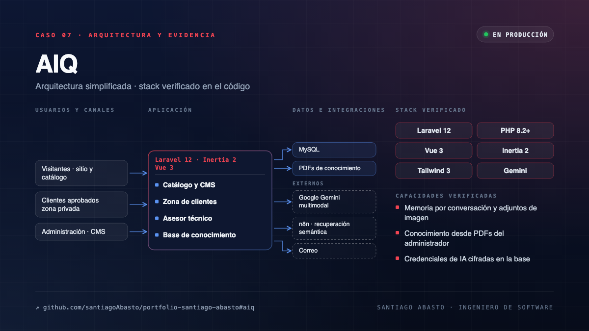


AIQ trabaja en el rubro plástico: masterbatches, bobinas y termoformados. Sus clientes consultan por procesos, aplicaciones y requisitos técnicos, y esas respuestas dependían de que un asesor estuviera disponible. Al mismo tiempo, el sitio institucional y el catálogo necesitaban actualizarse sin tocar las vistas, y la documentación técnica interna (fichas, hojas de seguridad, certificados) no debía circular sin control.


| Capa | Tecnología | Versión |
|---|---|---|
| Backend | PHP · Laravel · Sanctum · Breeze | ^8.2 · 12.55.1 · 4.3.1 · 2.4.1 |
| Importación | Laravel Excel · PhpSpreadsheet | 4.0.2 · 5.9.0 |
| Frontend | Blade · Vue · @inertiajs/vue3 · Inertia Laravel · Tailwind CSS · Axios | 3.4.30 · 1.2.0 · 2.0.22 · 3.4.4 · 1.7.2 |
| Build | Vite | 5.3.2 |
| Datos | MySQL (SQLite en memoria para pruebas) | — |
| IA | Google Gemini (modelo por `GEMINI_MODEL`) · webhooks de n8n | — |
| Calidad | PHPUnit · Laravel Pint | 11.5.55 · 1.29.0 |


Un monolito Laravel que reúne el sitio público, un CMS completo y una **zona privada de clientes** con un **asesor técnico** que conserva cada conversación, acepta fotos y responde a partir de la base de conocimiento de AIQ.

| Rol | Qué hace |
|---|---|
| **Visitante** | Recorre el catálogo, busca productos, lee novedades, pide presupuesto y se suscribe al newsletter |
| **Cliente** | Se registra (queda pendiente de aprobación), entra a la zona privada y conversa con el asesor |
| **Personal interno** | Gestiona contenido, catálogo, medios, metadatos, mensajes y suscriptores |
| **Administrador** | Aprueba clientes y su vigencia, importa contactos, carga PDFs de conocimiento y configura las integraciones de IA |


- **Participación:** desarrollo integral; único autor en el historial de git.
- **Producción:** sitio en [aiq.com.ar](https://aiq.com.ar/); el asesor con IA funciona en la zona privada de clientes (`/zona-clientes`, con usuario), verificado el 16-11-2026.
- **Código:** [público en GitHub](https://github.com/santiagoAbasto/AIQ).

<details>
<summary> <b>Ver 4 diagramas y flujos</b></summary>
<br>

```mermaid
flowchart TB
    subgraph usuarios["Usuarios"]
        VIS(["Visitante"])
        CLI(["Cliente"])
        ADM(["Personal y administrador"])
    end
    subgraph app["Laravel 12"]
        WEB["Sitio público<br/>Blade"]
        ZONA["Zona de clientes<br/>guard logincliente"]
        PANEL["Panel admin<br/>Blade + Vue/Inertia"]
        ASE["ClienteDashboardController<br/>asesor"]
        CFG["AiIntegrationSetting<br/>valores cifrados"]
        CB["Callback de conocimiento<br/>token con hash_equals"]
    end
    subgraph externos["Servicios externos"]
        N8N["n8n<br/>webhooks"]
        VEC[("Almacén vectorial<br/>externo")]
        GEM["Google Gemini<br/>API multimodal"]
        MAIL["Correo<br/>mailer de Laravel"]
    end
    DB[("MySQL")]
    DISK[("Disco public<br/>adjuntos y PDFs")]

    VIS --> WEB
    CLI --> ZONA
    ADM --> PANEL
    ZONA --> ASE
    ASE --> CFG
    ASE -->|"con webhook"| N8N
    ASE -->|"sin webhook"| GEM
    N8N --> VEC
    PANEL -->|"PDF de conocimiento"| N8N
    N8N -->|"estado del documento"| CB
    WEB --> MAIL
    WEB --> DB
    ZONA --> DB
    PANEL --> DB
    ASE --> DISK
    PANEL --> DISK
```

**Una consulta al asesor**

```mermaid
sequenceDiagram
    autonumber
    participant C as Cliente
    participant L as Laravel
    participant DB as MySQL
    participant N as n8n
    participant G as Gemini
    C->>L: consulta y foto opcional
    L->>L: acceso habilitado y vigente, imagen válida
    L->>DB: guarda el mensaje del cliente en el hilo
    L->>DB: lee hasta 60 mensajes de historial
    alt pide un documento interno
        L-->>C: respuesta fija, sin entregar el documento
    else hay webhook de n8n
        L->>N: consulta, historial, contexto, instrucciones e imagen
        N-->>L: respuesta en JSON
    else hay clave de Gemini
        L->>G: consulta multimodal directa
        G-->>L: respuesta
    else sin configuración
        L-->>C: aviso de configuración pendiente
    end
    L->>DB: guarda solicitud y respuesta con su estado
    L-->>C: respuesta del asesor
```

**Documento de la base de conocimiento**

```mermaid
stateDiagram-v2
    [*] --> uploaded: el administrador sube el PDF
    uploaded --> processing: se notifica al webhook de n8n
    uploaded --> error: el webhook falla
    processing --> ready: callback ready, completed o indexed
    processing --> error: callback error o failed
    ready --> [*]
    error --> [*]
```

**Documento de la base de conocimiento**

```mermaid
erDiagram
    CATEGORIAS ||--o{ SUBCATEGORIAS : agrupa
    PRODUCTOS ||--o{ RELACION_PRODUCTOS : clasifica
    CATEGORIAS ||--o{ RELACION_PRODUCTOS : incluye
    SUBCATEGORIAS ||--o{ RELACION_PRODUCTOS : incluye
    PRODUCTOS ||--o{ PRELACIONES : relaciona
    CARACTERISTICAS ||--o{ PRODUCTOS : describe
    LOGINCLIENTES ||--o{ CLIENTE_IMPORTADOS : importa
    LOGINCLIENTES ||--o{ CLIENTE_AI_CHATS : conversa
    LOGINCLIENTES ||--o{ CLIENTE_AI_REQUESTS : solicita
    CLIENTE_AI_CHATS ||--o{ CLIENTE_AI_CHAT_MESSAGES : contiene
    CLIENTE_AI_REQUESTS ||--o| CLIENTE_AI_CHAT_MESSAGES : responde
    USERS ||--o{ AI_KNOWLEDGE_DOCUMENTS : sube
    USERS ||--o{ AI_INTEGRATION_SETTINGS : actualiza
    PRODUCTOS {
        bigint id
        string titulo
        string slug
        string pdf
        json galeria
    }
    LOGINCLIENTES {
        bigint id
        string email
        string company
        boolean is_enabled
        boolean access_unlimited
        timestamp access_expires_at
    }
    CLIENTE_AI_CHAT_MESSAGES {
        bigint id
        string role
        string status
        string attachment_path
    }
    AI_KNOWLEDGE_DOCUMENTS {
        bigint id
        string assistant_type
        string status
        string n8n_document_id
    }
    AI_INTEGRATION_SETTINGS {
        bigint id
        string setting_key
        boolean is_secret
    }
```

</details>

[↑ Volver al índice](#indice)

---

<a name="melectric-ia"></a>
### 33. Melectric IA
> Plataforma técnico-comercial para MElectric: catálogo con procedencia y asistente que responde solo con evidencia.


El catálogo técnico de MElectric (productos eléctricos B2B) vive repartido en tres fuentes: un Excel con la lista de productos, PDF de fichas técnicas y el sitio público. Los valores no siempre coinciden entre ellas. Un caso real documentado: el Excel indica 17 A en AC-3 para el DILM17 y el catálogo, en su página 3, indica 18 A.

Cuando un cliente pregunta por una referencia, un asistente que completa huecos con suposiciones es peligroso en este rubro. El repositorio está diseñado alrededor de tres riesgos concretos:

- **Cifras inventadas**: un valor de corriente, tensión o potencia que no está en la fuente.
- **Compatibilidades no verificadas**: afirmar que un relé o accesorio sirve para un contactor solo porque una frase del catálogo lo menciona.
- **Decisiones de cálculo**: kVAR, cortocircuito, selectividad o caída de tensión que requieren un ingeniero, no un chat.


| Capa | Tecnología | Versión |
|---|---|---|
| Lenguaje backend | PHP | `^8.3` (composer.json) |
| Framework | Laravel | `^13.17` |
| Puente SPA | Inertia (`inertiajs/inertia-laravel`) | `^3.3` |
| Interfaz | React · TypeScript | `^19.3.1` · `^7.0.2` |
| Adaptador Inertia (React) | `@inertiajs/react` | `^3.11.0` |
| Estilos | Tailwind CSS | `^4.0.0` |
| Build | Vite | `^8.0.0` |
| Íconos | lucide-react | `^1.70.0` |
| IA | Anthropic SDK (`anthropic-ai/sdk`) · Ollama (embeddings locales) | `^1.3` · configurable |
| Hojas de cálculo | PhpSpreadsheet | `^5.11` |
| Datos | MySQL (producción y desarrollo) · SQLite en memoria (pruebas) | 8+ |
| Pruebas PHP | Pest · PHPUnit | `^4.0` · `^12.5.12` |
| Pruebas front | Vitest · Testing Library · Playwright | `^5.1` · `^16.3.3` · `^1.65.0` |
| Herramientas PDF | poppler-utils (`pdftotext`, `pdfinfo`) | del sistema |
| Sincronizador web | Python 3 (biblioteca estándar) | del sistema |
| OCR | Framework Vision de macOS (binario Swift) | solo macOS |


MElectric IA es un monolito que ingiere las fuentes autorizadas con su procedencia, normaliza los datos a unidades canónicas y responde con un asistente que **solo afirma lo que tiene como evidencia**. Cuando no la tiene, se abstiene, pregunta o deriva a una persona.

Quién lo usa:

- **Cliente final**: chat público sin cuenta en `/chat`, con respuestas citadas a la fila del Excel o a la página del PDF.
- **Operadores (ventas, soporte)**: bandeja en `/inbox` para seguir conversaciones, tomar el control y responder.
- **Ingeniería**: aprueba las respuestas técnicas con confianza baja antes de que lleguen al cliente, y revisa conflictos y relaciones.
- **Administración y conocimiento**: catálogo, documentos, notas internas, base de conocimiento y Centro de IA (prompts, reglas, trazas y evaluaciones).

Los permisos son de nueve roles con dieciséis permisos (`App\Enums\Role`), verificados en cada ruta con middleware `can:`.

<details>
<summary> <b>Ver 4 diagramas y flujos</b></summary>
<br>

```mermaid
flowchart LR
  CL["Cliente (chat web)"] --> RT["Rutas web (routes/web.php)"]
  OP["Operador (bandeja y Centro de IA)"] --> RT
  RT --> CV["Conversation (modos y derivaciones)"]
  CV --> AI["AI (orquestador, reglas y herramientas)"]
  AI --> SE["Search (parser, productos y conocimiento)"]
  AI --> PV["Proveedores (Anthropic, Ollama)"]
  CA["Catalog (importador y normalizador)"] --> DB[("MySQL")]
  DO["Documents (pipeline PDF)"] --> DB
  SE --> DB
  SR["Sources (conector público con robots)"] --> PY["scraper/melectric_sync.py"]
  PY --> DO
```

```mermaid
sequenceDiagram
  participant Cl as Cliente
  participant Ch as Chat web
  participant Cv as ConversationService
  participant Qp as ElectricalQueryParser
  participant Se as ProductSearchService
  participant Or as AIOrchestrator
  participant Gu as NumericGroundingGuard
  Cl->>Ch: Escribe su consulta
  Ch->>Cv: Guarda el mensaje y revisa el modo
  Cv->>Qp: Extrae tipo, valores y referencias
  Qp->>Se: Busca en orden exacta, normalizada, serie, estructurada y texto
  Se->>Or: Productos y evidencia
  Or->>Or: Arma borrador determinista con citas
  opt Hay redactor LLM aprobado
    Or->>Gu: Texto redactado
    Gu-->>Or: Aprobado o descartado
  end
  Or-->>Ch: Respuesta, abstención o derivación
  Ch-->>Cl: Muestra la respuesta
```

```mermaid
sequenceDiagram
  participant Ad as Administrador
  participant Im as CatalogImporter
  participant Dc as DocumentIngestionService
  participant DB as MySQL
  Ad->>Im: melectric:import-catalog (Excel B2B)
  Im->>DB: Productos y especificaciones con procedencia
  Ad->>Dc: melectric:ingest-documents (PDF)
  Dc->>DB: Páginas, tablas, referencias y fragmentos
  Dc->>DB: Conflictos cuando dos fuentes dan valores distintos
```

```mermaid
erDiagram
  SOURCES ||--o{ SOURCE_RECORDS : contiene
  SOURCES ||--o{ DOCUMENTS : origina
  BRANDS ||--o{ PRODUCTS : marca
  PRODUCT_FAMILIES ||--o{ PRODUCTS : agrupa
  SOURCE_RECORDS ||--o{ PRODUCTS : respalda
  PRODUCTS ||--o{ PRODUCT_SPECIFICATIONS : especifica
  SPECIFICATION_DEFINITIONS ||--o{ PRODUCT_SPECIFICATIONS : define
  PRODUCTS ||--o{ PRODUCT_RELATIONSHIPS : relaciona
  DOCUMENTS ||--o{ DOCUMENT_PAGES : paginas
  DOCUMENTS ||--o{ DOCUMENT_TABLES : tablas
  DOCUMENTS ||--o{ DOCUMENT_CHUNKS : fragmentos
  DOCUMENT_CHUNKS ||--o| CHUNK_EMBEDDINGS : vector
  PRODUCTS ||--o{ KNOWLEDGE_CONFLICTS : conflicto
  CUSTOMERS ||--o{ CONVERSATIONS : abre
  CONVERSATIONS ||--o{ MESSAGES : tiene
  CONVERSATIONS ||--o{ AI_RUNS : traza
  AI_RUNS ||--o{ AI_FEEDBACK : recibe
  PROMPT_DEFINITIONS ||--o{ PROMPT_VERSIONS : versiona
  USERS ||--o{ AUDIT_LOGS : registra
```

</details>

[↑ Volver al índice](#indice)

---

<a name="x-urban-ia"></a>
### 34. X-Urban IA
> Plataforma de inteligencia de producto y documentos para X-URBAN: el catálogo es la fuente de verdad y la IA razona sobre él, con trazabilidad y reglas de seguridad.


X-URBAN vende equipos de trabajo en altura, izaje y sujeción de cargas: eslingas, arneses, cintas, herrajes. Cada producto se identifica por un código que codifica capacidad y longitud, y un error de selección puede dejar una carga sin la capacidad necesaria.

Los datos están en catálogos PDF de 2026 (ALTURA, IZAJE y SUJECIÓN, con 52 páginas en total) y en el sitio público. Según `docs/xurban-source-inventory.md`, la importación dio 570 productos, 452 especificaciones y 116 celdas de matriz de carga por longitud. Un asistente conversacional que adivine capacidades, certificaciones o compatibilidades pondría en riesgo a quien usa el equipo.


| Capa | Tecnología | Versión |
|---|---|---|
| Lenguaje | PHP | `^8.3` en composer.json; 8.5 en la documentación |
| Framework | Laravel | `^13.0` en composer.json; 13.34 en `docs/architecture.md` |
| Puente SPA | Inertia (`inertiajs/inertia-laravel`) | `^3.0` |
| Interfaz | React · TypeScript | `^19.0.0` · `^5.7.2` |
| Adaptador Inertia (React) | `@inertiajs/react` | `^2.0.0` (ver nota de stack) |
| Estilos | Tailwind CSS | `^4.0.0` |
| Build | Vite · `laravel-vite-plugin` | `^6.0` · `^1.0` |
| Base de datos | MySQL | 9.6 (documentación) |
| Colas, caché y sesión | driver `database` | Redis opcional, no instalado |
| Pruebas | Pest | `^4.7` |
| IA | Proveedores Anthropic, Ollama y OpenAI (configurables) | por variable de entorno |
| OCR | Tesseract | no instalado; pendiente de la Fase 8 |


Una plataforma que separa los datos de la conversación. El catálogo estructurado (productos, especificaciones, matrices y procedencia) es la fuente de verdad. Las consultas se resuelven primero con búsqueda estructurada: por código exacto, por capacidad y longitud, o por texto. Cuando la evidencia no alcanza para una selección segura, el sistema se abstiene, pide datos faltantes o deriva a una persona.

Quién lo usa:

- **Cliente o usuario final**: consultor público en `/` con búsqueda por código, categoría y ficha de producto.
- **Equipo interno**: panel con fuentes (subida de catálogos, mapeo de tablas y sincronización web), control de IA, prompts y guía, tras iniciar sesión.

<details>
<summary> <b>Ver 4 diagramas y flujos</b></summary>
<br>

```mermaid
flowchart LR
  FU["Fuentes (catálogos PDF y sitio web)"] --> IN["Ingesta (CatalogTextParser, TabularReader)"]
  IN --> DB[("MySQL: productos, specs, matrices")]
  IN --> KD["Documentos con hash y versión"]
  CO["Consultor público"] --> SE["StructuredProductSearch"]
  SE --> DB
  SE --> RU["Reglas y confianza (RuleEngine, ConfidenceService)"]
  RU --> AI["AIOrchestrator y ModelRouter (pendiente)"]
  AI --> PV["Proveedores configurables (Anthropic, Ollama, OpenAI)"]
  RU --> CO
  AI --> CO
  AD["Panel interno"] --> IN
  AD --> AI
```

```mermaid
sequenceDiagram
  participant Us as Usuario
  participant Co as Consultor
  participant Se as StructuredProductSearch
  participant Mx as product_matrix_entries
  Us->>Co: "eslinga 2000 kg 4 metros"
  Co->>Se: Consulta normalizada (capacidad, longitud)
  Se->>Mx: Busca la celda de la matriz de la familia
  alt Hay una fila exacta
    Mx-->>Se: Código del producto
    Se-->>Co: Producto con procedencia (documento y página)
    Co-->>Us: Ficha con la fuente
  else No hay fila exacta
    Se-->>Co: Sin resultado seguro
    Co-->>Us: Se abstiene y pide datos o deriva a una persona
  end
```

```mermaid
stateDiagram-v2
  [*] --> Activo: importado con procedencia
  Activo --> Faltante: desaparece de la fuente (source_status=missing)
  Activo --> EnRevision: dato no extraíble con confianza (needs_review)
  EnRevision --> Activo: revisado por una persona
  Faltante --> Activo: vuelve a aparecer en la fuente
```

```mermaid
erDiagram
  CATEGORIES ||--o{ PRODUCT_FAMILIES : agrupa
  PRODUCT_FAMILIES ||--o{ PRODUCTS : contiene
  PRODUCTS ||--o{ PRODUCT_SPECIFICATIONS : especifica
  SPECIFICATION_DEFINITIONS ||--o{ PRODUCT_SPECIFICATIONS : define
  PRODUCTS ||--o{ PRODUCT_ALIASES : tiene
  PRODUCTS ||--o{ PRODUCT_IMAGES : muestra
  PRODUCTS ||--o{ PRODUCT_RELATIONSHIPS : relaciona
  PRODUCT_FAMILIES ||--o{ PRODUCT_MATRICES : tabula
  PRODUCT_MATRICES ||--o{ PRODUCT_MATRIX_ENTRIES : celdas
  KNOWLEDGE_SOURCES ||--o{ KNOWLEDGE_DOCUMENTS : origina
  KNOWLEDGE_DOCUMENTS ||--o{ PRODUCT_DOCUMENTS : respalda
  PRODUCTS ||--o{ PRODUCT_DOCUMENTS : documentado_en
```

</details>

[↑ Volver al índice](#indice)

---

<a name="carlos-bolsa-de-valores"></a>
### 35. Carlos — Bolsa de Valores
> Carpeta de trabajo de investigación financiera: una plataforma de riesgo en desarrollo, dos estudios de estrategias y un prototipo de reportes por ticker.


Evaluar una acción con criterio institucional —estados financieros, ratios, márgenes y una tesis clara de asignación de capital— es lento y disperso de hacer a mano.


Python · APIs de datos financieros · LLM (Gemini / Anthropic) · dashboards HTML/CSS · motor 'sentinel-engine' (Next.js en el frontend).


Un motor que reúne los datos financieros de una empresa, calcula indicadores (Altman Z, capital de trabajo, etc.) y arma con un LLM una tesis de inversión razonada, con dashboards por caso (MCD, NVO, UBER).

<details>
<summary> <b>Ver 1 diagramas y flujos</b></summary>
<br>

```mermaid
flowchart LR
    PR["stock-research-prompt<br/>prompt de X"] --> V1["Carlos v1 _DE X<br/>protocolo mejorado"]
    PR --> SP["Carlos v1 _DE X - solo prompt<br/>grupo de control"]
    V1 ---|"mismos datos y motor"| SP
    INV["investigate.py<br/>prototipo de reportes"] --> MD["*_Institutional_Analysis.md<br/>UBER_dashboard.html"]
    INV -.->|"idea previa"| SEN["sentinel-engine<br/>plataforma de riesgo"]
```

</details>

[↑ Volver al índice](#indice)

---

<a name="burrow-prospect"></a><a name="burrow-prospects"></a>
### 36. Burrow Prospect
> de la ficha de Google a la reunión

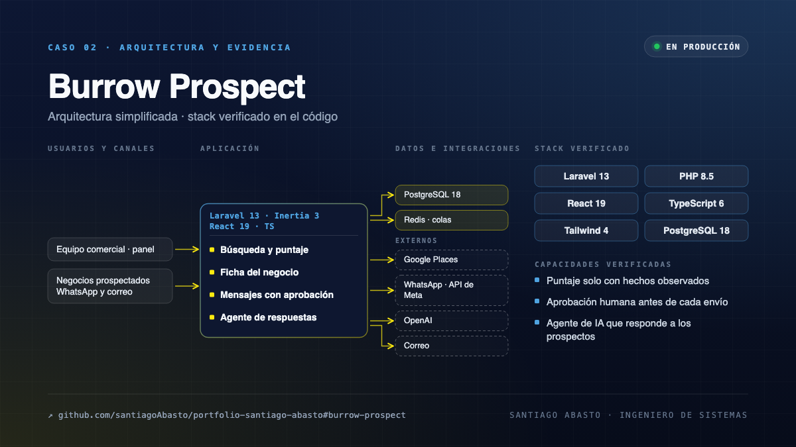


Conseguir clientes para un estudio de software pequeño obliga a buscar negocios, decidir a quién escribir, cuidar lo que se les dice y no volver a escribir a quien pidió que no. Hecho a mano, ese trabajo no deja historial ni reglas. Además, WhatsApp tiene reglas propias que un envío mal hecho rompe: plantillas aprobadas por Meta, bajas, topes diarios y números que no tienen WhatsApp, como los fijos.


| Capa | Tecnología | Versión |
|---|---|---|
| Backend | PHP · Laravel | PHP 8.5 (CI e imagen; `composer.json` pide `^8.3`) · Laravel 13.37 |
| Web | Inertia · React · TypeScript | `@inertiajs/react` 3.9.1 y `inertiajs/inertia-laravel` 3.5.1 · React 19.3.1 · TypeScript 6.0.3 |
| Interfaz | Vite · Tailwind CSS | Vite 8.3.4 · Tailwind CSS 4.3.3 · Radix UI, Headless UI, lucide-react y Phosphor |
| Datos | PostgreSQL · SQLite | PostgreSQL 18 en producción · SQLite en local, CI y pruebas |
| Tareas | Colas en base de datos · Scheduler | colas `default` y `contactos` (`queue:work` y `schedule:work`) |
| Integraciones | WhatsApp Cloud API · Google Places API (New) · OpenAI o Anthropic · SMTP | Graph API según `WHATSAPP_GRAPH_VERSION` · proveedor de IA según `AI_PROVIDER` |
| Contenedores | Docker · Docker Compose · Caddy | imagen `serversideup/php:8.5-fpm-nginx` · Node 26 para compilar · Caddy compartido del servidor |
| Calidad | PHPUnit · Laravel Pint · ESLint · Prettier | PHPUnit 13.4.3 · ESLint 9 · Prettier 3 |
| Marca | Archivo · JetBrains Mono | `@fontsource-variable` |


Burrow Prospect lleva la prospección de punta a punta en un solo sistema:

- **Busca** negocios en Google Places por ciudad y rubro, y los **puntúa** solo con hechos observados.
- **Arma la ficha**: auditoría web, análisis de zona, lectura de IA y los datos del negocio.
- **Prepara** los mensajes para aprobación humana y los envía por WhatsApp (API oficial de Meta) o por correo.
- **Responde** con un agente de IA que solo usa lo escrito: si le falta un dato, deriva a una persona.
- **Muestra** una demo que funciona con los datos del negocio y lleva la conversación a una reunión.

Todo cambio de estado, mensaje y envío queda en el historial de la ficha. Lo usa el equipo de Burrow Labs; el dueño aprueba cada lote y fija la lista de precios que el agente puede citar. Los textos van en español de Bolivia y la zona horaria es `America/La_Paz`.


- **Participación:** desarrollo integral; producto propio de Burrow Labs, único autor en el historial de git (84 commits).
- **Producción:** aplicación en [prospect.burrowlabs.com.bo](https://prospect.burrowlabs.com.bo/login) (acceso con usuario) y caso público en [burrowlabs.com.bo](https://burrowlabs.com.bo/proyectos/burrow-prospect).
- **Código:** privado.

<details>
<summary> <b>Ver 5 diagramas y flujos</b></summary>
<br>

**Acceso e integración**

```mermaid
flowchart LR
  U["Dueño<br/>navegador o celular"] -->|HTTPS| C["Caddy compartido<br/>prospect.burrowlabs.com.bo"]
  C --> APP["app<br/>Laravel 13 · Inertia · React"]
  APP --> DB[("PostgreSQL 18")]
  APP -->|encola| Q[("cola en la base<br/>default · contactos")]
  Q --> W["worker<br/>agente · lotes · envíos · correo"]
  W --> DB
  S["scheduler<br/>schedule:work"] --> Q
  S <-->|"token compartido"| BL["burrowlabs.com.bo"]
  M["Meta<br/>WhatsApp Cloud API"] -->|"webhooks firmados"| APP
  W -->|"plantillas y mensajes"| M
  W --> AI["OpenAI o Anthropic<br/>borradores · agente · audios"]
  APP --> GP["Google Places<br/>búsqueda y ficha"]
  W --> SMTP["Correo SMTP"]
  W --> VOL[("volumen<br/>archivos de WhatsApp")]
  APP --> VOL
  DB -.->|"respaldo diario"| BK[("shared/backups")]
```

**Ciclo de un prospecto**

```mermaid
stateDiagram-v2
  direction LR
  [*] --> descubierto: búsqueda o barrido
  descubierto --> evaluado: score con hechos
  evaluado --> priorizado
  priorizado --> contactado: llamada o plantilla enviada
  contactado --> respondio: escribió una persona
  respondio --> interesado: pidió demo, reunión o llenó la ficha
  interesado --> reunion: día y hora apuntados
  reunion --> propuesta: propuesta enviada
  propuesta --> ganado: propuesta aceptada
  propuesta --> negociacion
  negociacion --> ganado
  negociacion --> perdido
  contactado --> perdido: no le interesa
  descubierto --> no_contactar: baja por número
  contactado --> no_contactar
  respondio --> no_contactar
  ganado --> [*]
```

**Mensaje entrante y agente de IA**

```mermaid
sequenceDiagram
  autonumber
  participant N as Negocio
  participant W as Webhook de Meta
  participant F as Filtros
  participant A as Agente de IA
  participant D as Dueño
  N->>W: mensaje entrante con firma válida
  W->>F: ¿es respuesta automática, baja o una persona?
  alt respuesta automática del negocio
    F-->>W: se guarda como auto y no cuenta como respondió
    W->>N: reenvío de nuestra plantilla a los 90 s, una vez
  else pide la baja
    F-->>W: baja en todos los canales, por número
  else escribió una persona
    F->>A: conversación, ficha y base de conocimiento
    A->>A: decide si responde, deriva, detecta asistente, despide o agenda
    alt tiene lo que necesita
      A->>N: respuesta corta, con botones si corresponde
    else falta un dato o pide una persona
      A->>N: mensaje cordial fijo
      A->>D: aviso con el motivo
    end
  end
```

**Lote del autopiloto**

```mermaid
flowchart LR
  C["Candidatos<br/>con celular y sin baja"] --> D["Borradores<br/>uno por negocio"]
  D --> A{"Aprobación<br/>del dueño"}
  A -->|aprobado| Q["Cola con ritmo<br/>SendCampaignItem"]
  A -->|cancelado| L["Negocios liberados"]
  Q --> T{"Tope diario<br/>y horario"}
  T -->|dentro| M["WhatsApp<br/>plantilla aprobada por Meta"]
  T -->|fuera| F["Fila para el día siguiente"]
  M --> E{"Entregado"}
  E -->|sin WhatsApp| R["Vuelve a Llamadas"]
  E -->|otro fallo| S["Vuelve a un lote a los 7 días, una vez"]
```

**Lote del autopiloto**

```mermaid
erDiagram
    USER ||--o{ PROSPECT : "carga"
    USER ||--o{ CAMPAIGN : "crea"
    USER ||--o{ WHATSAPP_TEMPLATE : "crea"
    PROSPECT ||--o{ MESSAGE : "conversación"
    PROSPECT ||--o{ MESSAGE_DRAFT : "borradores"
    PROSPECT ||--o{ APPOINTMENT : "reuniones"
    PROSPECT ||--o{ PROPOSAL : "propuestas"
    PROSPECT ||--o{ WEBSITE_AUDIT : "auditorías"
    PROSPECT ||--o{ PROSPECT_ACTIVITY : "historial"
    PROSPECT |o--o{ CLIENT_RECORD : "consultas de burrowlabs.com.bo"
    CAMPAIGN |o--o{ MESSAGE_DRAFT : "lote"

    PROSPECT {
        bigint id PK
        string name
        string status
        string phone_e164
        string country
        string demo_code
        timestamp opted_out_at
    }
    MESSAGE {
        bigint id PK
        bigint prospect_id FK
        string direction
        string kind
        string channel
        text body
    }
    MESSAGE_DRAFT {
        bigint id PK
        bigint prospect_id FK
        bigint campaign_id FK
        string status
        string channel
        text body
    }
    CAMPAIGN {
        bigint id PK
        bigint user_id FK
        string channel
        string status
        timestamp scheduled_at
    }
    APPOINTMENT {
        bigint id PK
        bigint prospect_id FK
        datetime starts_at
        string status
    }
    WHATSAPP_TEMPLATE {
        bigint id PK
        bigint user_id FK
        string name
        string language
        string status
        text body
    }
    CLIENT_RECORD {
        bigint id PK
        bigint prospect_id FK
        string kind
        json data
    }
```

</details>

[↑ Volver al índice](#indice)

---

<a name="commerce-intelligence"></a>
### 37. Commerce Intelligence
> La IA interpreta y recomienda; nunca origina una cifra financiera.


Elegir qué producto importar y vender en Mercado Libre suele decidirse con una planilla: precios de proveedor en una moneda, comisiones en otra, tipo de cambio de memoria y márgenes que cambian cada vez que alguien toca una celda. Con un operador en Bolivia (BOB) vendiendo a Argentina (ARS, alta inflación) y reportando en USD, un redondeo o una tasa vieja alcanzan para «aprobar» un producto que pierde plata. Y si un modelo de IA mete una cifra inventada, nadie se entera.


| Capa | Tecnología | Versión |
|---|---|---|
| Backend | PHP · Laravel · Inertia Laravel · Ziggy | 8.5.5 (requiere 8.4+ con `bcmath`) · 13.25.0 · 3.3.1 · 2.6.3 |
| Frontend | React · TypeScript · @inertiajs/react · Tailwind CSS (`@tailwindcss/vite`) | 19.2.8 · 6.0.3 · 2.3.27 · 4.3.3 |
| Build | Vite · Node · npm | 8.2.1 · 24 · 11 |
| Datos | MySQL · Redis opcional | 9.6.0 |
| IA | Interfaz `AIProviderInterface` preparada; ningún proveedor conectado | — |
| Calidad | Pest · Vitest · ESLint · Pint | 5.1.1 · 4.1.10 · 10.8 · 1.30 |


Un monolito modular donde **cada importe sale de un motor determinístico** con su origen trazado (provenance), los resultados quedan **congelados** y la decisión final es siempre de una persona.

- Objetivos de negocio editables desde la aplicación (por defecto USD 8.000 de facturación, USD 2.000 de beneficio y 25 % de margen al mes).
- Un **motor de decisión** recomienda `REJECT`, `HOLD`, `RESEARCH`, `SAMPLE_TEST` o `VALIDATE`; una persona aprueba o corrige.
- Un módulo de **entrada al mercado** guarda evidencia oficial, requisitos y conflictos sobre si el operador puede vender en Argentina.

Hoy la usa un solo operador autenticado; no hay roles todavía, pero toda acción pasa por una policy.

<details>
<summary> <b>Ver 5 diagramas y flujos</b></summary>
<br>

```mermaid
flowchart TB
    U(["Operador"]) --> UI["React 19 + Inertia 3<br/>dashboard, productos, proveedores, mercados"]
    UI --> HTTP["Controllers + FormRequests<br/>Policies, SecurityHeaders"]
    subgraph dominio["app/Domain (PHP puro)"]
        SH["Shared<br/>Money, Currency, ExchangeRate, Provenance"]
        PROF["Profitability<br/>LandedCost, Profit, Target, Scenario"]
        SCO["Scoring<br/>ProductScoreService"]
        MK["Markets<br/>MarketContext, ReportingConverter, MarketOpportunityScorer"]
        DEC["Decision<br/>DecisionRuleEngine, MissingDataDetector"]
        ME["MarketEntry<br/>MarketEntryDecisionEngine"]
        LIFE["Products<br/>ProductLifecycleService"]
        AUD["Audit<br/>AuditLogger"]
        AI["AI<br/>AIProviderInterface (sin conectar)"]
    end
    HTTP --> PROF
    HTTP --> SCO
    HTTP --> MK
    HTTP --> DEC
    HTTP --> ME
    HTTP --> LIFE
    PROF --> SH
    MK --> PROF
    DEC --> PROF
    LIFE --> AUD
    HTTP --> MOD["app/Models<br/>Eloquent, MoneyCast"]
    MOD --> DB[("MySQL 9.6")]
    AUD --> DB
```

**El gate de decisión**

```mermaid
sequenceDiagram
    autonumber
    actor O as Operador
    participant P as Producto
    participant C as Cotización y supply route
    participant E as Motores financieros
    participant S as Scores
    participant R as DecisionRuleEngine
    participant H as Decisión humana
    O->>P: crea el producto
    O->>C: proveedor, cotización (versionada) y ruta
    C->>E: landed cost con FX en snapshot
    E->>E: escenarios y target sobre objetivos editables
    E->>S: Product Score y Market Opportunity Score
    S->>R: datos faltantes y calidad de datos
    R->>R: economics, luego evidencia, luego resultados
    R-->>O: recomendación con razones (reglas congeladas)
    O->>H: aprueba o corrige (append-only, auditado)
```

**Recomendación del motor**

```mermaid
stateDiagram-v2
    [*] --> Economics
    Economics --> REJECT: margen medido bajo el mínimo
    Economics --> Evidencia: margen suficiente o indefinido
    Evidencia --> RESEARCH: completitud o confianza bajas
    Evidencia --> Resultados: evidencia suficiente
    Resultados --> SAMPLE_TEST: ambos scores sobre el umbral
    Resultados --> HOLD: producto razonable que no llega
    Resultados --> RESEARCH: sin señales suficientes
    state "SCALE (bloqueado)" as escalar
    Resultados --> escalar: solo con ventas y ads reales
    escalar --> VALIDATE: sin performance real se degrada
    REJECT --> [*]
    SAMPLE_TEST --> [*]
    VALIDATE --> [*]
    HOLD --> [*]
    RESEARCH --> [*]
```

**Ciclo de vida de un producto**

```mermaid
stateDiagram-v2
    [*] --> DISCOVERED
    DISCOVERED --> RESEARCHING
    RESEARCHING --> CANDIDATE
    CANDIDATE --> SAMPLE_ORDERED
    CANDIDATE --> RESEARCHING
    SAMPLE_ORDERED --> SAMPLE_RECEIVED
    SAMPLE_RECEIVED --> TESTING
    TESTING --> VALIDATED
    VALIDATED --> WINNER
    VALIDATED --> TESTING
    WINNER --> TESTING
    DISCOVERED --> REJECTED
    RESEARCHING --> REJECTED
    CANDIDATE --> REJECTED
    TESTING --> REJECTED
    REJECTED --> RESEARCHING
```

**Ciclo de vida de un producto**

```mermaid
erDiagram
    PRODUCTS ||--o{ SUPPLIER_QUOTES : recibe
    SUPPLIERS ||--o{ SUPPLIER_QUOTES : cotiza
    PRODUCTS ||--o{ SUPPLY_ROUTES : llega_por
    SUPPLIER_QUOTES ||--o{ LANDED_COST_SCENARIOS : costea
    LANDED_COST_SCENARIOS ||--o{ SCENARIOS : proyecta
    PRODUCTS ||--o{ PRODUCT_SCORES : puntua
    PRODUCTS ||--o{ PRODUCT_MARKET_ANALYSES : analiza
    MARKETS ||--o{ PRODUCT_MARKET_ANALYSES : contextualiza
    PRODUCT_MARKET_ANALYSES ||--o{ MARKET_OPPORTUNITY_SCORES : puntua
    ORGANIZATIONS ||--o{ MARKETS : opera
    MARKETS ||--o{ MARKET_CHANNELS : ofrece
    SALES_CHANNELS ||--o{ MARKET_CHANNELS : vende_en
    PRODUCTS ||--o{ PRODUCT_DECISIONS : decide
    PRODUCT_DECISIONS ||--o{ HUMAN_DECISIONS : resuelve
    MARKETS ||--o{ MARKET_ENTRY_EVIDENCE : documenta
    PRODUCTS {
        bigint id
        string name
        string status
        string currency
        bigint target_sale_price_minor
    }
    SUPPLIER_QUOTES {
        bigint id
        string currency
        bigint unit_price_minor
        int moq
        string incoterm
        string unit_price_verification_status
    }
    SCENARIOS {
        bigint id
        string scenario_type
        json fx_snapshot
        json profit_result
        bigint contribution_profit_minor
    }
    PRODUCT_SCORES {
        bigint id
        decimal score_total
        json weights_used
        string weakest_verification_status
    }
    PRODUCT_DECISIONS {
        bigint id
        string decision
        string rule_version
        json missing_data
        bigint ai_analysis_id
    }
    HUMAN_DECISIONS {
        bigint id
        string decision
        string overridden_to
        string reason
    }
```

</details>

[↑ Volver al índice](#indice)

---

<a name="cotizaflow"></a>
### 38. CotizaFlow
> Sistema operativo de cotizaciones para distribuidores y empresas B2B: clientes, productos, precios, PDF y seguimiento en un solo flujo.


En un equipo comercial B2B, una cotización sigue un recorrido que se rompe fácil: el cliente consulta, alguien busca el producto y su precio, se arma un PDF o una planilla, se envía, y después nadie vuelve a llamar. Las cotizaciones enviadas que no reciben respuesta son ventas que se pierden sin que nadie lo note. La documentación de producto apunta a ese punto como el problema visible.


Versiones tomadas de `composer.json` y `package.json`.

| Capa | Tecnología | Versión |
|---|---|---|
| Backend | PHP · Laravel | `^8.4` · `^13.17` |
| Puente SPA | Inertia Laravel · Inertia React | `^3.3` · `^3.7.0` |
| Frontend | React · TypeScript | `^19.2.8` · `^7.0.2` |
| Build y estilos | Vite · Tailwind CSS | `^8.0.0` · `^4.0.0` |
| PDF y dinero | Laravel Dompdf · brick/math | `^3.1` · `^0.18` |
| Datos | MySQL (`DB_CONNECTION=mysql` en `.env.example`) | — |
| Pruebas | Pest · Vitest · Playwright | — · `^5.0.0` · `^1.63.0` |
| Calidad | oxlint · Prettier | `^1.82.0` · `^3.9.6` |


CotizaFlow mantiene en un solo lugar los clientes, los productos, las listas de precios, las cotizaciones con su PDF y los seguimientos pendientes, con un dashboard que prioriza qué llamar hoy.

| Actor | Qué hace |
|---|---|
| **Equipo comercial** | Crea cotizaciones con precios de la lista del cliente, envía el PDF, registra la respuesta y agenda seguimientos. |
| **Administración de la empresa** | Gestiona productos, listas de precios, clientes y usuarios de su empresa. |

Cada empresa es un tenant aislado: un usuario nunca ve datos de otra empresa, aunque tenga cuenta en varias.

<details>
<summary> <b>Ver 4 diagramas y flujos</b></summary>
<br>

```mermaid
flowchart TB
    U(["Equipo comercial"]) -->|"HTTPS · Inertia + React"| R["Rutas web<br/>auth · guest"]
    R --> M["Middleware de tenant<br/>empresa activa por membresía"]
    M --> D["Dominio<br/>Quotes · Pricing · FollowUps<br/>Customers · Products · Dashboard"]
    D --> T["TenantContext<br/>global scope por company_id"]
    T --> DB[("Base de datos<br/>MySQL")]
    D --> P["PDF de cotización<br/>DomPDF"]
    D -.-> J["Cola y tareas<br/>vencimiento de cotizaciones"]
```

**Ciclo de una cotización**

```mermaid
stateDiagram-v2
    [*] --> Borrador
    Borrador --> Enviada: enviar al cliente
    Enviada --> Aceptada: el cliente acepta
    Enviada --> Rechazada: el cliente rechaza
    Enviada --> Vencida: pasa la fecha de validez
    Aceptada --> [*]
    Rechazada --> [*]
    Vencida --> [*]
```

**Emisión de una cotización**

```mermaid
sequenceDiagram
    autonumber
    participant C as Equipo comercial
    participant W as Panel (Inertia)
    participant Q as Dominio de cotizaciones
    participant P as Precios
    participant DB as Base de datos
    C->>W: elige cliente y productos
    W->>Q: vista previa
    Q->>P: precio por lista del cliente
    P-->>Q: precio resuelto por línea
    Q-->>W: totales calculados en el servidor
    C->>W: emite y envía
    W->>Q: transición borrador → enviada
    Q->>DB: guarda cotización, número y PDF
    Q-->>C: cotización enviada
```

**Emisión de una cotización**

```mermaid
erDiagram
    COMPANY ||--o{ MEMBERSHIP : tiene
    USER ||--o{ MEMBERSHIP : "pertenece por"
    COMPANY ||--o{ CUSTOMER : contiene
    COMPANY ||--o{ PRODUCT : contiene
    COMPANY ||--o{ PRICE_LIST : contiene
    PRICE_LIST ||--o{ PRODUCT_PRICE : "fija precio"
    PRODUCT ||--o{ PRODUCT_PRICE : "tiene precio"
    COMPANY ||--o{ QUOTE : emite
    CUSTOMER ||--o{ QUOTE : recibe
    QUOTE ||--o{ QUOTE_ITEM : contiene
    QUOTE ||--o{ FOLLOW_UP : genera
    COMPANY ||--o{ QUOTE_SEQUENCE : numera

    COMPANY { bigint id PK string name }
    USER { bigint id PK string email }
    MEMBERSHIP { bigint id PK string role string status }
    CUSTOMER { bigint id PK bigint company_id }
    PRODUCT { bigint id PK bigint company_id }
    PRICE_LIST { bigint id PK bigint company_id }
    PRODUCT_PRICE { bigint id PK bigint price_list_id }
    QUOTE { bigint id PK string status bigint company_id }
    QUOTE_ITEM { bigint id PK bigint quote_id }
    FOLLOW_UP { bigint id PK string status bigint quote_id }
    QUOTE_SEQUENCE { bigint id PK bigint company_id }
```

</details>

[↑ Volver al índice](#indice)

---

<a name="pruebas-de-estres"></a>
### 39. Pruebas de estrés
> Convertir «el sitio anda lento» en mediciones repetibles: latencia, disponibilidad y checks, siempre juntos.


«El sitio se cae cuando hay mucha gente» no es un diagnóstico. Sin una línea base no se sabe si el problema existía antes de la carga; sin umbrales no se sabe si una corrida «pasó»; y un p95 bajo puede esconder que el servidor estaba respondiendo errores rápidos. Hacía falta medir con el mismo método cada vez, dejar la evidencia guardada y poder comparar después de optimizar.


| Pieza | Uso |
|---|---|
| k6 | Motor de carga (versión no fijada en el repositorio) |
| JavaScript (módulos ES de k6) | Escenarios: `k6/http`, `check`, `group`, `sleep` |
| [k6-reporter](https://github.com/benc-uk/k6-reporter) | Reporte HTML, importado como módulo remoto desde GitHub |
| Grafana | Dashboard exportado de la prueba 3 (throughput, fallos, promedio y p95) |


Escenarios de **k6** escritos en JavaScript que generan concurrencia con usuarios virtuales (VUs), validan cada respuesta con `check()`, declaran objetivos de servicio con `thresholds` y guardan el resumen en JSON y un reporte HTML. El trabajo evolucionó en tres etapas:

1. **Estrés sobre Todo Colombraro**: ráfagas de hasta 300 VUs y, después, versiones `*-real.js` con cabeceras de navegador y pausas aleatorias.
2. **Navegación humana sobre WordPress** (`colombraro.com.ar`): menos intensidad, recorridos plausibles de 8 a 10 minutos.
3. **Campaña Eventium en Hostinger** (12 de junio de 2026): cuatro ejecuciones con criterios de aceptación, reportes y una auditoría pasiva de seguridad.

k6 mide el comportamiento del servidor a nivel HTTP: estos scripts **no** ejecutan un navegador ni miden Core Web Vitals. Para esa capa conviene sumar Lighthouse, WebPageTest o k6 browser.

<details>
<summary> <b>Ver 3 diagramas y flujos</b></summary>
<br>

```mermaid
flowchart LR
    DEV(["Quien prueba"]) -->|"k6 run"| K6["k6<br/>VUs + stages"]
    K6 -->|"HTTP"| SITE["Sitio objetivo<br/>Todo Colombraro, WordPress o Eventium"]
    SITE -->|"respuesta"| K6
    K6 --> CHK["check()<br/>estado, HTML, errores PHP"]
    K6 --> THR["thresholds<br/>http_req_failed, p95, checks"]
    K6 -->|"handleSummary"| HTML["Reporte HTML<br/>k6-reporter"]
    K6 -->|"handleSummary"| JSON["Resumen JSON"]
    K6 -.->|"salida configurada aparte"| GRAF["Grafana<br/>dashboard exportado"]
    REP["k6-reporter<br/>módulo remoto en GitHub"] -.->|"import"| K6
```

**Una iteración del escenario mixto Prueba 3**

```mermaid
sequenceDiagram
    autonumber
    participant VU as Usuario virtual
    participant S as Sitio en Hostinger
    VU->>S: GET home
    S-->>VU: respuesta
    VU->>VU: check: estado 200, menos de 5 s, HTML, sin error PHP
    VU->>S: GET home (revisión de cabeceras)
    S-->>VU: cabeceras
    VU->>VU: check: HSTS, nosniff, framing, Referrer-Policy, CSP, Server, X-Powered-By
    loop ocho rutas públicas (robots, sitemap, admin, login, uploads, assets, vendor, .env)
        VU->>S: GET ruta
        S-->>VU: estado
        VU->>VU: check: sin 500, sin listado de directorios, sin .env expuesto
    end
    VU->>VU: pausa y siguiente iteración
```

**Cómo se lee el resultado de una corrida**

```mermaid
flowchart TD
    R["Corrida terminada"] --> T{"¿pasan los thresholds?"}
    T -->|"no"| F["No aprobada"]
    T -->|"sí"| L{"¿latencia y disponibilidad sanas a la vez?"}
    L -->|"p95 bajo pero muchos fallos"| E["Errores rápidos: falsa buena latencia"]
    L -->|"sí"| D{"¿hay degradación visible?"}
    D -->|"sí"| A["Aprobada con presión"]
    D -->|"no"| OK["Aprobada"]
    F --> C["Desglosar códigos 4xx y 5xx y correlacionar con el servidor"]
    E --> C
```

</details>

[↑ Volver al índice](#indice)

---


<a name="web-reservas-salud-y-landing"></a>

##  Web, reservas, salud y landing

<a name="burrow-labs"></a>
### 40. Burrow Labs
> Codificando soluciones.


El estudio necesitaba una presencia propia que mostrara su trabajo con nivel y convirtiera visitas en clientes, no una plantilla más.


Next.js 16 · React 19 · TypeScript estricto · Tailwind 4 · three.js (React Three Fiber) · GSAP ScrollTrigger · PostgreSQL 18 · Drizzle ORM · Docker. 159 pruebas Vitest y 62 E2E Playwright.


Sitio en producción (burrowlabs.com.bo) con hero 3D, casos de estudio, planes, diagnóstico express, panel de administración y SEO con búsqueda asistida por IA.

<details>
<summary> <b>Ver 1 diagramas y flujos</b></summary>
<br>

**Privacidad y correo**

```mermaid
flowchart LR
    V([Visitante]) -->|HTTPS| P[Proxy HTTPS<br/>certificado automático]
    A([Administrador]) -->|/admin| P
    B([Buscadores e IA]) -->|sitemap · robots · llms.txt| P
    P --> N[Next.js 16<br/>App Router · ISR<br/>contenedor Docker]
    N --> D[(PostgreSQL 18<br/>Drizzle ORM)]
    N --> S[Almacenamiento<br/>de medios]
    N -->|SMTP| G[Google Workspace<br/>correo]
    N -.->|IndexNow| I[Bing]
    V -.->|solo con consentimiento| T[GA4 · Clarity]
```

</details>

[↑ Volver al índice](#indice)

---

<a name="ninth-group"></a>
### 41. Ninth Group
> CRM inmobiliario, sitio público y proyectos en preventa

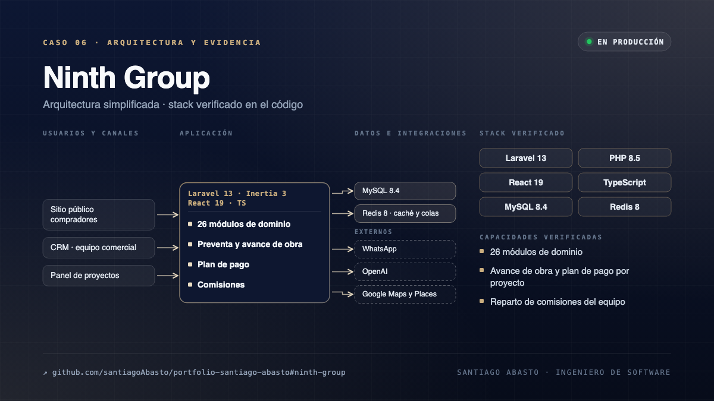


Una inmobiliaria con proyectos en preventa necesitaba unir el sitio público, el CRM, el avance de obra, los planes de pago y las comisiones del equipo en un solo sistema.


| Capa | Tecnología |
|---|---|
| Backend | PHP 8.5 · Laravel 13 |
| Frontend | React 19 · TypeScript · Inertia 3 · Tailwind 4 · Vite 8 · lucide-react |
| Datos | MySQL 8.4 (sistema de registro) · Redis 8 (caché, sesión, colas) |
| Servidor | Nginx 1.29 · PHP-FPM · worker y scheduler de Laravel |
| Contenedores | Docker Compose en desarrollo · imágenes inmutables en producción |
| Calidad | Pest · Vitest 5 · Playwright · `tsc --noEmit` |
| Integraciones | Google Maps · OpenAI y Anthropic (texto, CMA, imágenes) · correo por interfaz |


Plataforma en producción (ninthgroup.bo) con 26 módulos de dominio: sitio público, fichas de proyectos en preventa con avance de obra y plan de pago, CRM y reparto de comisiones.


- **Participación:** desarrollo integral; único autor en el historial de git (42 commits).
- **Producción:** [ninthgroup.bo](https://ninthgroup.bo/).
- **Código:** privado.

[↑ Volver al índice](#indice)

---

<a name="calendariow"></a>
### 42. CalendarioW
> La plataforma de agenda, caja y reservas para los negocios de servicios de Bolivia.

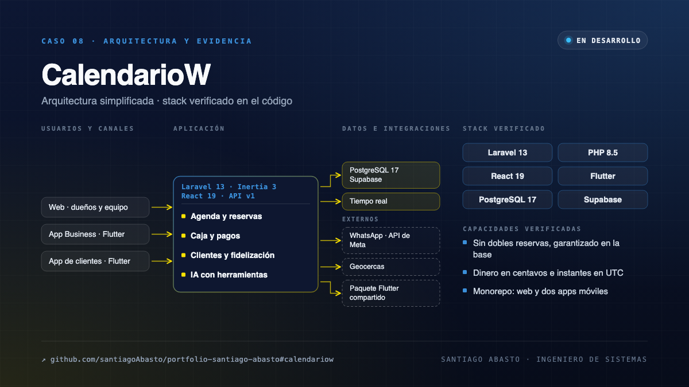


Peluquerías, spas, consultorios y veterinarias llevaban su agenda, su caja y sus reservas entre planillas y WhatsApp: dobles reservas, cobros sin control y clientes que se perdían.


Laravel 13 · PHP 8.5 · React 19 + Inertia · Tailwind 4 · Flutter 3.47 (iOS/Android) · PostgreSQL 17 · Supabase Realtime. Monorepo con 408 pruebas Pest y 93.7% de cobertura.


Una sola plataforma —agenda + caja + pagos + clientes + marketing— por web y por celular, en bolivianos y zona horaria de Bolivia, con las reglas de dinero y de reservas hechas en serio: sin dobles reservas y sin confundir un comprobante con un pago.


- **Participación:** desarrollo integral; único autor en el historial de git.
- **Estado:** en desarrollo; corre en local, sin despliegue a producción ni publicación en tiendas.
- **Código:** privado.

<details>
<summary> <b>Ver 5 diagramas y flujos</b></summary>
<br>

**Crecer y fidelizar**

```mermaid
flowchart TB
    subgraph cli["Clientes finales"]
        A1["CalendarioW<br/>app Flutter"]
        A2["Sitio público<br/>/negocios · /r/slug"]
    end
    subgraph neg["Dueños y equipo"]
        B1["CalendarioW Business<br/>app Flutter"]
        B2["Panel web<br/>Inertia + React 19"]
    end

    subgraph core["cw_core — paquete Flutter compartido"]
        C1["tokens de marca · íconos SVG<br/>cliente HTTP · formatos · prefs"]
    end

    subgraph back["Laravel 13 · backend/"]
        D1["API REST<br/>/api/v1"]
        D2["Web Inertia<br/>(panel del negocio)"]
        D3["Sitio público<br/>(marketplace + reservas)"]
    end

    subgraph data["Supabase"]
        E1[("PostgreSQL 17<br/>schema app")]
        E2(["Realtime"])
    end

    A1 --> C1
    B1 --> C1
    C1 --> D1
    A2 --> D3
    B2 --> D2
    D1 --> E1
    D2 --> E1
    D3 --> E1
    E2 -. "avisos en vivo" .-> B1

    classDef blue fill:#0A6AB5,stroke:#0B3363,color:#fff;
    classDef navy fill:#0B3363,stroke:#06182F,color:#fff;
    classDef soft fill:#E7F0F9,stroke:#0A6AB5,color:#0B3363;
    class D1,D2,D3 blue;
    class E1,E2 navy;
    class C1 soft;
```

**Anti doble reserva**

```mermaid
sequenceDiagram
    autonumber
    participant A as Cliente A
    participant B as Cliente B
    participant API as API Reservas
    participant DB as PostgreSQL
    A->>API: POST reserva 10:00 · profesional Ana
    B->>API: POST reserva 10:00 · profesional Ana
    API->>DB: BEGIN · SELECT … FOR UPDATE (Ana)
    Note over DB: fila de Ana bloqueada
    API->>DB: INSERT cita A ✓ · COMMIT
    API-->>A: 201 Reservado
    API->>DB: SELECT … FOR UPDATE (Ana) — espera…
    DB-->>API: el horario ya está tomado
    API-->>B: 409 Horario ocupado
```

**Estados de una cita independientes del pago y la asistencia**

```mermaid
stateDiagram-v2
    [*] --> Propuesta
    Propuesta --> Confirmada: cliente confirma (OTP / botón)
    Propuesta --> Cancelada
    Confirmada --> Atendida
    Confirmada --> NoVino: no-show
    Confirmada --> Cancelada: con política de cancelación
    Atendida --> [*]
    Cancelada --> [*]
    NoVino --> [*]
```

**Estados de una cita independientes del pago y la asistencia**

```mermaid
flowchart LR
    G["Geocerca del negocio<br/>native_geofence"] -->|"entra ~200 m"| CB["Callback en background"]
    CB --> CD{"¿cooldown<br/>24 h?"}
    CD -- sí --> X["nada"]
    CD -- no --> N["Notificación local"]
    N --> AP["Abre la app"]
    AP --> API["/api/v1/cliente/cercanos"]
    API --> CARD["Tarjeta con el ícono<br/>del rubro + mini-mapa"]

    classDef blue fill:#0A6AB5,stroke:#0B3363,color:#fff;
    classDef go fill:#077A43,stroke:#06241a,color:#fff;
    class G,API blue;
    class N,CARD go;
```

**Estados de una cita independientes del pago y la asistencia**

```mermaid
flowchart LR
    P["Pint<br/>(formato PHP)"] --> L["vp check<br/>(lint front)"] --> T["tsc<br/>(tipos)"] --> V["Vite<br/>(build)"] --> PE["Pest<br/>cobertura ≥ 90%"]
    F["Flutter ×3<br/>analyze + test"]

    classDef ok fill:#077A43,stroke:#06241a,color:#fff;
    classDef blue fill:#0A6AB5,stroke:#0B3363,color:#fff;
    class P,L,T,V ok;
    class PE,F blue;
```

</details>

[↑ Volver al índice](#indice)

---

<a name="vision-tours"></a>
### 43. Visión Tours


El repositorio no documenta el detalle del punto de partida del cliente. Lo que sí figura en la documentación es el objetivo: que la agencia presente sus rutas en un sitio propio, que el viajero arme su viaje en pocos pasos y que la venta se cierre por WhatsApp, con la agencia validando cupo y precio antes de cualquier cobro. Los pendientes de dominio incluyen además las redirecciones desde el sitio anterior en WordPress.


| Capa | Tecnología | Versión | Para qué |
|---|---|---|---|
| Servidor | **Laravel** | 13.40 (`composer.lock`) | Rutas, controladores, validación, CMS, correos, sesión |
| Lenguaje | **PHP** | mínimo 8.3 (`composer.json`); desarrollo con 8.5 | Aplicación |
| Vistas | **Blade** | | Páginas renderizadas en el servidor |
| Compilación | **Vite** | 8.3.6 | Empaquetado y módulos cargados bajo demanda |
| Estilos | **Tailwind CSS** | 4.3.5 | Tokens de diseño y CSS propio |
| Cliente | **TypeScript** | 7.0.2 | Buscador, calendario, panel de reserva, mapa de ruta, idioma |
| Movimiento | **anime.js** | 4.5.0 | Revelados, cadenas de entrada y scroll |
| Tipografía | Fraunces y Plus Jakarta Sans | | Con licencia libre, vía Fontsource |
| Datos | **SQLite** (local) · **MySQL** 8.4 o 9.7 (producción) | | Catálogo editable, pedidos y reservas |
| Pruebas | **Pest** 5.3.5 · **Playwright** 1.65.0 | | Backend y recorridos en navegador |
| Video | **Higgsfield** · **HyperFrames** · **ffmpeg** | | Clips generados, composición y render del hero |

Versiones de `composer.lock` y `package.json` / `node_modules`. Node: 26.7.0 según `.nvmrc`.


Un sitio en **Laravel 13** que presenta cinco rutas (**Torotoro, Chiquitania, Sajama, Salar de Uyuni y Villa Tunari**), con sus siete opciones de viaje, y permite armar el viaje: elegir programa, fecha y personas, agregarlo a la maleta y confirmar un pedido con código `VT-P-XXXXXX`.

Dos tipos de usuario:

- **Visitante**: explora destinos, arma su maleta y confirma el pedido o consulta por WhatsApp.
- **Agencia**: administra todo el contenido desde el CMS en `/admin` (destinos, departamentos, salidas, reseñas, reservas, pedidos, suscriptores y plataformas).

**Sin pasarela de pago todavía, a propósito.** El pedido queda registrado y la agencia confirma el cobro por WhatsApp y lo marca en el CMS.

### Vista previa

| Departamentos | Programas con precio por persona |
|---|---|
|  |  |
| **Ficha con panel de reserva** | **Maleta** |
|  |  |
| **Checkout** | **CMS** |
|  |  |

<details>
<summary> <b>Ver 4 diagramas y flujos</b></summary>
<br>

**Para la agencia CMS en /admin**

```mermaid
flowchart LR
  V([Visitante]) -->|HTTPS| W["Blade SSR + Vite"]
  subgraph App["Laravel 13"]
    W --> C["Catálogo<br/>destinos · departamentos · salidas"]
    W --> T["Tienda<br/>maleta · checkout · pedidos"]
    W --> M["Moneda<br/>Bs / USD"]
    A["CMS /admin"] --> C
    A --> T
  end
  C -->|"BD si hay contenido importado, si no JSON"| DB[("SQLite · MySQL")]
  T --> DB
  C -.-> J["resources/data/*.json"]
  M -->|"caché de 10 min"| X["dolarbluebolivia.click"]
  T -->|"correos"| S["SMTP de la agencia"]
  V -->|"wa.me"| WA["WhatsApp"]
  W -->|"sin cookies, al pulsar"| Y["YouTube"]
```

**Para la agencia CMS en /admin**

```mermaid
stateDiagram-v2
  [*] --> pendiente_pago: checkout crea VT-P-XXXXXX
  pendiente_pago --> pago_confirmado: la agencia confirma el cobro
  pago_confirmado --> confirmado: saldo y cupo al día
  pendiente_pago --> cancelado: sin pago
  pago_confirmado --> cancelado: el viajero desiste
```

**Para la agencia CMS en /admin**

```mermaid
stateDiagram-v2
  [*] --> nueva
  nueva --> contactada: la agencia escribe
  contactada --> confirmada
  nueva --> cancelada
  contactada --> cancelada
```

**Para la agencia CMS en /admin**

```mermaid
erDiagram
  DESTINO ||--o{ VARIANTE : "destino_id"
  DEPARTAMENTO
  PROMOCION
  RESENA
  RESERVA
  PEDIDO
  SUSCRIPTOR
  PLATAFORMA
```

</details>

[↑ Volver al índice](#indice)

---

<a name="vision-tours-2"></a>
### 44. Visión Tours 2
> Sitio y catálogo de Visión Tours Bolivia (Cochabamba): paquetes, ofertas vigentes y consultas por WhatsApp.


La oferta de la agencia está repartida entre publicaciones de WordPress, un blog espejo en Blogger y PDFs de ediciones distintas. Un mismo programa aparece con duraciones, salidas y paradas diferentes según la fecha. Por ejemplo, Chiquitania figura como 3D/1N en el título de WordPress y como 3D/2N en el texto y en el espejo. Sin un catálogo aprobado por la agencia, no hay forma segura de mostrar precios, fechas o puntos de salida.

Las URLs antiguas quedan inventariadas en `internal/sources/` para planear las redirecciones cuando la agencia confirme el dominio (`docs/fuentes.md`).


| Capa | Tecnología | Versión |
| --- | --- | --- |
| Servidor | PHP | 8.5 (`~8.5.0` en `composer.json`; verificación final con 8.5.12) |
| Framework | Laravel | 13.40.0 |
| Vistas | Blade | incluido en Laravel |
| Interactividad | React y TypeScript | React 19.3.0 · TypeScript 7.0.2 |
| Animación | GSAP y ScrollTrigger | 3.15.1 |
| Estilos | Tailwind CSS (`@tailwindcss/vite`) | 4.3.5 |
| Compilación | Vite y laravel-vite-plugin | 8.3.6 · 3.2.1 |
| Base de datos | SQLite en revisión · MySQL en preparación | MySQL 9.7.4 LTS en prueba (8.4.13 LTS como referencia) |
| Colas, sesiones y caché | Base de datos (valor por defecto) | — |
| Pruebas PHP | Pest y plugin de Laravel | 5.3.5 · 5.0.1 |
| Pruebas de navegador | Playwright | 1.65.0 |
| Formato PHP | Laravel Pint | 1.32.1 (bloqueado; `^1.27` en `composer.json`) |
| Herramientas | Node.js y npm | 26.13.0 LTS · 11.20.0 |

Las versiones están comprobadas en `docs/versiones.md` (corte del 6 de noviembre de 2026). Node se usa para compilar y para las pruebas de navegador; la aplicación corre con PHP.


Un sitio Laravel con vistas Blade y un catálogo editable en archivos JSON. Sus reglas principales:

- **Solo sale lo aprobado.** Los destinos visibles están en estado `consulta` y solo se muestran sus variantes `confirmado`. Los datos que aún no tienen aprobación quedan en `null`.
- **Las ofertas tienen vigencia en hora de Bolivia**, desde el inicio inclusive hasta el fin exclusivo.
- **La consulta por WhatsApp se arma en el servidor** con destino, variante, fecha (o flexible), viajeros y ciudad de salida. No se guarda.
- **Tres tipos de uso:** el público sin cuenta, el viajero con cuenta (pedidos y compra de prueba) y el operador de la agencia (catálogo y confirmación de cupos).

<details>
<summary> <b>Ver 5 diagramas y flujos</b></summary>
<br>

```mermaid
flowchart LR
    V(["Visitante"]) -->|"navegador"| L["Laravel 13<br/>rutas · límites · cabeceras"]
    O(["Operador"]) -->|"/administracion"| L
    L --> C["Controladores<br/>Site · Commerce · Newsletter · Account · CatalogAdmin"]
    C --> S["Servicios<br/>Commerce · Newsletter"]
    C --> K["Soporte<br/>Catalog · CatalogEditor · WhatsApp"]
    K --> J["content/*.json<br/>catálogo editorial"]
    S --> D["Base de datos<br/>SQLite en revisión · MySQL en preparación"]
    S --> Q["Cola (database)<br/>SendNewsletterConfirmation"]
    Q --> M["Correo SMTP<br/>confirmación de novedades"]
    C --> B["Vistas Blade y Vite<br/>islas React y TypeScript"]
    B -.-> W(["WhatsApp (wa.me)"])
```

**Compra de prueba con cupo**

```mermaid
sequenceDiagram
    autonumber
    participant V as Viajero
    participant L as Laravel
    participant BD as Base de datos
    participant O as Operador
    V->>L: Confirma la compra con cantidad y clave de idempotencia
    L->>BD: Transacción con bloqueo de la oferta
    BD-->>L: Pedido pendiente (pago y cupo pendientes)
    L-->>V: Redirige a Mis pedidos
    V->>L: Simula el pago
    L->>BD: Pago simulado, solo si el cupo sigue pendiente
    O->>L: Confirma el cupo
    L->>BD: Verifica el cupo restante y confirma
    BD-->>L: Cupo confirmado
    L-->>O: Muestra «Cupo confirmado» en la cola
```

**Estados del cupo**

```mermaid
stateDiagram-v2
    [*] --> Pendiente: pedido creado
    Pendiente --> Confirmado: operador confirma con pago simulado
    Pendiente --> Rechazado: operador rechaza
    Pendiente --> Cancelado: viajero cancela
    Confirmado --> [*]
    Rechazado --> [*]
    Cancelado --> [*]
```

**Alta en novedades**

```mermaid
stateDiagram-v2
    [*] --> Pendiente: alta con consentimiento
    Pendiente --> Confirmado: enlace confirmado a tiempo
    Pendiente --> Baja: enlace de baja
    Confirmado --> Baja: enlace de baja
    Baja --> Pendiente: nueva alta
```

**Alta en novedades**

```mermaid
erDiagram
    USERS ||--o{ COMMERCE_ORDERS : "compra"
    USERS |o--o{ COMMERCE_ORDERS : "revisa"
    USERS {
        bigint id PK
        string name
        string email UK
        string password
        boolean is_operator
    }
    COMMERCE_ORDERS {
        bigint id PK
        ulid public_id UK
        bigint user_id FK
        uuid idempotency_key
        string offer_key
        string variant_id
        bigint unit_price_minor
        smallint quantity
        bigint total_minor
        string payment_status
        string seat_status
        bigint reviewed_by FK
    }
    COMMERCE_OFFER_LOCKS {
        string offer_key PK
    }
    NEWSLETTER_SUBSCRIPTIONS {
        bigint id PK
        text email
        char email_digest UK
        string status
        string consent_version
        char confirmation_digest UK
        char unsubscribe_digest UK
    }
```

</details>

[↑ Volver al índice](#indice)

---

<a name="summer-s-style"></a>
### 45. Summer's Style


El salón necesitaba una web propia que mostrara su catálogo con precios confirmados y dejara reservar en horarios realmente libres, sin depender de mensajes sueltos para cada cita. Además, el equipo necesitaba una herramienta para la agenda del día, los clientes y la caja, y el dueño necesitaba cambiar textos, fotos y precios sin pedir cambios de código.


| Capa | Tecnología | Versión |
| --- | --- | --- |
| Backend | Laravel | ^13.17 (`composer.json`) |
| Backend | Inertia para Laravel | v2.0.28 (`composer.lock`) |
| Backend | PHP | 8.5 en producción; `^8.3` como mínimo en `composer.json` |
| Frontend | React y React DOM | ^19 (`package.json`) |
| Frontend | Inertia para React | ^2.0 |
| Frontend | TypeScript | ^5.8 |
| Frontend | Tailwind CSS | ^4 |
| Frontend | Vite | ^8 |
| Datos | MySQL | 8.4 (`compose.production.yml`) |
| Pruebas | PHPUnit | ^12.5 (lock 12.5.38) |
| Pruebas | Playwright | ^1.56 |
| Calidad | Laravel Pint | ^1.27 |
| Servidor | Docker Compose: `db`, `app`, `web` (Nginx) y `scheduler` | según `compose.production.yml` |
| Borde | Cloudflare (DNS, proxy y Turnstile) y Caddy compartido | según `docs/DEPLOYMENT.md` |
| Marca | Parlour Sans (títulos) y DM Sans (lectura) | según `DESIGN.md` |


Una sola aplicación con dos caras:

- **La web pública** muestra servicios, equipo, trabajos y preguntas frecuentes, y permite reservar sin pagar ni crear una cuenta. Los horarios se calculan en el servidor.
- **El panel del equipo** maneja la agenda, los clientes, la caja, los reportes y el contenido del sitio. Cada rol ve solo lo que su permiso y su sucursal permiten.

Hay ocho roles fijos (propietario, administrador, encargado, recepcionista, cajero, profesional, editor y cliente) con 23 habilidades. El alcance por sucursal y profesional se aplica en el servidor, y el acceso administrativo puede exigir MFA.

<details>
<summary> <b>Ver 7 diagramas y flujos</b></summary>
<br>

**Cómo llegar en 3D**

```mermaid
flowchart LR
    V(["Visitantes"]):::ext
    G(["Google y Bing"]):::ext
    E(["Dueño y equipo"]):::ext
    W(["WhatsApp"]):::ext

    subgraph CF["Cloudflare"]
        DNS["DNS, proxy y Turnstile"]
    end

    subgraph VPS["Servidor (stack propio)"]
        CADDY["Caddy compartido<br/>HTTPS"]:::proxy
        NGINX["Nginx<br/>solo lectura"]:::web
        APP["Laravel 13 + Inertia<br/>React 19"]:::app
        DB[("MySQL 8.4")]:::data
        FILES[("Archivos")]:::data
        SCH["Scheduler<br/>limpieza y retenciones"]:::app
    end

    V -->|HTTPS| DNS
    G -.->|rastreo| DNS
    E -->|HTTPS + MFA| DNS
    V -.->|botón flotante| W
    DNS -->|Full strict| CADDY --> NGINX -->|FastCGI| APP
    APP --> DB
    APP --> FILES
    SCH --> DB

    classDef ext fill:#f3f0e9,stroke:#8d8a7d,color:#171916
    classDef proxy fill:#e8e4d8,stroke:#b8b29c,color:#171916
    classDef web fill:#dfe9f3,stroke:#6b8db5,color:#171916
    classDef app fill:#171916,stroke:#b8b29c,color:#f3f0e9
    classDef data fill:#e5efe2,stroke:#5f8a5a,color:#171916
```

**Reserva**

```mermaid
sequenceDiagram
    autonumber
    actor C as Cliente
    participant W as Web (React)
    participant L as Laravel
    participant M as BookingEngine
    participant B as MySQL

    C->>W: Elige servicio y día
    W->>L: GET /api/availability
    L->>M: Horarios libres
    M->>B: Jornadas, citas, retenciones y recursos
    B-->>M: Ocupación del día
    M-->>W: Horarios realmente libres
    C->>W: Elige hora y deja sus datos
    W->>L: Reserva (POST con clave de idempotencia)
    L->>M: Confirmar
    M->>B: Bloqueo sucursal → profesional → recursos
    M->>B: Revalida y guarda la cita con su snapshot
    M-->>W: Código de cita y enlace privado
    W-->>C: Confirmación
```

**Estados de una cita**

```mermaid
stateDiagram-v2
    state "Llegó" as Llego
    state "En atención" as EnAtencion
    state "No asistió" as NoAsistio
    [*] --> Pendiente
    Pendiente --> Confirmada
    Pendiente --> Cancelada
    Confirmada --> Llego
    Confirmada --> EnAtencion
    Confirmada --> NoAsistio
    Confirmada --> Cancelada
    Llego --> EnAtencion
    Llego --> NoAsistio
    Llego --> Cancelada
    EnAtencion --> Completada
    Completada --> [*]
    Cancelada --> [*]
    NoAsistio --> [*]
```

**Del panel a la web**

```mermaid
flowchart LR
    A["Panel<br/>Web y contenido"] -->|guardar| B{"Validar<br/>sin HTML, enlaces seguros"}
    B -->|válido| C[("settings.content")]
    B -->|inválido| X["422: no se guarda"]
    C --> D["Contenido público<br/>vacío = texto original"]
    S["Interruptores Destacar"] --> F[("Banderas por tabla")] --> D
    WA["Pestaña WhatsApp<br/>número y mensaje"] --> C
    D -->|props Inertia| P["Páginas públicas"]
    D -->|enlace wa.me| Z["Botón flotante y botones de WhatsApp"]
    P --> V(["Visitante"])
```

**Despliegue de una versión**

```mermaid
flowchart LR
    A["Paquete<br/>lista blanca, sin secretos"] --> B["Subida<br/>SHA-256 verificado"]
    B --> C["Imágenes Docker<br/>el sitio anterior sigue"]
    C --> D{"¿Autorizado?"}
    D -->|sí| E["Respaldo<br/>base y variables"]
    E --> F["Cambio<br/>etiqueta y enlace · up -d"]
    F --> G{"¿web sana?"}
    G -->|sí| H(["En vivo"])
    G -->|no| R["Vuelve a la<br/>versión anterior"]
    D -->|no| W["Queda lista<br/>sin activar"]
```

**Video Cómo llegar**

```mermaid
flowchart LR
    A["gen.mjs<br/>voz, carteles y tiempos"] --> B["film.js<br/>Three.js: ruta, auto y cámara"]
    B -->|HyperFrames| C["Render 60 fps<br/>una pasada, supermuestreo 3×"]
    C --> D{"Control<br/>parpadeo y cuadros repetidos"}
    D -->|parpadea| B
    D -->|limpio| E["Mezcla<br/>voz, efectos CC0, música"]
    E --> F["Versión web<br/>720p y póster"]
    F --> G(["public/assets/video<br/>?v= en route-film.tsx"])
```

**Video Cómo llegar**

```mermaid
erDiagram
    BRANCHES ||--o{ PROFESSIONALS : "tiene"
    PROFESSIONALS }o--o{ SERVICES : "ofrece"
    CUSTOMERS ||--o{ BOOKINGS : "reserva"
    SERVICES ||--o{ BOOKINGS : "se reserva"
    PROFESSIONALS ||--o{ BOOKINGS : "atiende"
    BOOKINGS ||--o{ BOOKING_EVENTS : "registra"
    BOOKINGS ||--o{ PAYMENTS : "se cobra con"
    CASH_SESSIONS ||--o{ PAYMENTS : "registra"
    PAYMENTS ||--o{ REFUNDS : "se devuelve con"
```

</details>

[↑ Volver al índice](#indice)

---

<a name="sumer-style"></a>
### 46. Sumer Style
> Plataforma de marca para Summer's Style (Barber · Beauty Salon): reservas en línea con disponibilidad real, agenda, caja y sitio administrable, en una sola aplicación.


Un salón de barbería y belleza en Calacala (Cochabamba) recibe citas por WhatsApp, Facebook y en persona. Sin un sistema, la agenda vive en papel o en el celular de cada profesional, y eso provoca dobles reservas, clientes sin historial y cierres de caja que no cuadran. Quien reserva desde el móvil necesita ver horarios reales y saber que su cita quedó confirmada, sin crear una cuenta obligatoria.

El proyecto (`PRODUCT.md`) define el éxito así: una persona reserva en menos de un minuto desde el móvil, y el salón opera su día (agenda, cobros y cierre de caja) sin herramientas externas.


| Capa | Tecnología | Versión |
|---|---|---|
| Lenguaje | PHP | `^8.3` en composer.json; 8.5 en la documentación |
| Framework | Laravel | `^13.17` |
| Puente SPA | Inertia (`inertiajs/inertia-laravel`) | `^3.5` |
| Interfaz | React · TypeScript | `^19.3.0` · `^5.9.3` |
| Adaptador Inertia (React) | `@inertiajs/react` | `^3.8.0` |
| Estilos | Tailwind CSS | `^4.0.0` |
| Animación | GSAP · Three.js | `^3.15.0` · `^0.186.1` |
| Build | Vite | `^8.0.0` |
| Pruebas | Pest (PHPUnit) · Playwright | Pest con Laravel · `1.64` |
| Base de datos | MySQL | 9.6 verificado; 8.0 o superior en `INSTALL.md` |


Una aplicación de una sola marca que une el sitio público, las reservas, la agenda, el CRM, la caja y el CMS. La disponibilidad se calcula contra la base de datos con bloqueo real (`SELECT … FOR UPDATE`), así dos personas no pueden reservar el mismo horario. Las reservas no requieren cuenta: el cliente recibe un comprobante con un enlace privado para reprogramar o cancelar.

Quién lo usa:

- **Clientes**: reservan desde el móvil, consultan sus citas en el área de cliente, dejan reseñas de citas completadas y se anotan en lista de espera.
- **Equipo del salón**: propietario, administración, encargados de sucursal, recepción, caja, profesionales y editor de contenido, cada uno con su alcance (`docs/architecture/PERMISSIONS.md`).

<details>
<summary> <b>Ver 4 diagramas y flujos</b></summary>
<br>

```mermaid
flowchart LR
  CL["Cliente (móvil o escritorio)"] --> SI["Sitio público e inicio de reserva"]
  SI --> DI["Disponibilidad (Availability)"]
  DI --> DB[("MySQL: horarios, holds, citas")]
  SI --> RE["Confirmación y retención"]
  RE --> DB
  RE --> CO["Comprobante, .ics y enlace privado"]
  EQ["Equipo del salón"] --> AG["Agenda y CRM"]
  AG --> DB
  EQ --> CA["Caja y turnos"]
  CA --> DB
  EQ --> CM["CMS (páginas, promociones, legales)"]
  CM --> DB
  RE --> NO["Cola de notificaciones (correo)"]
  WA["WhatsApp (desactivado sin credenciales)"] -.-> NO
```

```mermaid
sequenceDiagram
  participant Cl as Cliente
  participant Re as Reserva
  participant Di as Disponibilidad
  participant DB as MySQL
  Cl->>Re: Elige servicio y profesional
  Re->>Di: Pide horarios del día
  Di-->>Cl: Horarios reales
  Cl->>Re: Retiene un horario
  Re->>DB: Crea hold con vencimiento de 10 minutos
  Cl->>Re: Confirma con sus datos y consentimientos
  Re->>DB: Confirma la cita de forma idempotente
  Re-->>Cl: Comprobante con enlace privado y .ics
```

```mermaid
stateDiagram-v2
  [*] --> Retenida: horario elegido
  Retenida --> Confirmada: cliente confirma
  Retenida --> Vencida: pasan 10 minutos
  Confirmada --> Reprogramada: cliente o salón reprograma
  Reprogramada --> Confirmada
  Confirmada --> Cancelada: cancelación
  Confirmada --> Completada: se atiende y se cobra
  Completada --> [*]
  Cancelada --> [*]
  Vencida --> [*]
```

```mermaid
erDiagram
  BRANCHES ||--o{ PROFESSIONALS : emplea
  BRANCHES ||--o{ RESOURCES : tiene
  CATEGORIES ||--o{ SERVICES : agrupa
  SERVICES ||--o{ SERVICE_VARIANTS : ofrece
  PROFESSIONALS ||--o{ SCHEDULES : trabaja
  PROFESSIONALS ||--o{ SCHEDULE_EXCEPTIONS : excepciones
  CUSTOMERS ||--o{ BOOKINGS : reserva
  BOOKINGS ||--o{ BOOKING_ITEMS : incluye
  BOOKINGS ||--o{ BOOKING_EVENTS : registra
  BOOKINGS ||--o{ PAYMENTS : cobra
  BOOKINGS ||--o{ REVIEWS : recibe
  CASH_SESSIONS ||--o{ CASH_MOVEMENTS : mueve
  PAYMENTS }o--|| CASH_SESSIONS : "en turno"
  CUSTOMERS ||--o{ CUSTOMER_NOTES : anota
  CUSTOMERS ||--o{ CONSENTS : firma
  PAGES ||--o{ PAGE_REVISIONS : versiona
```

</details>

[↑ Volver al índice](#indice)

---

<a name="ginos-barbershop"></a>
### 47. Ginos Barbershop
> Una sola app móvil para que GINO'S reserve sin llamadas, llene cada minuto de la agenda y lleve la caja, la fidelidad y el control del dueño desde el teléfono.


GINO'S es una barbería con tres sucursales en Cochabamba (dos de barbería para hombres y el **Beauty Lounge** para mujeres). Antes de la app, todo pasaba por la recepción y la memoria del personal:

- **Reservar era llamar o escribir.** Nadie aplicaba igual las reglas de anticipo, cancelación y límites; el cliente no veía qué horarios había de verdad.
- **La agenda tenía huecos muertos.** Un turno que se cancelaba, un cliente que no llegaba o un servicio que se pasaba de tiempo dejaban minutos perdidos que nadie ofrecía a otro.
- **La caja iba a ciegas.** Cobros mezclados (QR, efectivo, descuentos), comprobantes en fotos sueltas, sellos de fidelidad en papel e inventario sin bitácora.
- **El dueño no tenía números.** Ganancias por barbero, quién capta clientes, resúmenes del día y de la semana: todo había que reconstruirlo a mano.


| Capa | Tecnología | Versión |
|---|---|---|
| App | Flutter (iOS, Android y web) | ≥ 3.47 |
| Lenguaje | Dart | SDK ^3.13.3 |
| Estado | flutter_riverpod | ^3.4.3 |
| Navegación | go_router | ^18.0.1 |
| Backend | supabase_flutter → Supabase (Postgres, Auth, Realtime, Storage) | ^2.8.0 |
| Funciones del servidor | Supabase Edge Functions en TypeScript (Deno) | `ginobot`, `whatsapp-send` |
| IA (servidor) | OpenAI o Anthropic, elegido por la llave cargada (`GINOBOT_MODEL` opcional) | — |
| Mapas y ubicación | google_maps_flutter · geolocator | ^2.18.2 · ^14.1.1 |
| Avisos | flutter_local_notifications · timezone | ^22.3.1 · ^0.11.1 |
| QR, PDF y compartir | qr_flutter · pdf · share_plus | ^4.1.0 · ^3.13.1 · ^13.3.1 |
| Fotos | image_picker | ^1.1.2 |
| Diseño | flutter_svg · Sora e Inter locales · flutter_native_splash · flutter_launcher_icons | ^2.3.0 · — · ^2.4.8 · ^0.14.4 |
| Utilidades | intl · shared_preferences · url_launcher | ^0.20.3 · ^2.5.5 · ^6.3.2 |
| Desarrollo | device_preview (solo debug) · flutter_lints · flutter_test | ^3.0.0 · ^6.0.0 · SDK |


Una **app Flutter única** (iOS, Android y web) que aplica sola las reglas del negocio y conecta a todos sobre la misma agenda en vivo:

| Rol | Qué hace en la app |
|---|---|
| **Cliente** | Reserva para sí o un familiar, paga el anticipo por QR, reagenda, recibe recordatorios, junta sellos y puntos, compra tickets de sorteo y habla con GinoBot |
| **Cobradora** | Lleva el **tablero en vivo** (qué hace cada barbero ahora y cuándo se libera), anota a quien llega sin reserva, avisa demoras, cobra con desglose, sella la tarjeta, vende y mueve inventario |
| **Barbero** | Ve su día y su cola, atiende, deja notas y sube el antes y después. No cobra: «Terminé: pasa a caja» |
| **Administrador** | Todo lo de la caja, más ranking de barberos, ganancias, resúmenes y exportes, catálogo, inventario, promociones, sorteos, reseñas, sucursales, premios y accesos del personal |

Detrás corre **Supabase** (Postgres con RLS, Auth, Realtime, Storage y funciones Edge). Sin las llaves de Supabase, la app arranca en **modo demo** con datos en memoria, que es lo que usan las pruebas y la guía del presentador.

<details>
<summary> <b>Ver 8 diagramas y flujos</b></summary>
<br>

**Capturas**

```mermaid
flowchart LR
    subgraph tel["Teléfono del usuario"]
        CLI(["Cliente"])
        PER(["Personal<br/>cobradora · barbero · admin"])
        APP["App Flutter única<br/>4 roles · Riverpod · go_router"]
        REG["Reglas puras<br/>BookingRules · Scheduler · LiveBoard"]
        AV["Avisos del teléfono<br/>flutter_local_notifications"]
    end
    subgraph sb["Supabase"]
        AUTH["Auth<br/>correo + código de 6 dígitos"]
        DB[("Postgres + RLS<br/>31 migraciones")]
        ST["Storage<br/>comprobantes · fotos · avatares"]
        CRON["pg_cron<br/>cada minuto"]
        GB["Edge: ginobot<br/>tope diario por cuenta"]
        WA["Edge: whatsapp-send<br/>cola whatsapp_outbox"]
    end
    IA["OpenAI o Claude<br/>solo entiende el mensaje"]
    META["WhatsApp Cloud API<br/>Meta"]
    MAPS["Google Maps SDK"]

    CLI --> APP
    PER --> APP
    APP -->|calcula| REG
    REG -->|programa| AV
    APP -->|"consultas con RLS"| DB
    DB -.->|"Realtime en vivo"| APP
    APP -->|sesión| AUTH
    APP -->|fotos| ST
    APP -->|"mensaje + sesión"| GB
    GB -->|"tope diario"| DB
    GB -->|JSON| IA
    CRON --> DB
    DB -->|outbox| WA
    WA --> META
    APP --> MAPS
```

**Reserva del cliente con anticipo**

```mermaid
sequenceDiagram
    autonumber
    actor C as Cliente
    participant A as App (Flutter)
    participant R as Reglas (BookingRules · Scheduler)
    participant DB as Supabase (Postgres + RLS)
    participant K as Caja (tablero C01)
    C->>A: para quién, servicios y barbero (desde la 2.ª visita)
    A->>R: horarios para esa duración con la agenda real
    R-->>A: inicios válidos sin huecos, con descanso y almuerzo
    C->>A: elige hora, método de pago y nota
    A->>R: ¿pide anticipo? (más de 1 h 30, 3 servicios, más de 1 semana, 3 cancelaciones)
    alt corresponde anticipo de 50 Bs
        C->>A: foto del comprobante del QR
        A->>DB: sube el comprobante a Storage (bucket privado receipts)
    end
    A->>DB: guarda la cita (la base impide que dos turnos se pisen)
    DB-->>A: aviso «cita reservada» por Realtime
    DB-->>K: el turno aparece en el tablero en vivo
    Note over A: deja programados los avisos de 1 día, 30 y 5 min antes
    DB->>DB: pg_cron encola los recordatorios de WhatsApp
```

**Estados de una cita**

```mermaid
stateDiagram-v2
    state "Sin reserva" as SinReserva
    state "En espera" as EnEspera
    state "En atención" as EnAtencion
    state "Por reprogramar" as PorReprogramar
    state "No vino" as NoVino
    [*] --> Confirmada: reserva en la app o en caja
    [*] --> SinReserva: llega a la caja
    SinReserva --> EnEspera: se anota en espera
    Confirmada --> EnEspera: llega
    Confirmada --> EnAtencion: empieza sin esperar
    EnEspera --> EnAtencion: empieza
    EnAtencion --> Atendida: se cobra
    Confirmada --> PorReprogramar: emergencia del barbero
    PorReprogramar --> Confirmada: acepta otro barbero u hora
    PorReprogramar --> Cancelada: cancela, aun con anticipo
    Confirmada --> Cancelada: cancela
    Confirmada --> NoVino: no vino
    Atendida --> [*]
    Cancelada --> [*]
    NoVino --> [*]
```

**Ningún turno vacío regla 40**

```mermaid
flowchart TD
    E["Se libera un turno<br/>cancela · no viene · mueve su cita"] --> T["Trigger offer_freed_slot"]
    T --> F{"¿Se ofrece?<br/>faltan 20 min a 14 días<br/>y sigue libre"}
    F -->|no| N["No se ofrece nada<br/>lo acomoda la caja"]
    F -->|sí| O["slot_offers<br/>el hueco y sus 3 destinatarios"]
    O -->|"a los 3 siguientes del día"| AV["«Se liberó un turno antes»<br/>R19"]
    O -->|"ese día"| LE["Lista de espera<br/>abre GinoBot con el día"]
    AV --> TK["take_slot_offer<br/>el primero se lo queda"]
    TK --> AD["Turno adelantado<br/>su hora vieja queda libre"]
    AD -.->|"se ofrece en cascada"| T
```

**Ningún turno vacío regla 40**

```mermaid
erDiagram
    PROFILES ||--o| CLIENTS : "cuenta del cliente"
    PROFILES ||--o| PROFESSIONALS : "acceso del barbero"
    BRANCHES ||--o{ PROFESSIONALS : "trabajan en"
    BRANCHES ||--o{ CLIENTS : "sucursal"
    CLIENTS ||--o{ APPOINTMENTS : "reserva"
    PROFESSIONALS ||--o{ APPOINTMENTS : "atiende"
    BRANCHES ||--o{ APPOINTMENTS : "en"
    APPOINTMENTS ||--|{ APPOINTMENT_ITEMS : "incluye"
    SERVICES ||--o{ APPOINTMENT_ITEMS : "es"
    APPOINTMENTS ||--o{ SERVICE_RATINGS : "encuesta"
    CLIENTS ||--o{ SALES : "paga"
    SALES ||--|{ SALE_ITEMS : "detalle"
    PRODUCTS ||--o{ STOCK_MOVEMENTS : "bitácora"
    RAFFLES ||--o{ RAFFLE_TICKETS : "vende"
    REWARDS ||--o{ REDEMPTIONS : "se canjea"
    SLOT_OFFERS ||--|{ SLOT_OFFER_TARGETS : "se ofrece a"
    PROFILES ||--o{ NOTIFICATIONS : "recibe"

    PROFILES {
        uuid id PK
        text full_name
        user_role role
        text avatar_path
    }
    BRANCHES {
        uuid id PK
        text name
        branch_style style
        text city
        double latitude
        double longitude
    }
    PROFESSIONALS {
        uuid id PK
        uuid profile_id FK
        uuid branch_id FK
        int lunch_at
        boolean active
    }
    CLIENTS {
        uuid id PK
        uuid profile_id FK
        text code
        int stamps
        int points
        date birthday
    }
    SERVICES {
        text id PK
        text name
        service_category category
        int minutes
        boolean salon_only
    }
    APPOINTMENTS {
        uuid id PK
        uuid client_id FK
        uuid professional_id FK
        timestamptz start_at
        timestamptz end_at
        text app_status
        int deposit_bs
        boolean chosen_by_client
    }
    APPOINTMENT_ITEMS {
        uuid id PK
        uuid appointment_id FK
        text service_id FK
        int qty
        text size
    }
    SALES {
        uuid id PK
        uuid client_id FK
        int total_bs
        int qr
        int cash
        text branch_code
    }
    PRODUCTS {
        uuid id PK
        text name
        int price
        int stock
        int warehouse_stock
    }
    NOTIFICATIONS {
        uuid id PK
        uuid user_id FK
        text kind
        timestamptz read_at
    }
```

**5 Flujo del Cliente**

```mermaid
flowchart LR
  A00["A00 Splash"] -->|automático| A01["A01 a A03 Onboarding"]
  A01 --> A04["A04 Iniciar sesión"]
  A04 -->|datos incorrectos| A04E["A04E Error de credenciales"]
  A04 --> A05["A05 Crear cuenta"]
  A05 --> A06["A06 Verificar código"]
  A06 -->|reenviar| A06R["A06R Código reenviado"]
  A06 --> A08N["A08N Elegir sucursal, cliente nuevo"]
  A08N --> H00N["H00N Inicio de cliente nuevo"]
  A04 --> A07["A07 Recuperar contraseña"]
  A07 --> A06P["A06P Verificar código"]
  A06P --> A04
  A04 -->|ingreso correcto| A08["A08 Elegir sucursal"]
  A08 --> A09["A09 Mapa y cómo llegar"]
  A08 --> H00S["H00S Cargando"]
  H00S -->|automático| H00["H00 Inicio"]
```

**5 Flujo del Cliente**

```mermaid
flowchart TD
  R00["R00 Elige tus servicios"] -->|tercer servicio igual| R00L["R00L Límite de 3 iguales"]
  R00 --> R01["R01 Elegir barbero"]
  R00 -->|Siguiente, sin elegir barbero| R02["R02 Fecha y hora"]
  R01 --> R02
  R02 -->|más de 1 semana| R02W["R02W Pide anticipo"]
  R02 -->|día completo| R02F["R02F Día sin horarios"]
  R02F --> R15["R15 Lista de espera"]
  R02 -->|ya tiene 3 turnos ese día| R16["R16 Límite de 3 turnos"]
  R02 --> R03["R03 Revisa tu reserva"]
  R02W --> R03
  R03 --> R04["R04 Anticipo por QR"]
  R04 --> R04B["R04B Comprobante cargado"]
  R04 --> R05["R05 Reconfirmar reserva"]
  R04B --> R05
  R05 --> R06["R06 Confirmando"]
  R06 -->|automático| R07["R07 Cita reservada"]
  R07 --> R08["R08 Confirmación por WhatsApp y app"]
  R08 --> F04["F04 Mis citas"]
```

**6 Flujo de la Cobradora**

```mermaid
flowchart TD
  C00["C00 Acceso personal"] --> C01["C01 Agenda en vivo"]
  C01 --> C10["C10 Detalle del turno"]
  C10 --> C26["C26 Confirmar llegada"]
  C26 --> C12["C12 Llegada confirmada"]
  C01 --> C04["C04 Panel del día"]
  C04 --> C13["C13 Cobrar"]
  C13 --> C14["C14 Desglose y comprobante"]
  C14 --> C14B["C14B Comprobante adjunto"]
  C14 --> C15["C15 Sellar tarjeta"]
  C15 --> C27["C27 Quitar sello con motivo"]
  C14 --> C16["C16 Pago confirmado"]
  C01 --> C05["C05 Reserva manual"]
  C05 --> C06["C06 Barbero"] --> C07["C07 Fecha y hora"] --> C08["C08 Datos del cliente"] --> C11["C11 Confirmar cita"] --> C09["C09 Cita reservada"]
```

</details>

[↑ Volver al índice](#indice)

---

<a name="dra-isabel-pierola"></a>
### 48. Dra. Isabel Piérola
> Sistema de gestión y sitio público para un centro estético: pacientes, tratamientos, citas, sesiones con fotos y cotizaciones con PDF.


Un centro estético lleva a la vez sus pacientes, sus tratamientos, la agenda, el seguimiento de cada sesión (con fotos de antes y después) y los presupuestos. Cuando esa información vive en cuadernos, agendas y mensajes separados, es difícil saber qué se hizo, qué quedó agendado y cuánto corresponde cobrar.


| Capa | Tecnología | Versión (composer.json / package.json / Docker) |
|---|---|---|
| Backend | PHP · Laravel · Eloquent | PHP ^8.2 (imagen PHP 8.3-FPM) · Laravel ^12.0 |
| Autenticación | Laravel Breeze · Sanctum | Breeze ^2.3 · Sanctum ^4.0 |
| Puente Inertia | `inertiajs/inertia-laravel` · `@inertiajs/react` | ^2.0 · ^2 |
| Frontend | React · Vite · Tailwind CSS | React ^18.2 · Vite ^6.2 · Tailwind ^3.4 |
| Interfaz | FullCalendar · Chart.js · GSAP · Framer Motion · Lenis · Bootstrap 5 | según `package.json` |
| PDF | `barryvdh/laravel-dompdf` | ^3.1 |
| Base de datos | PostgreSQL 16 (Docker) · SQLite en memoria para pruebas | `postgres:16` |
| Pruebas | PHPUnit | ^11 |


DRAISABEL es un sistema con un sitio público informativo (con contacto por WhatsApp) y un panel interno que concentra la operación: pacientes, tratamientos, citas en calendario, sesiones con imágenes y cotizaciones calculadas en el servidor y enviadas en PDF por correo.

Roles que usa el sistema:

- **Visitante**: consulta el sitio informativo y contacta por WhatsApp.
- **Admin**: administra pacientes, tratamientos, citas, sesiones y cotizaciones.
- **Cliente**: rol con acceso a su propio panel.

<details>
<summary> <b>Ver 4 diagramas y flujos</b></summary>
<br>

```mermaid
flowchart TB
    NV(["Navegador"]) --> NG["Nginx"]
    NG --> LV["Laravel 12<br/>rutas · controladores · Eloquent"]
    LV --> IN["Inertia<br/>páginas React"]
    IN --> VT["Vite<br/>React 18 · Tailwind"]
    LV --> PG[("PostgreSQL 16")]
    LV --> PDF["DomPDF<br/>cotizaciones"]
    PDF --> ML["Mailable<br/>CotizacionMail"]
    ML --> MH["MailHog en desarrollo<br/>o SMTP configurado"]
    LV --> ST["Disco público<br/>imágenes de sesiones"]
```

```mermaid
sequenceDiagram
    autonumber
    participant AD as Admin
    participant L as Laravel
    participant DB as PostgreSQL
    participant P as DomPDF
    participant M as Correo
    AD->>L: Crea cotización con tratamientos y cantidades
    L->>L: Calcula subtotales y total
    L->>DB: Guarda Cotizacion y CotizacionTratamiento
    L->>P: Renderiza la vista a PDF
    L->>M: CotizacionMail con el PDF adjunto
    M-->>AD: Envío registrado
```

```mermaid
sequenceDiagram
    autonumber
    participant AD as Admin
    participant L as Laravel
    participant DB as PostgreSQL
    AD->>L: Registra sesión del tratamiento de la cita
    L->>L: Valida tipo (JPG, JPEG, PNG) y tamaño (2 MB)
    L->>DB: Guarda la sesión y las rutas de imágenes
    L-->>AD: Sesión visible en la ficha del paciente
```

```mermaid
erDiagram
    USER ||--o| PACIENTE : asociado
    PACIENTE ||--o{ CITA : agenda
    PACIENTE ||--o{ SESION : registra
    PACIENTE ||--o{ COTIZACION : recibe
    TRATAMIENTO ||--o{ CITA : corresponde
    TRATAMIENTO ||--o{ SESION : corresponde
    COTIZACION ||--o{ COTIZACIONTRATAMIENTO : incluye
    TRATAMIENTO ||--o{ COTIZACIONTRATAMIENTO : aparece_en
```

</details>

[↑ Volver al índice](#indice)

---

<a name="valentina-s-medical-store"></a>
### 49. Valentina's Medical Store
> Sistema multi-sucursal para saber cuánto hay de cada artículo en cada tienda y vender con trazabilidad.


Una tienda de indumentaria e insumos médicos con varias sucursales reparte su control entre planillas, cajas y conteos manuales. Sin un inventario por sucursal, nadie sabe con certeza qué hay disponible en cada tienda, las transferencias se pierden entre mensajes y el cierre de caja depende de lo que cada cajero recuerde.


| Capa | Tecnología | Versión (manifiestos) |
|---|---|---|
| Backend | PHP, Laravel, Sanctum, Spatie Laravel Permission | ^8.3 · ^13.8 · ^4.3 · ^7.4 |
| Puente UI | Inertia.js (servidor y cliente) | ^3.1 · ^3.1.1 |
| Frontend | React, TypeScript, Vite, Tailwind CSS | ^19.2.6 · ^6.0.3 · ^8.0.0 · ^4.0.0 |
| Formularios y estado | React Hook Form, Zod, TanStack Query, Zustand | ^7.76.0 · ^4.4.3 · ^5.100.11 · ^5.0.13 |
| Tiempo real | Laravel Reverb, Laravel Echo, pusher-js | ^1.10 · ^2.3.4 · ^8.5.0 |
| Colas | Laravel Horizon | ^5.46 |
| Base de datos y caché | PostgreSQL, Redis | — |
| Contenedores | PHP-FPM (`php:8.4-fpm-alpine`), Nginx, Vite, pgAdmin (opcional) | — |


Valentina's Medical Store centraliza esas operaciones:

- **Catálogo:** productos con categorías, variantes, atributos, SKU y precios.
- **Inventario:** existencias independientes por sucursal, stock mínimo y disponibilidad calculada.
- **Punto de venta y caja:** búsqueda de productos, carrito, descuentos, varios medios de pago y cierre de caja con diferencias.
- **Transferencias:** pedido de mercadería entre sucursales, con aprobación, envío, recepción o cancelación.
- **Analítica:** ingresos, ticket promedio, margen y desempeño por período, sucursal y usuario.

Los permisos son predefinidos: administración, gerencia de sucursal, caja e inventario.

<details>
<summary> <b>Ver 4 diagramas y flujos</b></summary>
<br>

```mermaid
flowchart TD
    U(["Usuario de sucursal"]) --> NG["Nginx"]
    NG --> PHP["Laravel 13 + Inertia (PHP-FPM)"]
    PHP <-->|Inertia| RE["React 19 + Vite"]
    PHP --> EL["Eloquent / Query Builder"]
    EL --> PG[("PostgreSQL")]
    PHP --> RD[("Redis: sesiones, caché y colas")]
    PHP --> RV["Reverb (WebSockets)"]
    RD --> HZ["Horizon (colas)"]
```

```mermaid
sequenceDiagram
    actor CJ as Cajero
    participant POS as Punto de venta
    participant API as SaleController
    participant DB as PostgreSQL
    CJ->>POS: Agrega productos y aplica descuentos
    CJ->>POS: Elige medio de pago
    POS->>API: Registra la venta (JSON)
    API->>DB: Transacción: valida stock y sesión de caja
    API->>DB: Crea venta, ítems y pagos
    API->>DB: Descuenta existencias y registra movimientos
    DB-->>API: Confirmación
    API-->>POS: Venta registrada
```

```mermaid
stateDiagram-v2
    [*] --> pending
    pending --> approved
    pending --> rejected
    approved --> in_transit
    in_transit --> completed
    pending --> cancelled
    approved --> cancelled
    completed --> [*]
    rejected --> [*]
    cancelled --> [*]
```

```mermaid
erDiagram
    COMPANY ||--o{ BRANCH : "tiene"
    COMPANY ||--o{ USER : "agrupa"
    BRANCH ||--o{ INVENTORY : "guarda"
    PRODUCT ||--o{ PRODUCT_VARIANT : "tiene"
    PRODUCT_VARIANT ||--o{ INVENTORY : "existe en"
    INVENTORY ||--o{ INVENTORY_MOVEMENT : "registra"
    REGISTER_SESSION ||--o{ SALE : "agrupa"
    SALE ||--|{ SALE_ITEM : "contiene"
    SALE ||--o{ SALE_PAYMENT : "se cobra con"
    TRANSFER ||--|{ TRANSFER_ITEM : "incluye"
```

</details>

[↑ Volver al índice](#indice)

---

<a name="wasi-pet"></a>
### 50. Wasi Pet
> Página de servicios de peluquería canina y petshop, pensada para que cada visita termine en una consulta por WhatsApp.


Quien busca peluquería para su perro llega desde redes sociales y necesita, en pocos segundos, entender qué servicios hay, cómo es la atención y cómo pedir una cita. Sin una página ordenada, la consulta se pierde entre publicaciones y mensajes sueltos.


| Capa | Tecnología | Versión (`package.json`) |
|---|---|---|
| Interfaz | React, React DOM | ^19.2.0 |
| Lenguaje | TypeScript | ~5.9.0 |
| Empaquetado | Vite, @vitejs/plugin-react | ^7.0.0 · ^5.0.0 |
| Estilos | Tailwind CSS (`@tailwindcss/vite`) | ^4.3.0 |
| Animación | Framer Motion | ^12.40.0 |
| Iconos | Lucide React | ^1.17.0 |
| Backend, base de datos, contenedores | No aplica | — |


Wasi Pet es una landing de una sola página para la peluquería canina y el petshop de Cochabamba. Presenta:

- los servicios, con un mensaje de WhatsApp preparado para cada uno;
- el proceso de atención en cuatro pasos;
- la galería, los testimonios y la sección de petshop;
- los canales de contacto, redes y Google Maps.

La página no registra reservas ni confirma horarios: la cita se cierra en la conversación de WhatsApp.

<details>
<summary> <b>Ver 2 diagramas y flujos</b></summary>
<br>

```mermaid
flowchart LR
    V(["Visitante"]) --> H["index.html"]
    H --> APP["App.tsx"]
    APP --> LAY["Header · Footer · WhatsApp flotante"]
    APP --> SEC["Secciones: Hero, Servicios, Experiencia, Galería, Opiniones, Contacto"]
    SEC --> DATA["src/data (servicios, galería, testimonios, SITE)"]
    SEC --> WA["waLink(mensaje)"]
    LAY --> WA
    WA --> WAPP["WhatsApp (wa.me)"]
    SEC -.-> EXT["Redes sociales · Google Maps"]
```

```mermaid
sequenceDiagram
    actor V as Visitante
    participant P as Página
    participant D as src/data
    participant W as WhatsApp
    V->>P: Abre la landing desde redes
    P->>D: Lee servicios y contenido
    D-->>P: Datos locales
    V->>P: Elige un servicio
    P->>W: Abre wa.me con mensaje preparado
    V->>W: Envía el mensaje y acuerda la cita
```

</details>

[↑ Volver al índice](#indice)

---

<a name="fundasalis"></a>
### 51. FundasAlis
> Catálogo para explorar fundas y protectores por modelo, marca y color, y continuar la consulta por WhatsApp.


Quien vende fundas para celular tiene decenas de modelos, marcas y colores. Un cliente que pregunta por una funda necesita ver cómo queda en su teléfono y confirmar que existe en su modelo antes de seguir la conversación por WhatsApp. Sin un catálogo ordenado, esa consulta se hace a ciegas y con muchas idas y vueltas.


| Capa | Tecnología | Versión (`package-lock.json`) |
|---|---|---|
| Interfaz | React y React DOM | 19.2.7 |
| Lenguaje | TypeScript (modo estricto) | 6.0.3 |
| Estilos | Tailwind CSS y `@tailwindcss/vite` | 4.3.0 |
| 3D | Three.js · React Three Fiber · Drei | 0.184.0 · 9.6.1 · 10.7.7 |
| Animación | Framer Motion | 12.40.0 |
| Iconos y tipografía | Lucide React · Manrope (Fontsource) | — |
| Empaquetado | Vite | 8.0.16 |
| Gestor de paquetes | npm | `package-lock.json` |


FundasAlis es un catálogo de una sola página para explorar los accesorios por categoría, marca, modelo y color. Cada producto abre su ficha con fotos y características, y un visor 3D muestra cómo se ven los acabados sobre un teléfono. Cuando la persona decide, el sitio arma un mensaje de WhatsApp con el producto, el modelo y el color ya escritos.

Roles: visitante. No hay cuentas, carrito ni panel de administración.

<details>
<summary> <b>Ver 2 diagramas y flujos</b></summary>
<br>

```mermaid
flowchart TD
    V(["Visitante"]) --> APP["App.tsx (secciones)"]
    APP --> CAT["Catálogo, filtros y galería"]
    APP --> STUDIO["Estudio 3D (carga diferida)"]
    CAT --> DATA["data/products.ts · colors · gallery"]
    CAT --> HOOK["useFilteredProducts"]
    STUDIO --> R3F["React Three Fiber + Drei"]
    CAT --> WA["lib/whatsapp.ts"]
    STUDIO --> WA
    WA --> LINK["wa.me con mensaje codificado"]
```

```mermaid
sequenceDiagram
    actor V as Visitante
    participant C as Catálogo
    participant M as Modal de producto
    participant W as lib/whatsapp.ts
    participant WA as WhatsApp
    V->>C: Filtra por marca, modelo o color
    C-->>V: Productos que coinciden
    V->>M: Abre la ficha del producto
    M->>W: Pide el enlace con producto, modelo y color
    W-->>M: URL wa.me codificada
    V->>WA: Pulsa el enlace y envía el mensaje
```

</details>

[↑ Volver al índice](#indice)

---

<a name="lavafacil"></a>
### 52. LavaFácil
> Registra servicios, recibe pedidos de clientes y controla cobros y estados desde un solo panel.


Una lavandería maneja pedidos con fecha y hora de recojo, varios servicios con precio distinto, pagos en efectivo, QR o transferencia, y clientes que preguntan por el estado de su ropa. Cuando todo eso vive en cuadernos y mensajes, es fácil perder pedidos, cobrar mal o no saber qué sigue en proceso.


| Capa | Tecnología | Versión (composer.json / package.json) |
|---|---|---|
| Backend | PHP, Laravel, Fortify, Sanctum | ^8.4 · ^13.0 · ^1.25 · ^4.0 |
| Puente UI | Inertia.js (servidor y React) | ^2.0 |
| Frontend | React, Vite, Tailwind CSS, Headless UI | ^18.2 · ^6.2.4 · ^3 · ^2.0 |
| Gráficos | Chart.js y react-chartjs-2 | ^4.4.9 · ^5.3.0 |
| Base de datos | PostgreSQL (`DB_CONNECTION=pgsql` en `.env.example`); SQLite por defecto en `config/database.php` | 15 en Docker |
| Pruebas | PHPUnit | ^11.5.3 |
| Contenedores | Docker (PHP 8.4-FPM), Nginx, PostgreSQL | — |


LavaFácil centraliza esa operación:

- **Cliente:** elige servicios, indica fecha, hora y dirección de recojo, y consulta su historial y su último pedido.
- **Administrador:** ve pedidos y clientes, cambia el estado de cada pedido, registra pagos y revisa reportes.
- **Superadministrador:** además administra usuarios del sistema.

Roles: `cliente`, `admin` y `super_admin`, con rutas separadas por rol.

<details>
<summary> <b>Ver 4 diagramas y flujos</b></summary>
<br>

```mermaid
flowchart LR
    CL(["Cliente"]) -->|HTTPS| WEB["Nginx / PHP-FPM"]
    AD(["Admin / Superadmin"]) -->|HTTPS| WEB
    WEB --> RT["Rutas web por rol (middleware role)"]
    RT --> CT["Controladores"]
    CT --> EL["Eloquent (User, Servicio, Pedido, DetallePedido, Pago)"]
    EL --> PG[("PostgreSQL")]
    CT -->|Inertia| UI["Páginas React (resources/js/Pages)"]
    UI --> VITE["Vite + Tailwind CSS"]
    CT --> FO["Laravel Fortify (autenticación)"]
```

```mermaid
sequenceDiagram
    actor C as Cliente
    participant UI as Página React
    participant PC as ClientePedidoController
    participant DB as PostgreSQL
    C->>UI: Completa servicios, fecha y dirección
    UI->>PC: POST /cliente/pedido
    PC->>DB: Inicia transacción
    PC->>DB: Inserta pedido y sus detalles
    PC->>DB: Confirma transacción
    PC-->>UI: Pedido creado
```

```mermaid
stateDiagram-v2
    [*] --> pendiente
    pendiente --> en_proceso
    en_proceso --> entregado
    entregado --> [*]
```

```mermaid
erDiagram
    USER ||--o{ PEDIDO : "realiza"
    PEDIDO ||--|{ DETALLE_PEDIDO : "contiene"
    SERVICIO ||--o{ DETALLE_PEDIDO : "aparece en"
    PEDIDO ||--|| PAGO : "tiene"
    USER {
        string email
        string rol
    }
    PEDIDO {
        string estado
        date fecha_recojo
        time hora_recojo
    }
    PAGO {
        string metodo
        decimal monto
        bool confirmado
    }
```

</details>

[↑ Volver al índice](#indice)

---

<a name="match-adopt"></a>
### 53. Match & Adopt
> Plataforma de adopción de mascotas: refugios y adoptantes se encuentran, conversan y tramitan la solicitud en un mismo lugar.


Adoptar una mascota suele depender de publicaciones sueltas, mensajes en canales distintos y solicitudes en papel o en hojas de cálculo. Para el refugio, eso significa perseguir datos incompletos; para la persona que quiere adoptar, no saber en qué estado va su trámite ni con quién está hablando.


| Capa | Tecnología | Versión |
|---|---|---|
| Frontend | Next.js, React, TypeScript, Tailwind CSS | 14.2.5 · 18.3 · 5 · 3.4 |
| Cliente de chat | @microsoft/signalr | 8.0 |
| Backend | ASP.NET Core, EF Core | 8.0 |
| Base de datos | PostgreSQL (una por servicio) | 16 |
| Caché | Redis | 7 |
| Mensajería | RabbitMQ + MassTransit | — |
| Búsqueda | Elasticsearch | 8 |
| Almacenamiento | AWS S3 o compatible | — |
| Gateway | YARP | — |
| Contenedores | Docker, Kubernetes, Helm | — |
| CI | GitHub Actions (un flujo por servicio) | — |


Match&Adopt reúne el proceso completo en una sola aplicación:

- **El refugio** registra su perfil, sus mascotas con fotos, y publica listados de adopción.
- **El adoptante** completa un perfil de preferencias, descubre mascotas deslizando y envía una solicitud de adopción.
- **El refugio y el adoptante** conversan por chat en tiempo real dentro de la plataforma.
- **El personal y los administradores** revisan las solicitudes y su estado.

Roles que contempla el modelo de datos: `adopter`, `shelter_staff` y `admin`.

<details>
<summary> <b>Ver 3 diagramas y flujos</b></summary>
<br>

```mermaid
flowchart LR
    U(["Adoptante / Refugio"]) -->|HTTPS| FE["Frontend (Next.js 14)"]
    FE -->|REST| GW["Gateway YARP :5000"]
    FE <-->|WebSocket| MSG["Messaging (SignalR) :5007"]
    GW --> AUTH["Auth :5001"]
    GW --> PROF["Profiles :5002"]
    GW --> PETS["Pets :5003"]
    GW --> LST["Listings :5004"]
    GW --> APP["Applications :5005"]
    GW --> MATCH["Matching :5006"]
    GW --> SHL["Shelters"]
    PETS --> MEDIA["Media (URLs prefirmadas)"]
    MEDIA --> S3[("S3 / almacenamiento de objetos")]
    SEARCH["Search"] --> ES[("Elasticsearch 8")]
    AUTH --> PG1[("PostgreSQL por servicio")]
    PROF --> PG2[("PostgreSQL por servicio")]
    APP --> PG3[("PostgreSQL por servicio")]
    MATCH --> REDIS[("Redis 7")]
    APP -->|eventos| MQ{{"RabbitMQ"}}
    LST -->|eventos| MQ
    MQ --> NOTIF["Notifications"]
    NOTIF --> MAIL["Correo / push"]
```

```mermaid
sequenceDiagram
    actor A as Adoptante
    participant FE as Frontend
    participant GW as Gateway YARP
    participant MT as Matching
    participant LS as Listings
    participant AP as Applications
    participant MQ as RabbitMQ
    participant NO as Notifications
    A->>FE: Abre /feed
    FE->>GW: GET /api/matching/recommendations
    GW->>MT: reenvía la petición
    MT->>LS: consulta listados
    MT-->>FE: recomendaciones
    A->>FE: Desliza a la derecha
    FE->>GW: POST /api/matching/swipe
    A->>FE: Envía solicitud de adopción
    FE->>GW: POST /api/applications
    GW->>AP: registra la solicitud
    AP->>MQ: ApplicationStatusChanged
    MQ->>NO: dispara el aviso
    NO-->>A: correo de estado
```

```mermaid
erDiagram
    USERS ||--o{ REFRESH_TOKENS : "tiene"
    USERS {
        uuid id PK
        text email
        text role
        bool is_email_verified
    }
    REFRESH_TOKENS {
        uuid id PK
        uuid user_id FK
        text token
        bool is_revoked
    }
```

</details>

[↑ Volver al índice](#indice)

---

<a name="juegos-2d"></a>
### 54. Juegos 2D
> Plataforma reutilizable para juegos 2D multijugador: salas de hasta 100 jugadores y servidor autoritativo. Hoy está en la Fase 0 (foundation).


Los juegos 2D para móvil con partidas de muchos jugadores a la vez exigen un servidor que decida el resultado, no el teléfono, porque un cliente manipulado puede inventar puntajes. También exigen cuentas, sesiones revocables, rankings y perfiles, y eso se repite en cada juego nuevo si no se construye una base común.

El plan de producto (`docs/product/GAME_CATALOG.md`) define cinco juegos sobre la misma plataforma: Sprint, Obstacle Dash, Maze Race, Point Collector y Checkpoint Challenge. El objetivo es no reconstruir cuentas, salas y rankings para cada uno.


| Capa | Tecnología | Versión |
|---|---|---|
| Runtime | Node.js | 24.21.0 (CI y Dockerfile); `>=24.12.0` en `engines` |
| Gestor de paquetes | pnpm | 11.8.0 |
| API | NestJS (`@nestjs/core`, platform-express, testing) | 12.0.2 |
| Base de datos | PostgreSQL (`pg`) | 17 (compose) · driver 8.23.0 |
| ORM y migraciones | Drizzle ORM · drizzle-kit | 0.45.2 |
| Caché y denylist | Redis (`ioredis`) | 7.4 (compose) · cliente 6.0.0 |
| Contraseñas | argon2 | 0.45.1 |
| Contratos | Zod (`packages/protocol` y servidor) | 4.6.4 |
| Métricas | prom-client · Prometheus | 15.1.3 · v3.1.0 |
| Pruebas de integración | Testcontainers | 12.1.0 |
| Carga | k6 | opcional, no versionado en el repo |
| Seguridad | trivy | opcional |
| Cliente planificado | Unity 6.3 LTS · Colyseus 0.18 | no instalados (Fase 1 y 2) |


Un monorepo con una API NestJS que ya resuelve la base: registro, login, sesiones con rotación de refresh tokens, perfil con avatar, salud, métricas y telemetría. Los contratos Zod compartidos (REST, realtime y configuración de juegos) viven en un paquete propio para que cliente y servidor compartan los mismos esquemas.

Quién lo usa: jugadores (cuenta, perfil y, en fases siguientes, salas y partidas). Hoy no hay cliente: el cliente Unity está planificado para la Fase 2.

Lo que **no** existe todavía: salas, realtime, juegos, rankings y cliente. Las fases 1 a 2 los traen; `docs/PLAN_TECNICO.md` describe el orden y los criterios de salida de cada una.

<details>
<summary> <b>Ver 4 diagramas y flujos</b></summary>
<br>

```mermaid
flowchart LR
  CL["Cliente (Unity planificado)"] --> API["API NestJS (apps/server)"]
  API --> AU["auth (sesiones y tokens)"]
  API --> US["users (perfil y avatares)"]
  API --> RL["rate-limit"]
  API --> HE["health (live y ready)"]
  AU --> PG[("PostgreSQL 17")]
  US --> PG
  AU --> RD[("Redis 7.4 (denylist)")]
  RL --> RD
  API --> TL["telemetry (métricas)"]
  TL --> PR["Prometheus (puerto interno)"]
  PT["packages/protocol (contratos Zod)"] -.-> API
  PT -.-> CL
```

```mermaid
sequenceDiagram
  participant Cl as Cliente
  participant Au as AuthController
  participant Db as PostgreSQL
  Cl->>Au: POST /v1/auth/refresh (refresh token)
  Au->>Db: Busca el hash del token (SHA-256)
  alt Token vigente y no usado
    Au->>Db: Marca el token como usado y emite uno nuevo
    Au-->>Cl: Access token y refresh token nuevos
  else Token ya usado (reutilizado)
    Au->>Db: Revoca la sesión (refresh_reuse)
    Au-->>Cl: 401, hay que volver a iniciar sesión
  end
```

```mermaid
stateDiagram-v2
  [*] --> Activa: login o registro
  Activa --> Revocada: logout
  Activa --> Revocada: logout_all
  Activa --> Revocada: user_revoked
  Activa --> Revocada: refresh_reuse
  Activa --> Revocada: session_limit
  Activa --> Revocada: banned
  Activa --> Revocada: admin
  Activa --> Expirada: 90 días
  Revocada --> [*]
  Expirada --> [*]
```

```mermaid
erDiagram
  USERS ||--|| PROFILES : tiene
  AVATARS ||--o{ PROFILES : elegido_por
  USERS ||--o{ SESSIONS : abre
  SESSIONS ||--o{ REFRESH_TOKENS : rota
```

</details>

[↑ Volver al índice](#indice)

---

<a name="21-regalo-para-sharol"></a>
### 55. 21 — Regalo para Sharol
> Un regalo de cumpleaños hecho página: un corazón de florcitas que se arma solo y mensajes que aparecen al tocar.


Hacer un regalo digital distinto: una página hecha a mano para una persona, no una tarjeta genérica.


| Capa | Tecnología | Versión |
|---|---|---|
| Página | HTML y CSS (variables, `clamp()`, `@keyframes`) | estándar del navegador |
| Animación | JavaScript sin librerías, Canvas 2D, `requestAnimationFrame` | estándar del navegador |
| Tipografía | Google Fonts: Cormorant Garamond y Nunito | cargadas con `@import` |


Una página de regalo con mensajes que se revelan por interacción y estados animados, pensada para abrirse desde el celular.

<details>
<summary> <b>Ver 2 diagramas y flujos</b></summary>
<br>

```mermaid
flowchart LR
    U(["Quien abre la página"]) --> H["detalle.html"]
    H --> CSS["CSS en línea<br/>colores y animaciones de entrada"]
    H --> GF["Google Fonts<br/>Cormorant Garamond y Nunito"]
    H --> JS["Script en línea"]
    JS --> C1["Canvas del corazón<br/>tallo y florcitas"]
    JS --> C2["Canvas de fondo<br/>corazones flotantes"]
    JS --> BTN["Botón Tocá aquí"]
    BTN -->|ráfaga de 46 corazones| C2
    BTN --> MSG["Mensaje palabra por palabra<br/>aria-live"]
    RM{"¿Reducir movimiento?"} -.->|"sí: cuadro final, sin fondo animado"| C1
```

**Los mensajes**

```mermaid
stateDiagram-v2
    [*] --> Inicio
    Inicio --> Mensaje1: toque
    Mensaje1 --> Mensaje2: toque
    Mensaje2 --> Mensaje3: toque
    Mensaje3 --> Mensaje4: toque, el botón pasa a Otra vez
    Mensaje4 --> Mensaje1: toque
```

</details>

[↑ Volver al índice](#indice)

---


<a name="colaboraciones"></a>

##  Colaboraciones

<a name="frenos-sr33"></a>
### 56. Frenos SR33
> Catálogo de repuestos de frenos para clientes mayoristas: búsqueda por marca, modelo y medida, precios por cuenta y pedidos.


En el mercado de repuestos de frenos, el cliente necesita encontrar la pieza correcta por marca, modelo del vehículo y medida, y ver el precio que le corresponde a su cuenta. Con listas de precios en hojas de cálculo y pedidos por mensaje, cada consulta exige intervención manual y los precios distintos por cliente son difíciles de sostener.


| Capa | Tecnología | Versión |
| --- | --- | --- |
| Lenguaje | PHP | ^8.2 |
| Backend | Laravel framework | ^12.0 |
| Integración panel | inertiajs/inertia-laravel | ^2.0 |
| Frontend | React | ^18.2 |
| Frontend | @inertiajs/react | ^2.0.0 |
| Estilos | Tailwind CSS | ^4.0.0 |
| Build | Vite | ^6.0 |
| Excel | maatwebsite/excel y phpoffice/phpspreadsheet | según `composer.json` |
| Pruebas | Pest | ^3.8 |
| Base de datos | MySQL | configurada en `.env` |


**SR33** es una aplicación Laravel con tres zonas:

- **Sitio público**: inicio, novedades, calidad, nosotros, contacto, búsqueda y fichas de producto. Cada producto tiene un código con su propia URL, que también puede abrirse desde un código QR.
- **Zona privada para clientes**: productos y listas de precios de la cuenta, carrito, pedidos propios, recompra y datos de pago.
- **Panel administrativo** para el equipo: marcas, modelos, categorías, subproductos, importación desde Excel, listas de precios, margenes por cliente, pedidos, clientes, vendedores, sucursales, newsletter y contenidos del sitio.

<details>
<summary> <b>Ver 4 diagramas y flujos</b></summary>
<br>

```mermaid
flowchart LR
    C["Cliente"] --> PUB["Sitio público (Inertia + React)"]
    C --> PRV["Zona privada (Inertia + React)"]
    AD["Administrador"] --> ADM["Panel administrativo"]
    PUB --> CTL["Controladores"]
    PRV --> CTL
    ADM --> CTL
    CTL --> MW["Middleware (auth, verified, admin)"]
    CTL --> MRG["Margen por cliente (Margen)"]
    CTL --> PED["Pedidos y envío por correo"]
    CTL --> Q["Cola (importaciones)"]
    Q --> XLS["Jobs de Excel y CSV"]
    CTL --> EL["Eloquent"]
    XLS --> EL
    EL --> DB[("MySQL")]
    PED --> ML["Correo"]
```

```mermaid
sequenceDiagram
    actor Cliente
    participant Zona as Zona privada
    participant Laravel as Laravel
    participant DB as MySQL
    participant Mail as Correo
    Cliente->>Zona: Arma el carrito con productos de su lista
    Zona->>Laravel: Confirma el pedido
    Laravel->>Laravel: Calcula precio con el margen de la cuenta
    Laravel->>DB: Guarda el pedido y sus productos
    Laravel->>Mail: Envía el pedido con adjuntos al equipo
    Cliente->>Zona: Consulta sus pedidos o recompra uno anterior
```

```mermaid
sequenceDiagram
    actor Admin as Administrador
    participant Panel as Panel
    participant Cola as Cola
    participant Job as Job de importación
    participant DB as MySQL
    Admin->>Panel: Sube el archivo de productos
    Panel->>Cola: Encola ImportarProductosDesdeExcelJob
    Cola->>Job: Procesa filas
    Job->>DB: Crea o actualiza marcas, modelos y productos
    Admin->>Panel: Revisa el resultado en el catálogo
```

```mermaid
erDiagram
    MARCA ||--o{ MODELO : tiene
    MODELO ||--o{ MODELO_PRODUCTO : vincula
    PRODUCTO ||--o{ MODELO_PRODUCTO : aplica
    PRODUCTO ||--o{ SUBPRODUCTO : tiene
    CATEGORIA ||--o{ SUBCATEGORIA : contiene
    CATEGORIA ||--o{ PRODUCTO : agrupa
    USER ||--o{ PEDIDO : realiza
    PEDIDO ||--o{ PEDIDO_PRODUCTO : contiene
    USER ||--o| MARGEN : tiene
    MARCA {
        bigint id PK
    }
    PRODUCTO {
        bigint id PK
    }
    PEDIDO {
        bigint id PK
    }
```

</details>

[↑ Volver al índice](#indice)

---

<a name="testori"></a>
### 57. Testori
> Sitio corporativo trilingüe con panel de administración para contenidos, novedades, calidad y consultas comerciales.


Una empresa del sector plástico e industrial necesita que su sitio cambie con frecuencia (novedades, clientes, documentos de calidad, textos en tres idiomas) sin que cada cambio requiera editar plantillas. Las consultas comerciales, además, deben llegar a alguien con registro y poder responderse desde el mismo lugar.


| Capa | Tecnología | Versión (composer.json / package.json) |
|---|---|---|
| Backend | PHP · Laravel | PHP ^8.3 · Laravel ^13.8 |
| Imágenes | Intervention Image Laravel | ^4.0 |
| Frontend | Blade · Tailwind CSS · Vite | Tailwind ^4.0 · Vite ^8.0 |
| Compilación | `laravel-vite-plugin` · `@tailwindcss/vite` | ^3.1 · ^4.3 |
| Pruebas | PHPUnit · Mockery · Pint | PHPUnit ^12.5 |
| Gestor de paquetes | pnpm (lock `pnpm-lock.yaml`) | — |


Testori combina un sitio público en español, inglés y portugués con un panel donde el equipo edita textos, imágenes, videos, novedades y metadatos SEO. Las consultas del formulario de contacto quedan guardadas, notifican por correo y se pueden responder desde el panel.

Roles que usa el sistema:

- **Visitante**: navega el sitio, descarga documentos de calidad, busca contenidos, escribe por contacto y se suscribe al boletín.
- **Administrador**: edita contenidos, atiende consultas y envía newsletters.
- **Superadministrador**: además crea y elimina administradores.

<details>
<summary> <b>Ver 4 diagramas y flujos</b></summary>
<br>

```mermaid
flowchart TB
    V(["Visitante"]) --> W["Rutas web Laravel<br/>routes/web.php"]
    A(["Administrador"]) --> W
    W --> M["Middleware<br/>idioma · auth · admin"]
    M --> C["Controladores<br/>público · Auth · Admin"]
    C --> B["Vistas Blade<br/>sitio · panel · correos"]
    C --> E[("Base SQL<br/>Eloquent")]
    C --> S["Servicios multimedia<br/>imágenes · videos"]
    C --> MA["Mail::send<br/>contacto · respuesta · newsletter"]
    S --> D["Disco público"]
    MA --> T["Transporte de correo<br/>log por defecto"]
```

```mermaid
sequenceDiagram
    autonumber
    participant V as Visitante
    participant L as Laravel
    participant DB as Base de datos
    participant ML as Correo
    participant AD as Administrador
    V->>L: POST /contacto
    L->>L: Valida campos
    L->>DB: Guarda ContactMessage (no leído)
    L->>ML: NuevoMensajeContacto
    L-->>V: Confirmación
    AD->>L: Abre la consulta en el panel
    L->>DB: Marca como leída
    AD->>L: Envía respuesta
    L->>ML: RespuestaContacto
```

```mermaid
sequenceDiagram
    autonumber
    participant AD as Administrador
    participant L as Laravel
    participant DB as Base de datos
    participant ML as Transporte de correo
    AD->>L: Elige suscriptores y envía
    L->>DB: Lee suscriptores activos o seleccionados
    loop Cada destinatario
        L->>ML: NewsletterMail
        ML-->>L: Enviado o fallido
    end
    L-->>AD: Recuento de envíos y fallos
```

```mermaid
erDiagram
    CATEGORIANOV ||--o{ NOVEDAD : agrupa
    USER {
        string email
        boolean is_admin
        boolean is_super_admin
    }
    CONTACTMESSAGE
    NEWSLETTERSUBSCRIBER
    HOMECONTENT
    SEO
```

</details>

[↑ Volver al índice](#indice)

---

<a name="agromarket"></a>
### 58. AgroMarket
> App para que clientes, productores y administradores gestionen catálogo, pedidos y saldo en un mismo lugar.


Productores agrícolas y compradores coordinan pedidos, stock, entregas y pagos por canales dispersos. Sin un registro común, el productor no sabe qué está reservado, el cliente no ve el estado de su compra y nadie lleva la cuenta del saldo disponible ni de las recargas.


| Capa | Tecnología | Versión (`pubspec.yaml`) |
|---|---|---|
| Interfaz | Flutter (`stable` en la imagen de build) | SDK Dart `^3.11.1` |
| Estado | provider | ^6.1.1 |
| Base de datos | mysql_client | ^0.0.27 |
| Mapas y ubicación | flutter_map · latlong2 · geolocator · geocoding | ^7.0.2 · ^0.9.0 · ^13.0.2 · ^3.0.0 |
| Documentos | pdf · printing | ^3.11.0 · ^5.13.1 |
| Seguridad | bcrypt | ^1.1.3 |
| Correo | mailer | ^6.1.0 |
| Notificaciones | flutter_local_notifications | ^17.2.4 |
| Servidor web (imagen) | Nginx | 1.27 (alpine) |


AgroMarket es una aplicación Flutter con tres interfaces según el rol:

- **Cliente:** consulta productos, arma el carrito, elige retiro o entrega, paga con saldo interno y sigue su pedido.
- **Productor:** publica productos con precio, unidad, fotografía, fecha de cosecha y stock; atiende pedidos y consulta sus monedas.
- **Administrador:** gestiona usuarios, aprueba recargas con comprobante y revisa reportes.

El saldo funciona con monedas internas: cada compra descuenta saldo y cada recarga se aprueba antes de acreditarse.

<details>
<summary> <b>Ver 4 diagramas y flujos</b></summary>
<br>

```mermaid
flowchart TD
    CL(["Cliente"]) --> V["Vistas Flutter"]
    PR(["Productor"]) --> V
    AD(["Administrador"]) --> V
    V --> C["Controladores (ChangeNotifier + Provider)"]
    C --> S["Servicios Dart (pedidos, productos, saldo, reportes)"]
    S --> DB["DBConnection (singleton)"]
    DB --> MY[("MySQL")]
    S --> MAIL["Correo SMTP"]
    S --> IMG["Imágenes y mapas"]
```

```mermaid
sequenceDiagram
    actor C as Cliente
    participant A as App Flutter
    participant OS as OrderService
    participant DB as MySQL
    participant P as Productor
    C->>A: Confirma el carrito (un solo productor)
    A->>OS: Crear pedido
    OS->>DB: Inserta pedido y detalle
    OS->>DB: Descuenta stock y saldo
    DB-->>OS: Resultado
    OS-->>A: Pedido creado
    P->>A: Revisa y actualiza el estado
```

```mermaid
stateDiagram-v2
    [*] --> Nuevo
    Nuevo --> Confirmado
    Confirmado --> Preparacion
    Preparacion --> Enviado
    Enviado --> Entregado
    Entregado --> [*]
    Nuevo --> Rechazado
    Rechazado --> [*]
```

```mermaid
erDiagram
    USER ||--o{ PRODUCT : "publica (productor)"
    USER ||--o{ ORDERS : "compra o recibe"
    ORDERS ||--|{ ORDER_DETAIL : "contiene"
    PRODUCT ||--o{ ORDER_DETAIL : "aparece en"
    ORDERS ||--o| REVIEW : "recibe"
    USER ||--o{ COIN_MOVEMENT : "registra"
    USER ||--o{ COIN_RECHARGE : "solicita"
    USER ||--o{ REQUEST : "envía"
```

</details>

[↑ Volver al índice](#indice)

---

<a name="nikitos-figma"></a>
### 59. Nikitos — Figma
> El sitio de la marca de snacks Nikitos llevado del mockup de Figma a Laravel 13 + React 19, con su panel de catálogo.


Nikitos es una marca de snacks que vende por líneas de producto (cada una con su color) a comercios y distribuidores de Argentina. Su sitio tiene que mostrar el catálogo completo con código, tamaño y vida útil de cada producto, publicar recetas, decir dónde comprar, recibir consultas comerciales y postulaciones de RRHH, y darle a los clientes mayoristas un lugar donde armar pedidos.

La prueba técnica consistía en llevar ese sitio desde un **mockup de Figma** a una aplicación real, con un **panel** para que el equipo cargue productos, categorías y recetas sin tocar código.

Este repositorio es una de las tres implementaciones de la misma prueba que conviven en `PROYECTOS NIKITOS`:

| Repo | Enfoque |
|---|---|
| **nikitosFigma** (este) | Laravel 13 + Inertia 3 + React 19, starter kit con Fortify |
| [nikitos-prueba-tecnica](https://github.com/BruninAlv61/nikitos-prueba-tecnica) | Laravel 12 + Blade + Breeze |
| [PruebaTecnica-Osole](https://github.com/Marki0/PruebaTecnica-Osole) | Laravel 8 + Blade + Laravel Mix |


| Capa | Tecnología | Versión |
|---|---|---|
| Backend | Laravel | ^13.7 |
| Lenguaje | PHP | ^8.3 |
| Autenticación | Laravel Fortify | ^1.34 |
| Puente | Inertia (`inertia-laravel` / `@inertiajs/react`) | ^3.0 |
| Rutas tipadas | Laravel Wayfinder | ^0.1.14 |
| Frontend | React · TypeScript | ^19.2 · ^5.7 |
| Estilos | Tailwind CSS · Radix UI · lucide-react | ^4.0 · varios · ^0.475 |
| Build | Vite | ^8.0 |
| Datos | SQLite (por defecto en `.env.example`) | — |
| Pruebas | Pest · plugin Laravel | ^4.7 · ^4.1 |
| Calidad | Pint · ESLint 9 · Prettier 3 | — |


Una aplicación Laravel 13 que sirve páginas React por Inertia. Las páginas públicas leen el catálogo y las recetas desde SQLite; el panel `/admin` permite editarlos.

| Rol | Qué hace |
|---|---|
| **Visitante** | Recorre inicio, productos por línea, ficha de producto, recetas, nosotros, dónde comprar, lista de precios y contacto. |
| **Cliente registrado** | Inicia sesión (usuario y contraseña con Fortify), entra a la pantalla de pedidos y al histórico de pedidos. |
| **Administrador** (`role = admin`) | Gestiona categorías, productos con galería, recetas con ingredientes y pasos, y los mensajes de contacto. |

<details>
<summary> <b>Ver 4 diagramas y flujos</b></summary>
<br>

**Cuenta starter kit**

```mermaid
flowchart LR
    V(["Visitante"]) --> R["routes/web.php"]
    C(["Cliente registrado"]) --> F["Fortify<br/>login · registro · 2FA"]
    A(["Administrador"]) --> M["Middleware<br/>auth · verified · admin"]
    F --> R
    M --> AC["Controladores admin<br/>categorías · productos · recetas · mensajes"]
    R --> E["Eloquent<br/>Product · Category · Recipe · Historic"]
    AC --> E
    AC --> S["Storage public<br/>imágenes de productos"]
    E --> DB[("SQLite")]
    R --> I["Inertia 3"]
    AC --> I
    I --> P["Páginas React 19<br/>resources/js/pages"]
    SS["SiteSetting<br/>caché 1 h"] --> R
    SS --> DB
```

**Alta de un producto desde el panel**

```mermaid
sequenceDiagram
    autonumber
    participant A as Administrador
    participant L as Laravel 13
    participant MW as Middleware admin
    participant ST as Storage public
    participant DB as SQLite
    A->>L: POST /admin/productos (datos + imágenes)
    L->>MW: auth · verified · isAdmin()
    MW-->>L: acceso permitido
    L->>L: validar (imágenes jpg/png/webp, máx. 2 MB)
    L->>DB: crear Product
    loop cada imagen
        L->>ST: guardar en products/
        L->>DB: crear ProductImage (ruta)
    end
    L-->>A: redirección Inertia al listado
```

**Mensaje de contacto**

```mermaid
stateDiagram-v2
    [*] --> Nuevo: formulario ventas o RRHH
    Nuevo --> Leido: admin marca como leído
    Nuevo --> Eliminado: admin borra
    Leido --> Eliminado: admin borra
    Eliminado --> [*]
```

**Mensaje de contacto**

```mermaid
erDiagram
    CATEGORIES ||--o{ PRODUCTS : agrupa
    PRODUCTS ||--o{ PRODUCT_IMAGES : tiene
    RECIPES ||--o{ INGREDIENTES : lleva
    RECIPES ||--o{ PASOS : sigue
    CATEGORIES {
        bigint id PK
        string nombre
        string imagen
        string color
    }
    PRODUCTS {
        bigint id PK
        bigint category_id FK
        string nombre
        string codigo UK
        string descripcion
        string tamano
        string vida_util
    }
    PRODUCT_IMAGES {
        bigint id PK
        bigint product_id FK
        string ruta
    }
    RECIPES {
        bigint id PK
        string nombre
        string tiempo_preparacion
        string tiempo_coccion
        string porciones
        string imagen
    }
    INGREDIENTES {
        bigint id PK
        bigint recipe_id FK
        string ingrediente
    }
    PASOS {
        bigint id PK
        bigint recipe_id FK
        string paso
    }
    HISTORIC {
        bigint id PK
        string clientId
        string razon_social
        string nro_pedido
        string fecha_pedido
    }
    CONTACT_MESSAGES {
        bigint id PK
        string tipo
        string razon_social
        string cuit
        string email
        boolean leido
    }
    SITE_SETTINGS {
        bigint id PK
        string clave UK
        text valor
        string tipo
        string label
    }
    USERS {
        bigint id PK
        string name
        string email
        string role
    }
```

</details>

[↑ Volver al índice](#indice)

---

<a name="nikitos-prueba-tecnica"></a>
### 60. Nikitos — Prueba técnica
> Réplica del sitio de snacks Nikitos en Laravel 12 y Blade, con un panel donde se edita todo lo que se ve.


Nikitos es una marca argentina de snacks que vende a comercios y distribuidores. Su sitio necesita mostrar el catálogo por líneas (cada una con su color y su catálogo en PDF), publicar recetas, indicar los puntos de venta en un mapa y recibir dos tipos de contacto muy distintos: **consultas comerciales** (razón social, CUIT, tipo de negocio) y **postulaciones laborales** (datos personales y CV).

Si todo eso se escribe a mano en las plantillas, cada producto nuevo o texto del inicio depende de un programador. La prueba técnica pedía replicar el sitio y sumarle un **panel de administración** para que el contenido se edite sin tocar código.

Este repositorio es una de las tres implementaciones de la misma prueba que conviven en `PROYECTOS NIKITOS`:

| Repo | Enfoque |
|---|---|
| [nikitosFigma](https://github.com/Lucas-Sanguinetti/nikitosFigma) | Laravel 13 + Inertia 3 + React 19 |
| **nikitos-prueba-tecnica** (este) | Laravel 12 + Blade + Breeze |
| [PruebaTecnica-Osole](https://github.com/Marki0/PruebaTecnica-Osole) | Laravel 8 + Blade + Laravel Mix |


| Capa | Tecnología | Versión |
|---|---|---|
| Backend | Laravel | ^12.0 |
| Lenguaje | PHP | ^8.2 |
| Autenticación | Laravel Breeze | ^2.4 |
| Vistas | Blade · Alpine.js | — · ^3.4 |
| Estilos | Tailwind CSS (`@tailwindcss/vite`) · `@tailwindcss/forms` | ^4.3 · ^0.5 |
| Build | Vite · `laravel-vite-plugin` | ^7.0 · ^2.0 |
| Mapas | Leaflet | ^1.9.4 |
| Imágenes | GD de PHP (opcional) | — |
| Datos | SQLite (por defecto) o MySQL | — |
| Pruebas | Pest · plugin Laravel | ^3.8 · ^3.2 |


Un sitio Laravel 12 con vistas Blade y un back-office bajo `/admin`. El contenido (productos, categorías, recetas, textos del inicio y de nosotros) vive en la base de datos; las imágenes que se suben desde el panel se optimizan a WebP antes de guardarse.

| Rol | Qué hace |
|---|---|
| **Visitante** | Recorre el catálogo, las recetas y el mapa de puntos de venta; envía una consulta de ventas o una postulación con CV. |
| **Usuario autenticado** (Breeze) | Entra al panel `/admin` y administra productos, categorías, recetas, contenidos y mensajes recibidos. |

<details>
<summary> <b>Ver 4 diagramas y flujos</b></summary>
<br>

**Imágenes optimizadas**

```mermaid
flowchart LR
    V(["Visitante"]) --> W["routes/web.php"]
    U(["Usuario del panel"]) --> B["Breeze<br/>login · registro · perfil"]
    B --> AD["routes/admin.php<br/>middleware auth"]
    W --> PC["PaginaController<br/>ProductoController<br/>RecetaController"]
    W --> CC["ContactoController"]
    CC --> FR["StoreContactoRequest<br/>ventas o RRHH"]
    AD --> AC["Controladores Admin<br/>productos · categorías · recetas<br/>contactos · contenidos"]
    AC --> IMG["OptimizedPublicImage<br/>GD → WebP"]
    PC --> DB[("SQLite<br/>o MySQL")]
    FR --> DB
    AC --> DB
    IMG --> ST["Storage public<br/>imágenes · catálogos · CV"]
    FR --> ST
    PC --> BL["Vistas Blade<br/>Vite + Tailwind 4"]
    BL --> LF["Leaflet<br/>public/vendor/leaflet"]
```

**Envío del formulario de contacto**

```mermaid
sequenceDiagram
    autonumber
    participant V as Visitante
    participant C as ContactoController
    participant R as StoreContactoRequest
    participant ST as Storage public
    participant DB as Base de datos
    V->>C: POST /contacto (tipo = ventas o rrhh)
    C->>R: validar según el tipo
    alt datos inválidos
        R-->>V: vuelve al formulario con errores
    else datos válidos
        opt postulación con CV
            C->>ST: guardar en cvs/
        end
        C->>DB: Contacto::create
        C-->>V: vuelve con «¡Consulta enviada correctamente!»
    end
```

**Subida de una imagen desde el panel**

```mermaid
sequenceDiagram
    autonumber
    participant A as Usuario del panel
    participant AC as Controlador Admin
    participant O as OptimizedPublicImage
    participant ST as Storage public
    A->>AC: guardar producto, categoría, receta o inicio
    AC->>O: store(archivo, carpeta)
    alt GD disponible
        O->>O: reducir a 1920 px como máximo
        O->>ST: guardar .webp (o .jpg si no hay WebP)
    else sin GD o error
        O->>ST: guardar el archivo original
    end
    O-->>AC: ruta relativa
    AC-->>A: redirección con mensaje
```

**Subida de una imagen desde el panel**

```mermaid
erDiagram
    CATEGORIAS ||--o{ PRODUCTOS : agrupa
    CATEGORIAS {
        bigint id PK
        string nombre
        string color
        string imagen
        string catalogo
    }
    PRODUCTOS {
        bigint id PK
        bigint categoria_id FK
        string nombre
        string codigo
        string tamano
        string vida_util
        string imagen
        boolean destacado
    }
    RECETAS {
        bigint id PK
        string titulo
        string imagen
        string tiempo_preparacion
        int porciones
        json ingredientes
        json pasos
    }
    CONTACTOS {
        bigint id PK
        string tipo
        string razon_social
        string cuit
        string email
        string nombre
        string dni
        string puesto_aspira
        string cv
    }
    INICIO_CONTENIDOS {
        bigint id PK
        string hero_titulo
        text hero_texto
        string hero_catalogo_pdf
        string hero_banner_path
        text about_us_texto
    }
    NOSOTROS_CONTENIDOS {
        bigint id PK
        string hero_titulo
        string seccion_1_titulo
        text seccion_1_cuerpo
    }
    USERS {
        bigint id PK
        string name
        string lastname
        string email
    }
```

</details>

[↑ Volver al índice](#indice)

---

<a name="prueba-tecnica-osole"></a>
### 61. Prueba técnica Osole
> Réplica funcional del sitio de snacks Nikitos, con un panel que administra textos, banners, catálogo, recetas y mensajes.


Nikitos es una marca argentina de snacks con varias líneas de producto. Su sitio tiene que mostrar el catálogo por línea, publicar recetas, contar quiénes son, indicar dónde comprar y recibir consultas, y cada sección tiene su propia imagen de cabecera.

La prueba técnica pedía replicar el sitio a partir del [prototipo de Figma](https://www.figma.com/proto/rMIU14zUYIY3Ci5A1bZYLy/Nikitos?page-id=0%3A1&node-id=2181-2957&viewport=431%2C389%2C0.02&t=Ak5PWNjAU2rrtwq1-1&scaling=min-zoom&content-scaling=fixed&starting-point-node-id=2181%3A2957) y sumar un **panel de administración** para cambiar textos, imágenes y catálogo sin tocar las plantillas.

Este repositorio es una de las tres implementaciones de la misma prueba que conviven en `PROYECTOS NIKITOS`:

| Repo | Enfoque |
|---|---|
| [nikitosFigma](https://github.com/Lucas-Sanguinetti/nikitosFigma) | Laravel 13 + Inertia 3 + React 19 |
| [nikitos-prueba-tecnica](https://github.com/BruninAlv61/nikitos-prueba-tecnica) | Laravel 12 + Blade + Breeze |
| **PruebaTecnica-Osole** (este) | Laravel 8 + Blade + Laravel Mix |


| Capa | Tecnología | Versión |
|---|---|---|
| Backend | Laravel | ^8.75 |
| Lenguaje | PHP | ^8.2 |
| API | Laravel Sanctum (solo `/api/user`) | ^2.11 |
| Imágenes | Intervention Image (`gd` o `imagick`) | ^2.7 |
| Vistas | Blade | — |
| Estilos | Tailwind CSS · PostCSS · Autoprefixer | ^3.4.17 · ^8.4 · ^10.4 |
| Build | Laravel Mix · webpack | ^6.0.49 · 5.89.0 |
| Datos | SQLite (por defecto) o MySQL | — |
| Pruebas | PHPUnit | ^9.5.10 |


Un sitio Laravel 8 con vistas Blade y un panel `/admin` restringido a administradores. Los textos de cada sección viven en `site_sections`, las cabeceras de sección en `banners`, y el catálogo en `categories → products → product_images`. Las imágenes que se suben pasan por Intervention Image antes de guardarse.

| Rol | Qué hace |
|---|---|
| **Visitante** | Recorre inicio, productos por línea, recetas publicadas, nosotros, dónde comprar y contacto. |
| **Administrador** (`is_admin = true`) | Inicia sesión y gestiona secciones, banners, categorías, productos, recetas y mensajes. |

<details>
<summary> <b>Ver 4 diagramas y flujos</b></summary>
<br>

**Panel /admin**

```mermaid
flowchart LR
    V(["Visitante"]) --> W["routes/web.php"]
    A(["Administrador"]) --> LG["LoginController<br/>solo is_admin"]
    LG --> AD["routes/admin.php<br/>web · auth · admin"]
    W --> HC["HomeController"]
    W --> CC["ContactController<br/>throttle 10/min"]
    AD --> AC["Controladores Admin<br/>secciones · banners · categorías<br/>productos · recetas · mensajes"]
    AC --> FR["Form Requests"]
    AC --> IS["Servicios de imagen<br/>Intervention Image"]
    HC --> LD["Support/Landing<br/>URLs e imágenes de respaldo"]
    HC --> DB[("SQLite<br/>o MySQL")]
    CC --> DB
    FR --> DB
    IS --> ST["Storage public"]
    LD --> PN["public/nikitos<br/>PNG del mockup"]
    HC --> BL["Vistas Blade<br/>site.css vía Laravel Mix"]
    CFG["config/nikitos_home.php<br/>nikitos_product_lines.php"] --> HC
```

**Cambiar la cabecera de una sección**

```mermaid
sequenceDiagram
    autonumber
    participant A as Administrador
    participant L as LoginController
    participant B as BannerController
    participant I as BannerImageStorage
    participant DB as Base de datos
    participant V as Visitante
    A->>L: POST /login
    L->>L: credenciales válidas y is_admin
    L-->>A: redirige a /admin
    A->>B: actualizar banner (placement section_recetas)
    B->>I: imagen nueva
    I->>I: redimensionar a 1600 px · JPEG 85
    I->>DB: guarda image_path
    V->>DB: GET /recetas
    DB-->>V: hero con el banner activo (o PNG de respaldo)
```

**Recetas y mensajes**

```mermaid
stateDiagram-v2
    state Receta {
        [*] --> Borrador
        Borrador --> Publicada: is_published = true
        Publicada --> Borrador: se despublica
    }
    state Mensaje {
        [*] --> SinLeer: POST /contacto
        SinLeer --> Leido: el admin lo abre (read_at)
    }
```

**Recetas y mensajes**

```mermaid
erDiagram
    CATEGORIES ||--o{ PRODUCTS : agrupa
    PRODUCTS ||--o{ PRODUCT_IMAGES : tiene
    CATEGORIES {
        bigint id PK
        string name
        string slug UK
        text description
        string image_path
        string accent_color
        int sort_order
    }
    PRODUCTS {
        bigint id PK
        bigint category_id FK
        string name
        string slug UK
        text description
        boolean is_featured
        int sort_order
    }
    PRODUCT_IMAGES {
        bigint id PK
        bigint product_id FK
        string path
        boolean is_primary
        int sort_order
    }
    RECIPES {
        bigint id PK
        string title
        string slug UK
        string excerpt
        text body
        string image_path
        boolean is_published
        int sort_order
    }
    BANNERS {
        bigint id PK
        string title
        string subtitle
        string image_path
        string link_url
        string placement
        boolean is_active
    }
    SITE_SECTIONS {
        bigint id PK
        string key UK
        string title
        text body
        json extra
    }
    CONTACT_MESSAGES {
        bigint id PK
        string name
        string email
        string phone
        text message
        timestamp read_at
    }
    USERS {
        bigint id PK
        string name
        string email
        boolean is_admin
    }
```

</details>

[↑ Volver al índice](#indice)

---


<a name="contacto"></a>

##  Contacto

**Ing. Santiago Abasto** — Ingeniero de software full-stack.
Diseño, construyo y despliego el producto completo: backend, frontend, móvil, datos e IA.

<a href="https://www.linkedin.com/in/santiagoabasto/"></a>
<a href="https://burrowlabs.com.bo"></a>

> Portafolio generado el 2026-11-16. 61 proyectos · 251 diagramas. Cada ficha enlaza su arquitectura y flujos reales; las cifras de pruebas y el estado de producción son los documentados en cada repositorio.

<div align="center"><br/>

**¿Hablamos de tu proyecto?**

</div>
